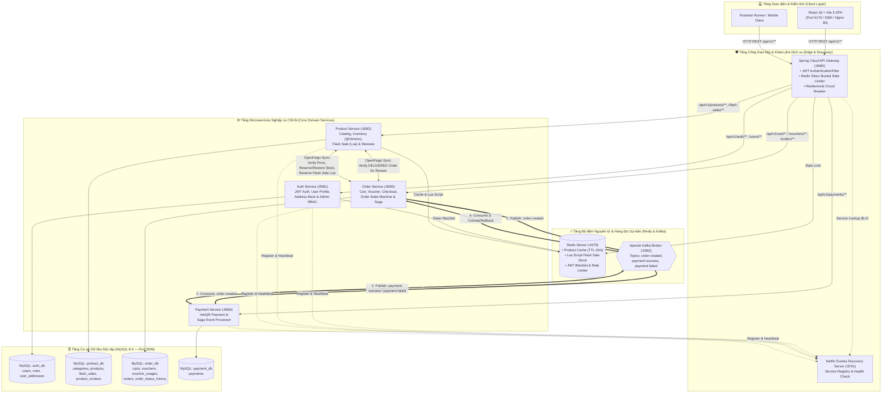
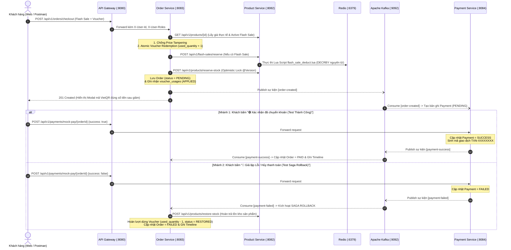

# SHOPMART E-COMMERCE PLATFORM — ENTERPRISE MICROSERVICES SYSTEM

> **Nền tảng Thương mại Điện tử Phân tán Kiến trúc Microservices Chuẩn Production-Ready**  
> Hệ thống được xây dựng trên nền tảng **Java 21**, **Spring Boot 3.3.4**, **Spring Cloud 2023.0.3 (Gateway WebFlux, Netflix Eureka, OpenFeign, Resilience4j)**, **Apache Kafka (Choreographed Saga)**, **Redis 7.2 (Cache, Lua Script Atomic Stock, Token Blacklist & Rate Limiting)**, **MySQL 8.0 (Database-per-Service)** và **React 18 + Vite 5**.

---

## Mục lục

1. [Tổng quan Dự án & Kiến trúc Hệ thống (Mermaid)](#1-tổng-quan-dự-án--kiến-trúc-hệ-thống)
2. [Bảng Danh sách Services & Ports](#2-bảng-danh-sách-services--ports)
3. [Điểm nhấn Kỹ thuật Nổi bật (Key Engineering Highlights)](#3-điểm-nhấn-kỹ-thuật-nổi-bật-key-engineering-highlights)
4. [Hướng dẫn Cài đặt & Khởi chạy Chi tiết (Step-by-Step)](#4-hướng-dẫn-cài-đặt--khởi-chạy-chi-tiết-step-by-step)
5. [Tài khoản Mẫu & Dữ liệu Khởi tạo (Seed Data)](#5-tài-khoản-mẫu--dữ-liệu-khởi-tạo-seed-data)
6. [Bộ Kiểm thử Tự động (Automated Testing)](#6-bộ-kiểm-thử-tự-động-automated-testing)
7. [Tài liệu Đặc tả API, Postman Collection & Kịch bản Demo MVP](#7-tài-liệu-đặc-tả-api-postman-collection--kịch-bản-demo-mvp)

---

## 1. Tổng quan Dự án & Kiến trúc Hệ thống

**ShopMart** là nền tảng thương mại điện tử công nghệ được thiết kế theo kiến trúc **Microservices phân tán**, đảm bảo tính độc lập dữ liệu (**Database-per-Service**), khả năng chịu tải cao trong các sự kiện **Flash Sale**, và tính nhất quán dữ liệu cuối cùng (**Eventual Consistency**) thông qua giao dịch phân tán **Choreographed Saga**.

### 1.1. Sơ đồ Kiến trúc Tổng thể (System Architecture)



### 1.2. Luồng Giao dịch Phân tán Choreographed Saga & VietQR



---

## 2. Bảng Danh sách Services & Ports

| Phân hệ / Dịch vụ | Tên Container / Module | Cổng (Port) | Cơ sở dữ liệu / Vai trò chính | Đường dẫn Kiểm tra Nhanh |
|---|---|:---:|---|---|
| **Frontend (React + Vite)** | `ecommerce-frontend` | **`5173`** / **`3000`** | Giao diện người dùng & Admin Portal (SPA) | `http://localhost:5173` |
| **Nginx Reverse Proxy** | `ecommerce-nginx` | **`80`** | Cổng HTTP hợp nhất (Frontend + `/api/v1`) | `http://localhost` |
| **API Gateway** | `api-gateway` | **`8080`** | Định tuyến tập trung, xác thực JWT, Rate Limiter | `http://localhost:8080/actuator/health` |
| **Eureka Discovery** | `discovery-server` | **`8761`** | Đăng ký và khám phá dịch vụ (`eureka`/`eurekapassword`) | `http://localhost:8761` |
| **Auth Service** | `auth-service` | **`8081`** | MySQL `auth_db` + Redis Blacklist | `http://localhost:8081/swagger-ui.html` |
| **Product Service** | `product-service` | **`8082`** | MySQL `product_db` + Redis Cache & Lua Script | `http://localhost:8082/swagger-ui.html` |
| **Order Service** | `order-service` | **`8083`** | MySQL `order_db` + Kafka Saga Orchestration | `http://localhost:8083/swagger-ui.html` |
| **Payment Service** | `payment-service` | **`8084`** | MySQL `payment_db` + VietQR & Kafka Consumer/Producer | `http://localhost:8084/swagger-ui.html` |
| **MySQL 8.0 Server** | `ecommerce-mysql` | **`3306`** *(Docker: `3307`)* | Lưu trữ 4 DB độc lập (`auth_db`, `product_db`, `order_db`, `payment_db`) | `jdbc:mysql://localhost:3306/` |
| **Redis 7.2 Server** | `ecommerce-redis` | **`6379`** | Cache danh mục/sản phẩm, Lua Script, Rate Limit | `redis://localhost:6379` |
| **Apache Kafka** | `ecommerce-kafka` | **`9092`** | Event Streaming Broker cho Choreography Saga | `localhost:9092` |
| **Kafka UI** | `ecommerce-kafka-ui` | **`8090`** | Giao diện giám sát Kafka Topics & Messages | `http://localhost:8090` |

---

## 3. Điểm nhấn Kỹ thuật Nổi bật (Key Engineering Highlights)

### 3.1. Chống Bán lố Tồn kho Kép (Anti-Overselling Dual Protection)
- **Optimistic Locking (`@Version`) trên MySQL:** Thực thể `Product` sử dụng cột `@Version Long version` kết hợp ràng buộc `CHECK (stock_quantity >= 0)`. Khi có hàng trăm luồng đặt hàng đồng thời, nếu phát sinh xung đột phiên bản (`ObjectOptimisticLockingFailureException`), hệ thống lập tức từ chối an toàn với mã `409 Conflict` thay vì để âm kho.
- **Redis Lua Script Nguyên tử cho Flash Sale (`flash_sale_deduct.lua`):** Tồn kho chiến dịch Flash Sale được nạp lên Redis (`flash_sale_stock:{productId}`). Khi khách săn sale, `product-service` thực thi kịch bản Lua đơn luồng nguyên tử trên Redis để kiểm tra `GET` và trừ `DECRBY` trong một thao tác không thể chia cắt, triệt tiêu 100% Race Condition.

### 3.2. Chống Dùng lố & Dùng trùng Mã giảm giá Voucher (Atomic Voucher Concurrency)
- **Atomic Conditional SQL Update:** Thay vì đọc số lượng rồi mới cộng trong bộ nhớ Java, `VoucherRepository` thực thi câu lệnh cập nhật nguyên tử tại tầng Database (`UPDATE vouchers SET used_quantity = used_quantity + 1 WHERE id = :id AND used_quantity < quantity`), đảm bảo không bao giờ vượt quá tổng số lượng phát hành (`quantity`).
- **Kiểm soát Lượt dùng theo Cá nhân (`voucher_usages`):** Mỗi người dùng chỉ được áp dụng 1 lần cho mỗi mã Voucher (`status = APPLIED`). Nếu đơn hàng bị hủy hoặc thanh toán lỗi, bản ghi được chuyển sang `RESTORED` và hoàn lại `used_quantity = used_quantity - 1` để khách có thể tái sử dụng mã.

### 3.3. Giao dịch Phân tán Choreographed Saga & Tự động Hoàn trả (Compensating Rollback)
- Giao tiếp bất đồng bộ giữa `order-service` và `payment-service` qua 3 Kafka Topics (`order-created`, `payment-success`, `payment-failed`).
- Khi giao dịch thanh toán thất bại (do vượt hạn mức $> 50.000.000\text{ VNĐ}$ hoặc người dùng hủy/giả lập lỗi trên màn hình QR), `order-service` tự động thực thi **Giao dịch Bù trừ (Compensating Transaction)** có khóa đồng bộ `ReentrantLock` theo `orderId`:
  1. Gọi `ProductClient.restoreStock(...)` hoàn trả chính xác số lượng tồn kho sản phẩm.
  2. Gọi `VoucherService.restoreVoucherUsage(...)` cộng trả lại lượt dùng Voucher.
  3. Chuyển trạng thái đơn sang `FAILED` và ghi vết vào bảng `order_status_history`.

### 3.4. Bảo mật Chiều sâu: Chống IDOR, Chống Price Tampering & Rate Limiting
- **Chống Price Tampering (Giả mạo giá từ Client):** `OrderServiceImpl.checkout()` tuyệt đối không tin tưởng giá tiền hay số tiền giảm gửi từ Frontend. Backend chủ động gọi sang `product-service` để lấy giá niêm yết hoặc giá `activeFlashSale` thực tế, sau đó tự tính toán `subtotalAmount`, `discountAmount` và `totalAmount`.
- **Chống IDOR (Insecure Direct Object Reference):** Mọi thao tác xem chi tiết đơn hàng, xem lịch sử trạng thái, hủy đơn hoặc sửa/xóa đánh giá đều đối chiếu nghiêm ngặt `authenticatedUserId` (trích xuất từ JWT tại Gateway qua header `X-User-Id`) với `userId` sở hữu bản ghi.
- **Chống Spam Đặt hàng:** API Gateway tích hợp `RequestRateLimiter` dùng thuật toán **Redis Token Bucket** (`replenishRate = 2 req/s`, `burstCapacity = 5`) riêng cho endpoint `/api/v1/orders/checkout`.

### 3.5. Thanh toán VietQR & Kiểm duyệt Đánh giá Thực chứng
- **Modal Thanh toán VietQR (`QrPaymentModal.jsx`):** Tự động sinh mã QR chuẩn Napas 247 theo đúng số tiền thực thu sau khi trừ ưu đãi Flash Sale + Voucher, đi kèm **"Bảng điều khiển Demo / Test Thanh Toán"** cho phép kiểm chứng trực quan cả kịch bản Thành công (`PAID`) và Thất bại (`Saga Rollback`) chỉ với 1 cú nhấp chuột.
- **Đánh giá Xác thực Mua hàng & Kiểm duyệt (`Moderation`):** Chỉ khách hàng có đơn hàng đã giao thành công (`DELIVERED`) chứa sản phẩm mới được phép gửi đánh giá (mỗi sản phẩm tối đa 1 lần, chặn trùng `409 Conflict`). Admin có thể ẩn đánh giá vi phạm sang `HIDDEN` kèm lý do, hệ thống lập tức ẩn khỏi trang công khai và tính toán lại điểm sao trung bình (`averageRating`).

---

## 4. Hướng dẫn Cài đặt & Khởi chạy Chi tiết (Step-by-Step)

### 4.1. Yêu cầu Môi trường (Prerequisites)

- **JDK:** OpenJDK **21** (Eclipse Temurin 21 hoặc Microsoft OpenJDK 21).
- **Docker:** Docker Desktop (Windows/macOS) hoặc Docker Engine + Docker Compose v2.
- **Node.js:** Phiên bản **18+** (khuyến nghị Node.js 20 LTS).
- **RAM trống tối thiểu:** 6 GB – 8 GB.

---

### 4.2. Cách 1: Chạy Toàn bộ Hệ thống bằng Docker Compose (Khuyến nghị)

Cách này tự động đóng gói và khởi chạy toàn bộ 10+ containers (Zookeeper, Kafka, Kafka UI, MySQL 8.0 với 4 DB, Redis 7.2, Eureka, 4 Microservices, API Gateway, React Frontend và Nginx):

```bash
# Bước 1: Di chuyển vào thư mục backend
cd backend

# Bước 2: Build và khởi chạy toàn bộ hệ thống ở chế độ nền (Detached mode)
docker compose up -d --build

# Bước 3: Kiểm tra trạng thái sức khỏe (Healthy) của các containers
docker compose ps
```

Sau khoảng **60 – 90 giây** khi các dịch vụ báo `healthy`, truy cập ngay:
- 🌐 **Giao diện Web (Storefront & Admin):** `http://localhost:5173` (hoặc `http://localhost` / `http://localhost:3000`)
- 🛡️ **API Gateway Entrypoint:** `http://localhost:8080`
- 🧭 **Eureka Service Registry:** `http://localhost:8761` *(Đăng nhập: `eureka` / `eurekapassword`)*
- 📊 **Kafka UI Dashboard:** `http://localhost:8090`

Để dừng hệ thống:
```bash
cd backend
docker compose down
```

---

### 4.3. Cách 2: Chạy Hạ tầng trên Docker + Chạy Microservices trên IntelliJ IDEA & Frontend bằng `npm run dev`

Phù hợp cho quá trình phát triển, debug từng dòng code trên IDE và trình diễn trực tiếp:

#### Bước 1: Khởi chạy 4 контейners Hạ tầng nền tảng (MySQL, Redis, Zookeeper, Kafka)
```bash
cd backend
docker compose up -d zookeeper kafka mysql redis
```
> **Lưu ý cổng MySQL khi chạy Local:** Trong `backend/docker-compose.yml`, MySQL container ánh xạ cổng `3307:3306` ra máy host (hoặc nếu bạn dùng MySQL cài sẵn trên máy ở cổng `3306`, hãy chạy script [`backend/docker/mysql/init.sql`](backend/docker/mysql/init.sql) để tạo 4 database `auth_db`, `product_db`, `order_db`, `payment_db`). Bạn cũng có thể dùng `docker compose -f docker-compose.sprint1-lite.yml up -d` nếu muốn ánh xạ trực tiếp cổng `3306:3306`.

#### Bước 2: Khởi chạy 6 Backend Modules (Trên IntelliJ IDEA hoặc Terminal)
Mở thư mục `backend` bằng **IntelliJ IDEA** (Gradle project, JDK 21) và bấm **Run** theo thứ tự dưới đây, hoặc mở các cửa sổ Terminal tại thư mục `backend`:

```bash
# 1. Khởi chạy Eureka Discovery Server (:8761) — Đợi khởi động xong trước tiên
./gradlew :discovery-server:bootRun

# 2. Khởi chạy 4 Core Microservices (:8081, :8082, :8083, :8084)
./gradlew :auth-service:bootRun
./gradlew :product-service:bootRun
./gradlew :order-service:bootRun
./gradlew :payment-service:bootRun

# 3. Khởi chạy API Gateway (:8080)
./gradlew :api-gateway:bootRun
```

#### Bước 3: Khởi chạy Giao diện React + Vite Frontend (:5173)
Mở một cửa sổ Terminal mới tại thư mục gốc của dự án:
```bash
cd frontend
npm install
npm run dev
```
Mở trình duyệt truy cập **`http://localhost:5173`**.

---

## 5. Tài khoản Mẫu & Dữ liệu Khởi tạo (Seed Data)

Khi khởi động lần đầu, hệ thống tự động nạp dữ liệu mẫu thông qua `DataInitializer` và `VoucherDataInitializer`:

### 5.1. Tài khoản Đăng nhập Mẫu

| Vai trò | Email đăng nhập | Mật khẩu | Nguồn khởi tạo & Ghi chú sử dụng |
|---|---|---|---|
| **Quản trị viên (Backend Seed)** | `admin@ecommerce.com` | `Admin@123456` | Tự động tạo trong MySQL `auth_db` bởi `auth-service/DataInitializer.java` (`ROLE_ADMIN`, `ROLE_USER`). |
| **Quản trị viên (Quick-Fill UI)** | `admin@test.com` | `123456` | Nút điền nhanh trên trang `/login` của Frontend (hoặc đăng ký tài khoản mới). |
| **Khách hàng (Customer)** | `customer@shopmart.com` | `Customer@123` | Đăng ký mới trực tiếp tại trang `/register` hoặc qua Request `1.1` trong Postman Collection. |
| **Khách hàng (Quick-Fill UI)** | `user@test.com` | `123456` | Nút điền nhanh trên trang `/login` của Frontend. |
| **Eureka Dashboard** | `eureka` | `eurekapassword` | HTTP Basic Auth khi truy cập `http://localhost:8761`. |

### 5.2. Dữ liệu Sản phẩm, Chiến dịch Flash Sale & Kho Voucher Mặc định

- **4 Danh mục & 6 Sản phẩm Công nghệ (`product-service`):** *Laptop Dell XPS 15 (32.990.000đ)*, *iPhone 15 Pro Max 256GB (29.990.000đ)*, *Tai nghe Sony WH-1000XM5 (7.490.000đ)*, *Robot Hút Bụi Deebot X2 OMNI (18.990.000đ)*, *Bàn phím cơ không dây (1.850.000đ)*, *MacBook Air M2 13 inch (24.500.000đ)*.
- **Chiến dịch Flash Sale Tự động (`Flash Sale Giữa Tháng Tech Day`):** Tự động kích hoạt trạng thái `ACTIVE`, giảm giá **20%** cho toàn bộ sản phẩm mẫu và nạp sẵn tồn kho lên Redis.
- **8 Mã giảm giá Voucher (`order-service`):**
  - `GIAM20K` (Giảm 20.000đ cho đơn từ 200.000đ)
  - `GIAM50K` (Giảm 50.000đ cho đơn từ 500.000đ)
  - `SALE10` (Giảm 10% tối đa 100.000đ cho đơn từ 300.000đ)
  - `TECHVIP` (Giảm 15% tối đa 300.000đ cho đơn từ 1.000.000đ)
  - `FREESHIP` (Giảm 30.000đ cho đơn từ 150.000đ)
  - `WELCOME100` (Giảm 100.000đ cho đơn từ 800.000đ)
  - `WELCOME50` (Giảm 50.000đ cho đơn từ 200.000đ)
  - `VIP20` (Giảm 20% tối đa 200.000đ cho đơn từ 500.000đ)

---

## 6. Bộ Kiểm thử Tự động (Automated Testing)

Hệ thống đi kèm bộ kiểm thử tự động toàn diện cho cả Backend (JUnit 5 + MockMvc + Mockito) và Frontend (Node.js Test Runner E2E/QA Suites):

### 6.1. Chạy Kiểm thử Backend (6 Microservices)
Từ thư mục `backend`:
```bash
cd backend
./gradlew test
```
*(Trên Windows PowerShell/CMD: `.\gradlew.bat test`)*

### 6.2. Chạy Kiểm thử Frontend (30+ QA & E2E Test Suites)
Từ thư mục gốc của dự án:
```bash
npm --prefix frontend test
```
Hoặc kiểm tra đồng thời Lint và Build Production:
```bash
npm --prefix frontend run lint
npm --prefix frontend run build
```

---

## 7. Tài liệu Đặc tả API, Postman Collection & Kịch bản Demo MVP

Toàn bộ tài liệu kỹ thuật phục vụ nghiệm thu và bảo vệ đồ án được đặt tại:

1. 📘 **Đặc tả REST API Toàn diện (`OpenAPI / Markdown`):** [`docs/REST_API_DOCUMENTATION.md`](docs/REST_API_DOCUMENTATION.md)
2. 🎬 **Kịch bản Trình diễn & Bảo vệ Đồ án (`Demo MVP Script 10-15 phút`):** [`docs/DEMO_MVP_SCRIPT.md`](docs/DEMO_MVP_SCRIPT.md)
3. 🚀 **Postman Collection Chuẩn v2.1 (8 Luồng Nghiệp vụ + Auto Test Scripts):** [`ECommerce_Microservices_Postman_Collection.json`](ECommerce_Microservices_Postman_Collection.json)
4. ☁️ **Hướng dẫn Thiết lập CI/CD & Triển khai VPS Ubuntu:** [`docs/CI_CD_SETUP.md`](docs/CI_CD_SETUP.md) & [`docs/VPS_DEPLOYMENT.md`](docs/VPS_DEPLOYMENT.md)
