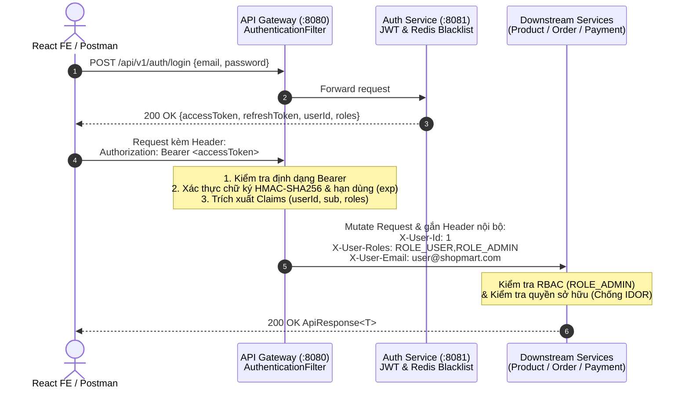

# TÀI LIỆU ĐẶC TẢ REST API TOÀN DIỆN (REST API SPECIFICATION)
## Hệ thống Thương mại Điện tử Phân tán — ShopMart E-Commerce Microservices

> **Phiên bản API:** `v1.0.0` (Production-Ready)  
> **Cổng giao tiếp tập trung (API Gateway):** `http://localhost:8080`  
> **Định dạng dữ liệu:** `application/json; charset=UTF-8`  
> **Chuẩn tài liệu:** OpenAPI 3.0 / Swagger UI (`springdoc-openapi v2.5.0`)  
> **Bộ sưu tập Postman:** [`ECommerce_Microservices_Postman_Collection.json`](../ECommerce_Microservices_Postman_Collection.json)

---

## Mục lục

1. [Quy ước Chung (General Conventions)](#1-quy-ước-chung-general-conventions)
2. [Cơ chế Xác thực JWT & Phân quyền RBAC qua API Gateway](#2-cơ-chế-xác-thực-jwt--phân-quyền-rbac-qua-api-gateway)
3. [Bảng Mã lỗi HTTP Chuẩn hóa (HTTP Status Codes)](#3-bảng-mã-lỗi-http-chuẩn-hóa-http-status-codes)
4. [Đường dẫn Swagger UI & OpenAPI 3.0](#4-đường-dẫn-swagger-ui--openapi-30)
5. [Đặc tả Chi tiết Endpoints theo Microservice](#5-đặc-tả-chi-tiết-endpoints-theo-microservice)
   - [5.1. Auth Service (`auth-service` — Port `8081`)](#51-auth-service-auth-service--port-8081)
   - [5.2. Product Service (`product-service` — Port `8082`)](#52-product-service-product-service--port-8082)
   - [5.3. Order Service (`order-service` — Port `8083`)](#53-order-service-order-service--port-8083)
   - [5.4. Payment Service (`payment-service` — Port `8084`)](#54-payment-service-payment-service--port-8084)

---

## 1. Quy ước Chung (General Conventions)

### 1.1. Base URL & Định tuyến Tập trung

Mọi yêu cầu từ Client (React Vite Frontend, Mobile App, Postman) đều đi qua một điểm truy cập duy nhất là **Spring Cloud API Gateway**:

| Môi trường | Base URL | Tiền tố API (Prefix) |
|---|---|---|
| **Local Development (Gateway)** | `http://localhost:8080` | `/api/v1` |
| **Docker / Nginx Reverse Proxy** | `http://localhost:80` | `/api/v1` |

### 1.2. Cấu trúc Bọc Phản hồi Chuẩn (`ApiResponse<T>`)

Toàn bộ các Microservices trong hệ thống đều chuẩn hóa dữ liệu trả về thông qua lớp vỏ bọc generic `ApiResponse<T>`:

```json
{
  "success": true,
  "message": "Thao tác thành công",
  "data": { ... },
  "timestamp": "2026-11-12T21:00:00.123456"
}
```

| Trường | Kiểu dữ liệu | Bắt buộc | Mô tả |
|---|---|:---:|---|
| `success` | `boolean` | Có | `true` nếu xử lý thành công (`2xx`), `false` nếu xảy ra lỗi (`4xx`, `5xx`). |
| `message` | `string` | Có | Thông báo kết quả xử lý bằng tiếng Việt rõ ràng, thân thiện với người dùng. |
| `data` | `T` (Object / Array) | Tùy chọn | Payload dữ liệu nghiệp vụ trả về (ẩn tự động khi `null` nhờ `@JsonInclude(NON_NULL)`). |
| `timestamp` | `string (ISO-8601)` | Có | Thời điểm phản hồi từ máy chủ (`LocalDateTime`). |

### 1.3. Cấu trúc Phân trang Chuẩn (`PagedResponse<T>`)

Các API danh sách có phân trang trả về đối tượng `PagedResponse<T>` bên trong trường `data` của `ApiResponse`:

```json
{
  "success": true,
  "message": "Lấy danh sách thành công",
  "data": {
    "content": [ ... ],
    "pageNumber": 0,
    "pageSize": 10,
    "totalElements": 45,
    "totalPages": 5,
    "last": false
  },
  "timestamp": "2026-11-12T21:00:00.123456"
}
```

| Trường | Kiểu dữ liệu | Mô tả |
|---|---|---|
| `content` | `List<T>` | Danh sách phần tử của trang hiện tại. |
| `pageNumber` | `int` | Chỉ số trang hiện tại (bắt đầu từ `0`). |
| `pageSize` | `int` | Số lượng bản ghi tối đa trên mỗi trang (mặc định `10` hoặc `20`). |
| `totalElements` | `long` | Tổng số bản ghi thỏa mãn điều kiện lọc trong cơ sở dữ liệu. |
| `totalPages` | `int` | Tổng số trang. |
| `last` | `boolean` | `true` nếu đây là trang cuối cùng. |

---

## 2. Cơ chế Xác thực JWT & Phân quyền RBAC qua API Gateway

### 2.1. Luồng Xác thực & Giải mã Header Nội bộ

Hệ thống áp dụng mô hình **Centralized Edge Authentication** tại `api-gateway` kết hợp **Defense-in-Depth RBAC** tại từng Microservice:



### 2.2. Quy tắc Truyền Header

1. **Từ phía Client (Frontend / Postman):**
   ```http
   Authorization: Bearer <accessToken>
   Content-Type: application/json
   ```
2. **Từ API Gateway chuyển tiếp xuống Microservices (Downstream Mutation):**
   - `X-User-Id`: ID định danh của tài khoản đã xác thực (ví dụ: `1`). Dùng để định danh chủ sở hữu giỏ hàng, đơn hàng, đánh giá và **chống giả mạo danh tính (Anti-IDOR / Anti-Spoofing)**.
   - `X-User-Roles`: Chuỗi danh sách vai trò phân cách bởi dấu phẩy (ví dụ: `ROLE_USER` hoặc `ROLE_ADMIN,ROLE_USER`).
   - `X-User-Email`: Địa chỉ email trích xuất từ `subject` của JWT.

### 2.3. Ma trận Phân quyền (RBAC Matrix)

| Cấp độ Quyền | Ký hiệu trong Tài liệu | Mô tả Quyền truy cập |
|---|:---:|---|
| **Công khai** | `PUBLIC` | Không yêu cầu JWT Token. Khách vãng lai (Guest) có thể xem sản phẩm, danh mục, tồn kho, Flash Sale, Voucher và đánh giá công khai. |
| **Khách hàng** | `USER` | Yêu cầu `Authorization: Bearer <userToken>` hợp lệ (`ROLE_USER` hoặc `ROLE_ADMIN`). Chỉ được thao tác trên tài nguyên thuộc sở hữu của chính `X-User-Id`. |
| **Quản trị viên** | `ADMIN` | Yêu cầu `Authorization: Bearer <adminToken>` có chứa quyền `ROLE_ADMIN` trong `X-User-Roles`. |
| **Nội bộ** | `INTERNAL` | Giao tiếp đồng bộ giữa các Microservices qua `Spring Cloud OpenFeign` (hoặc gọi kiểm thử qua Gateway kèm JWT). |

---

## 3. Bảng Mã lỗi HTTP Chuẩn hóa (HTTP Status Codes)

| Mã HTTP | Tên chuẩn | Ý nghĩa Nghiệp vụ & Tình huống Xảy ra trong Hệ thống |
|:---:|---|---|
| **`200 OK`** | Thành công | Truy vấn (`GET`), cập nhật (`PUT`/`PATCH`), xóa (`DELETE`) hoặc xác nhận thanh toán thành công. |
| **`201 Created`** | Khởi tạo thành công | Đăng ký tài khoản, tạo sản phẩm, danh mục, chiến dịch Flash Sale, Voucher, thêm giỏ hàng, đặt đơn hàng (`checkout`) hoặc gửi đánh giá mới thành công. |
| **`400 Bad Request`** | Dữ liệu không hợp lệ | Lỗi `@Valid` Jakarta Validation (thiếu trường bắt buộc, sai định dạng SĐT/Email, giá Flash Sale $\ge$ giá gốc, số lượng Flash Sale $>$ tồn kho, đơn hàng chưa đạt giá trị tối thiểu `minOrderValue`, chuyển trạng thái đơn sai quy tắc State Machine). |
| **`401 Unauthorized`** | Chưa xác thực | Thiếu header `Authorization`, định dạng không phải `Bearer <token>`, chữ ký JWT sai, token hết hạn hoặc đã bị thu hồi vào Redis Blacklist. |
| **`403 Forbidden`** | Từ chối truy cập | Tài khoản `ROLE_USER` cố tình gọi API quản trị (`/api/v1/admin/**`), hoặc người dùng cố tình xem/hủy/sửa đơn hàng và đánh giá của người khác (**Chống IDOR**), hoặc tài khoản bị khóa (`BLOCKED`). |
| **`404 Not Found`** | Không tìm thấy | Không tồn tại `productId`, `categoryId`, `campaignId`, `voucherId`, `orderId`, `paymentId`, `reviewId` hoặc sản phẩm đã bị xóa mềm (`INACTIVE`). |
| **`409 Conflict`** | Xung đột tài nguyên | Email đăng ký đã tồn tại; trùng tên danh mục/mã Voucher; **hết tồn kho sản phẩm / cháy hàng Flash Sale** (`NotEnoughStockException`); xung đột khóa lạc quan `@Version` (`ObjectOptimisticLockingFailureException`); khách hàng **đánh giá trùng lần 2** trên cùng sản phẩm hoặc **dùng lại mã Voucher** đã sử dụng. |
| **`422 Unprocessable Entity`** | Vi phạm điều kiện nghiệp vụ | Khách hàng gửi đánh giá khi đơn hàng chưa đạt trạng thái `DELIVERED`, đơn hàng không chứa sản phẩm đó, hoặc Admin cố xóa danh mục đang chứa sản phẩm. |
| **`429 Too Many Requests`** | Vượt giới hạn tần suất | Vi phạm bộ giới hạn tốc độ phân tán **Redis Token Bucket Rate Limiter** tại API Gateway (`/api/v1/orders/checkout`: `replenishRate=2/s, burstCapacity=5`). |
| **`500 / 503`** | Lỗi máy chủ / Dịch vụ | Lỗi hệ thống nội bộ hoặc `Resilience4j Circuit Breaker` kích hoạt Fallback khi một Microservice đang bảo trì. |

---

## 4. Đường dẫn Swagger UI & OpenAPI 3.0

Khi các Microservices đang hoạt động, có thể truy cập trực tiếp giao diện tài liệu tương tác **Swagger UI** và đặc tả JSON **OpenAPI 3.0** tại các cổng tương ứng:

| Microservice | Cổng (Port) | Đường dẫn Swagger UI | Đường dẫn OpenAPI JSON |
|---|:---:|---|---|
| **Auth Service** | `8081` | `http://localhost:8081/swagger-ui.html` | `http://localhost:8081/api-docs` |
| **Product Service** | `8082` | `http://localhost:8082/swagger-ui.html` | `http://localhost:8082/api-docs` |
| **Order Service** | `8083` | `http://localhost:8083/swagger-ui.html` | `http://localhost:8083/api-docs` |
| **Payment Service** | `8084` | `http://localhost:8084/swagger-ui.html` | `http://localhost:8084/api-docs` |
| **Eureka Server** | `8761` | `http://localhost:8761` *(Dashboard)* | Basic Auth: `eureka` / `eurekapassword` |

---

## 5. Đặc tả Chi tiết Endpoints theo Microservice

---

### 5.1. Auth Service (`auth-service` — Port `8081`)

Quản lý định danh, cấp phát & làm mới JWT Token, thu hồi Token qua Redis Blacklist, quản lý Hồ sơ cá nhân, Sổ địa chỉ nhận hàng và Quản trị tài khoản người dùng.

#### A. Bảng Tổng hợp Endpoints — `auth-service`

| STT | HTTP Method | Endpoint Path (qua Gateway `:8080`) | Role Yêu cầu | Mã HTTP | Mô tả Chức năng |
|:---:|:---:|---|:---:|:---:|---|
| 1 | `POST` | `/api/v1/auth/register` | `PUBLIC` | `201`, `400`, `409` | Đăng ký tài khoản khách hàng mới (`ROLE_USER`). |
| 2 | `POST` | `/api/v1/auth/login` | `PUBLIC` | `200`, `400`, `401`, `403` | Đăng nhập hệ thống (User / Admin), nhận `accessToken` & `refreshToken`. |
| 3 | `POST` | `/api/v1/auth/refresh` | `PUBLIC` | `200`, `401` | Làm mới `accessToken` bằng `refreshToken` còn hiệu lực. |
| 4 | `POST` | `/api/v1/auth/logout` | `USER / ADMIN` | `200` | Đăng xuất và đưa Access Token vào **Redis Blacklist**. |
| 5 | `GET` | `/api/v1/auth/validate` | `PUBLIC / INTERNAL` | `200`, `401` | Kiểm tra tính hợp lệ của JWT Token và trích xuất thông tin Claims. |
| 6 | `GET` | `/api/v1/auth/me` | `USER / ADMIN` | `200`, `401` | Lấy thông tin Principal hiện tại từ `SecurityContext`. |
| 7 | `GET` | `/api/v1/users/profile` | `USER / ADMIN` | `200`, `401`, `404` | Xem thông tin hồ sơ cá nhân và sổ địa chỉ. |
| 8 | `PUT` | `/api/v1/users/profile` | `USER / ADMIN` | `200`, `400`, `401` | Cập nhật họ tên, số điện thoại và địa chỉ mặc định. |
| 9 | `GET` | `/api/v1/users/me/addresses` | `USER / ADMIN` | `200`, `401` | Lấy danh sách sổ địa chỉ giao hàng của người dùng. |
| 10 | `POST` | `/api/v1/users/me/addresses` | `USER / ADMIN` | `201`, `400`, `401` | Thêm địa chỉ mới vào sổ địa chỉ cá nhân. |
| 11 | `PUT` | `/api/v1/users/me/addresses/{id}` | `USER / ADMIN` | `200`, `400`, `403`, `404` | Cập nhật địa chỉ nhận hàng theo ID (chống IDOR). |
| 12 | `DELETE` | `/api/v1/users/me/addresses/{id}` | `USER / ADMIN` | `200`, `403`, `404` | Xóa địa chỉ nhận hàng khỏi sổ địa chỉ. |
| 13 | `GET` | `/api/v1/admin/users` | `ADMIN` | `200`, `403` | Lấy danh sách toàn bộ tài khoản người dùng (phân trang). |
| 14 | `PUT` | `/api/v1/admin/users/{id}/status` | `ADMIN` | `200`, `400`, `403`, `404` | Khóa (`BLOCKED`) hoặc Mở khóa (`ACTIVE`) tài khoản người dùng. |
| 15 | `GET` | `/api/v1/admin/customers` | `ADMIN` | `200`, `400`, `403` | Tìm kiếm & lọc danh sách khách hàng theo `keyword`, `status`. |
| 16 | `GET` | `/api/v1/admin/customers/{id}` | `ADMIN` | `200`, `403`, `404` | Xem chi tiết hồ sơ và sổ địa chỉ của một khách hàng. |
| 17 | `PUT` | `/api/v1/admin/customers/{id}/status` | `ADMIN` | `200`, `400`, `403`, `404` | Khóa / Mở khóa tài khoản khách hàng. |
| 18 | `GET` | `/api/v1/admin/customers/count` | `ADMIN` | `200`, `403` | Đếm tổng số lượng khách hàng trong hệ thống. |

#### B. Mẫu Request & Response JSON Tiêu biểu — `auth-service`

##### 1. Đăng ký & Đăng nhập (`POST /api/v1/auth/register` & `POST /api/v1/auth/login`)
- **Request Body (`RegisterRequest`):**
```json
{
  "email": "customer@shopmart.com",
  "password": "Customer@123",
  "fullName": "Nguyễn Văn Khách Hàng",
  "phone": "0987654321"
}
```
- **Request Body (`LoginRequest`):**
```json
{
  "email": "admin@ecommerce.com",
  "password": "Admin@123456"
}
```
- **Response Body (`200 OK` / `201 Created` — `ApiResponse<AuthResponse>`):**
```json
{
  "success": true,
  "message": "Đăng nhập thành công",
  "data": {
    "accessToken": "eyJhbGciOiJIUzI1NiJ9...",
    "refreshToken": "eyJhbGciOiJIUzI1NiJ9...",
    "tokenType": "Bearer",
    "expiresIn": 86400000,
    "userId": 1,
    "email": "admin@ecommerce.com",
    "fullName": "System Administrator",
    "roles": ["ROLE_ADMIN", "ROLE_USER"]
  },
  "timestamp": "2026-11-12T21:05:00"
}
```

##### 2. Cập nhật Hồ sơ & Thêm Sổ địa chỉ (`PUT /api/v1/users/profile` & `POST /api/v1/users/me/addresses`)
- **Request Body (`AddressRequest`):**
```json
{
  "receiverName": "Nguyễn Văn Khách Hàng VIP",
  "phone": "0912345678",
  "addressLine": "Tòa nhà Bitexco, Số 2 Hải Triều",
  "city": "TP. Hồ Chí Minh",
  "district": "Quận 1",
  "ward": "Phường Bến Nghé",
  "isDefault": true
}
```
- **Response Body (`201 Created` — `ApiResponse<AddressResponse>`):**
```json
{
  "success": true,
  "message": "Thêm địa chỉ thành công",
  "data": {
    "id": 1,
    "userId": 2,
    "receiverName": "Nguyễn Văn Khách Hàng VIP",
    "phone": "0912345678",
    "addressLine": "Tòa nhà Bitexco, Số 2 Hải Triều",
    "city": "TP. Hồ Chí Minh",
    "district": "Quận 1",
    "ward": "Phường Bến Nghé",
    "isDefault": true,
    "createdAt": "2026-11-12T21:06:00",
    "updatedAt": "2026-11-12T21:06:00"
  },
  "timestamp": "2026-11-12T21:06:00"
}
```

---

### 5.2. Product Service (`product-service` — Port `8082`)

Quản lý Danh mục, Sản phẩm (kèm bộ đệm Redis Cache), Quản lý Kho hàng (`Optimistic Locking @Version`), Chiến dịch Flash Sale (`Redis Lua Script` chống bán lố) và Đánh giá Sản phẩm & Kiểm duyệt (`Moderation`).

#### A. Bảng Tổng hợp Endpoints — `product-service`

| STT | HTTP Method | Endpoint Path (qua Gateway `:8080`) | Role Yêu cầu | Mã HTTP | Mô tả Chức năng |
|:---:|:---:|---|:---:|:---:|---|
| 1 | `GET` | `/api/v1/products/categories` | `PUBLIC` | `200` | Lấy danh sách toàn bộ danh mục sản phẩm công khai. |
| 2 | `GET` | `/api/v1/products/categories/{id}` | `PUBLIC` | `200`, `404` | Xem chi tiết một danh mục theo ID. |
| 3 | `GET` | `/api/v1/products/categories/search` | `ADMIN` | `200`, `403` | Tìm kiếm danh mục theo từ khóa `?keyword=...`. |
| 4 | `POST` | `/api/v1/products/categories` | `ADMIN` | `201`, `400`, `403`, `409` | Tạo danh mục sản phẩm mới (chặn trùng tên `409`). |
| 5 | `PUT` | `/api/v1/products/categories/{id}` | `ADMIN` | `200`, `400`, `403`, `404`, `409` | Cập nhật thông tin danh mục sản phẩm. |
| 6 | `DELETE` | `/api/v1/products/categories/{id}` | `ADMIN` | `200`, `403`, `404`, `422` | Xóa danh mục (chặn `422` nếu danh mục đang có sản phẩm). |
| 7 | `GET` | `/api/v1/products` | `PUBLIC` | `200`, `400` | Lấy danh sách sản phẩm phân trang + lọc đa tiêu chí (`keyword`, `categoryId`, `category`, `minPrice`, `maxPrice`, `inStock`, `sort`). |
| 8 | `GET` | `/api/v1/products/search` | `PUBLIC` | `200` | Tìm kiếm sản phẩm theo từ khóa (`?keyword=...` hoặc `?search=...`). |
| 9 | `GET` | `/api/v1/products/{id}` | `PUBLIC` | `200`, `404` | Xem chi tiết sản phẩm kèm thông tin `activeFlashSale` (nếu có). |
| 10 | `GET` | `/api/v1/products/admin` | `ADMIN` | `200`, `403` | Admin xem toàn bộ sản phẩm (bao gồm cả `INACTIVE` đã xóa mềm). |
| 11 | `GET` | `/api/v1/products/low-stock/count` | `PUBLIC / ADMIN` | `200` | Đếm số lượng sản phẩm sắp hết hàng (`stockQuantity <= threshold`). |
| 12 | `POST` | `/api/v1/products` | `ADMIN` | `201`, `400`, `403`, `404` | Tạo sản phẩm mới và xóa cache Redis `@CacheEvict`. |
| 13 | `PUT` | `/api/v1/products/{id}` | `ADMIN` | `200`, `400`, `403`, `404` | Cập nhật thông tin sản phẩm & trạng thái (`ACTIVE`/`INACTIVE`/`OUT_OF_STOCK`). |
| 14 | `DELETE` | `/api/v1/products/{id}` | `ADMIN` | `200`, `403`, `404` | **Xóa mềm sản phẩm**: chuyển trạng thái sang `INACTIVE`. |
| 15 | `GET` | `/api/v1/products/{id}/stock` | `PUBLIC` | `200`, `404` | Kiểm tra nhanh tồn kho theo số lượng yêu cầu `?quantity=1`. |
| 16 | `POST` | `/api/v1/products/{id}/inbound` | `ADMIN` | `200`, `400`, `403`, `404`, `409` | **Nhập kho**: cộng dồn số lượng hàng mới vào tồn kho hiện tại. |
| 17 | `POST` | `/api/v1/products/{id}/adjust-stock` | `ADMIN` | `200`, `400`, `403`, `404`, `409` | **Điều chỉnh kiểm kê**: cập nhật số lượng tồn kho thực tế kèm lý do. |
| 18 | `POST` | `/api/v1/products/reserve-stock` | `INTERNAL / USER` | `200`, `400`, `409` | Đặt trước và trừ tồn kho nguyên tử với `Optimistic Lock (@Version)`. |
| 19 | `POST` | `/api/v1/products/restore-stock` | `INTERNAL / USER` | `200`, `400`, `409` | Hoàn trả lại tồn kho khi hủy đơn hoặc khi chạy **Saga Rollback**. |
| 20 | `GET` | `/api/v1/flash-sales/active` | `PUBLIC` | `200` | Lấy danh sách các chiến dịch Flash Sale đang diễn ra (`ACTIVE`). |
| 21 | `POST` | `/api/v1/flash-sales/reserve` | `INTERNAL / USER` | `200`, `404`, `409` | Trừ tồn kho Flash Sale nguyên tử trên Redis bằng **Lua Script**. |
| 22 | `GET` | `/api/v1/admin/flash-sales/campaigns` | `ADMIN` | `200`, `403` | Admin lấy danh sách toàn bộ chiến dịch Flash Sale. |
| 23 | `GET` | `/api/v1/admin/flash-sales/campaigns/{id}` | `ADMIN` | `200`, `403`, `404` | Admin xem chi tiết một chiến dịch Flash Sale. |
| 24 | `POST` | `/api/v1/admin/flash-sales/campaigns` | `ADMIN` | `201`, `400`, `403`, `404` | Admin tạo chiến dịch Flash Sale mới (chặn giá $\ge$ giá gốc). |
| 25 | `PUT` | `/api/v1/admin/flash-sales/campaigns/{id}` | `ADMIN` | `200`, `400`, `403`, `404` | Admin cập nhật chiến dịch Flash Sale. |
| 26 | `PUT` | `/api/v1/admin/flash-sales/campaigns/{id}/status` | `ADMIN` | `200`, `400`, `403`, `404` | Kích hoạt (`?status=ACTIVE`) hoặc kết thúc (`?status=ENDED`) chiến dịch. |
| 27 | `DELETE` | `/api/v1/admin/flash-sales/campaigns/{id}` | `ADMIN` | `200`, `403`, `404` | Xóa chiến dịch Flash Sale và giải phóng key Redis. |
| 28 | `POST` | `/api/v1/admin/flash-sales/products/{productId}` | `ADMIN` | `200`, `403` | Nạp trực tiếp số lượng Flash Sale của 1 sản phẩm lên Redis (`?stock=20`). |
| 29 | `GET` | `/api/v1/products/{productId}/reviews` | `PUBLIC` | `200`, `404` | Xem danh sách đánh giá công khai (`APPROVED`) & điểm sao trung bình. |
| 30 | `GET` | `/api/v1/products/{productId}/reviews/me` | `USER` | `200`, `401`, `403` | Lấy đánh giá của chính người dùng đang đăng nhập cho sản phẩm. |
| 31 | `POST` | `/api/v1/products/{productId}/reviews` | `USER` | `201`, `400`, `403`, `404`, `409`, `422` | Gửi đánh giá sản phẩm (yêu cầu đơn `DELIVERED`; chặn đánh giá lần 2 với `409`). |
| 32 | `PUT` | `/api/v1/products/{productId}/reviews/{reviewId}` | `USER (Owner)` | `200`, `400`, `403`, `404` | Chỉnh sửa đánh giá của bản thân. |
| 33 | `DELETE` | `/api/v1/products/{productId}/reviews/{reviewId}` | `USER / ADMIN` | `200`, `403`, `404` | Xóa đánh giá sản phẩm (Chủ sở hữu hoặc Admin). |
| 34 | `GET` | `/api/v1/admin/reviews` | `ADMIN` | `200`, `403` | Admin lấy danh sách toàn bộ đánh giá để kiểm duyệt (`?status=APPROVED\|HIDDEN`). |
| 35 | `PATCH` | `/api/v1/admin/reviews/{reviewId}/moderate` | `ADMIN` | `200`, `400`, `403`, `404` | Admin duyệt (`APPROVED`) hoặc ẩn (`HIDDEN`) đánh giá vi phạm kèm lý do. |

#### B. Mẫu Request & Response JSON Tiêu biểu — `product-service`

##### 1. Lọc Sản phẩm Nâng cao & Chi tiết Sản phẩm (`GET /api/v1/products?keyword=MacBook&categoryId=2&minPrice=10000000&maxPrice=40000000&inStock=true&sort=price,asc`)
- **Response Body (`200 OK` — `ApiResponse<ProductResponse>`):**
```json
{
  "success": true,
  "message": "Lấy thông tin sản phẩm thành công",
  "data": {
    "id": 1,
    "name": "MacBook Pro 16 M3 Max 48GB 1TB",
    "description": "Siêu phẩm workstation di động chip Apple M3 Max",
    "price": 25000000.00,
    "stockQuantity": 100,
    "category": "Laptop & Workstation",
    "imageUrl": "https://images.unsplash.com/photo-1517336714731-489689fd1ca8",
    "status": "ACTIVE",
    "version": 3,
    "activeFlashSale": {
      "campaignId": 1,
      "flashSalePrice": 19990000.00,
      "quantity": 30,
      "soldQuantity": 1,
      "remainingStock": 29,
      "userLimit": 5,
      "endTime": "2027-12-31T23:59:59"
    },
    "createdAt": "2026-11-12T20:00:00",
    "updatedAt": "2026-11-12T21:00:00"
  },
  "timestamp": "2026-11-12T21:08:00"
}
```

##### 2. Nhập kho & Điều chỉnh Kho kiểm kê (`POST /api/v1/products/{id}/inbound` & `/adjust-stock`)
- **Request Body (`/inbound`):**
```json
{
  "quantity": 20,
  "note": "Nhập lô hàng chính hãng đợt 2 phục vụ chiến dịch Flash Sale"
}
```
- **Request Body (`/adjust-stock`):**
```json
{
  "actualStock": 100,
  "reason": "Kiểm kê định kỳ cuối quý — đồng bộ số lượng thực tế tại kho trung tâm"
}
```

##### 3. Tạo Chiến dịch Flash Sale (`POST /api/v1/admin/flash-sales/campaigns`)
- **Request Body (`CreateFlashSaleCampaignRequest`):**
```json
{
  "name": "Siêu Sale Giờ Vàng Tech Deal",
  "startTime": "2026-01-01T00:00:00",
  "endTime": "2027-12-31T23:59:59",
  "items": [
    {
      "productId": 1,
      "flashSalePrice": 19990000,
      "quantity": 30,
      "userLimit": 5
    }
  ]
}
```

##### 4. Gửi Đánh giá & Kiểm duyệt Đánh giá (`POST /api/v1/products/{id}/reviews` & `PATCH /api/v1/admin/reviews/{id}/moderate`)
- **Request Body Tạo đánh giá (`CreateReviewRequest`):**
```json
{
  "orderId": 1,
  "rating": 5,
  "comment": "Sản phẩm chính hãng tuyệt vời, đóng gói cẩn thận, giao hàng siêu tốc!"
}
```
- **Request Body Kiểm duyệt (`ModerateReviewRequest`):**
```json
{
  "status": "HIDDEN",
  "reason": "Nội dung chứa liên kết quảng cáo spam vi phạm tiêu chuẩn cộng đồng"
}
```
- **Response Body (`200 OK` — `ApiResponse<ReviewResponse>`):**
```json
{
  "success": true,
  "message": "Kiểm duyệt đánh giá thành công",
  "data": {
    "id": 1,
    "productId": 1,
    "userId": 2,
    "orderId": 1,
    "rating": 5,
    "comment": "Sản phẩm chính hãng tuyệt vời, đóng gói cẩn thận, giao hàng siêu tốc!",
    "status": "HIDDEN",
    "hiddenReason": "Nội dung chứa liên kết quảng cáo spam vi phạm tiêu chuẩn cộng đồng",
    "createdAt": "2026-11-12T21:10:00",
    "updatedAt": "2026-11-12T21:11:00"
  },
  "timestamp": "2026-11-12T21:11:00"
}
```

---

### 5.3. Order Service (`order-service` — Port `8083`)

Quản lý Giỏ hàng (`Cart`), Hệ thống Mã giảm giá (`Voucher` với Atomic Conditional Update chống dùng lố), Đặt hàng (`Checkout` chống Price Tampering, kết hợp giá Flash Sale & Voucher), Máy trạng thái Đơn hàng (`Order State Machine`), Lịch sử Hành trình đơn (`Timeline`) và Điều phối Giao dịch Phân tán (**Kafka Choreographed Saga**).

#### A. Bảng Tổng hợp Endpoints — `order-service`

| STT | HTTP Method | Endpoint Path (qua Gateway `:8080`) | Role Yêu cầu | Mã HTTP | Mô tả Chức năng |
|:---:|:---:|---|:---:|:---:|---|
| 1 | `GET` | `/api/v1/vouchers/active` | `PUBLIC / USER` | `200` | Lấy danh sách mã giảm giá đang mở (tự động lọc mã user chưa dùng nếu có `X-User-Id`). |
| 2 | `POST` | `/api/v1/vouchers/apply` | `USER` | `200`, `400`, `404`, `409` | Kiểm tra điều kiện & tính thử số tiền giảm (`discountAmount`, `finalAmount`). |
| 3 | `GET` | `/api/v1/admin/vouchers` | `ADMIN` | `200`, `403` | Admin lấy danh sách toàn bộ Voucher hệ thống. |
| 4 | `GET` | `/api/v1/admin/vouchers/{id}` | `ADMIN` | `200`, `403`, `404` | Admin xem chi tiết một Voucher theo ID. |
| 5 | `POST` | `/api/v1/admin/vouchers` | `ADMIN` | `201`, `400`, `403`, `409` | Admin tạo mã giảm giá Voucher mới (`FIXED` hoặc `PERCENT`). |
| 6 | `PUT` | `/api/v1/admin/vouchers/{id}` | `ADMIN` | `200`, `400`, `403`, `404`, `409` | Admin cập nhật thông tin Voucher. |
| 7 | `PATCH` | `/api/v1/admin/vouchers/{id}/toggle-status` | `ADMIN` | `200`, `403`, `404` | Bật / Tắt trạng thái hoạt động của Voucher (`ACTIVE` $\leftrightarrow$ `INACTIVE`). |
| 8 | `DELETE` | `/api/v1/admin/vouchers/{id}` | `ADMIN` | `200`, `403`, `404` | Xóa Voucher khỏi hệ thống. |
| 9 | `GET` | `/api/v1/cart` | `USER` | `200`, `401`, `403` | Xem giỏ hàng và tổng tiền tạm tính của người dùng. |
| 10 | `POST` | `/api/v1/cart/items` | `USER` | `201`, `400`, `404`, `409` | Thêm sản phẩm vào giỏ hàng (kiểm tra tồn kho qua Feign). |
| 11 | `PUT` | `/api/v1/cart/items/{itemId}` | `USER` | `200`, `400`, `404`, `409` | Cập nhật số lượng của một mặt hàng trong giỏ. |
| 12 | `DELETE` | `/api/v1/cart/items/{itemId}` | `USER` | `200`, `404` | Xóa một sản phẩm khỏi giỏ hàng. |
| 13 | `DELETE` | `/api/v1/cart` *(hoặc `/api/v1/cart/clear`)* | `USER` | `200` | Làm trống toàn bộ giỏ hàng. |
| 14 | `POST` | `/api/v1/orders/checkout` | `USER` | `201`, `400`, `404`, `409`, `429` | **Đặt hàng (Checkout)**: Tính giá Server-side (Flash Sale + Voucher), trừ kho Feign, tạo đơn `PENDING` và phát Kafka `order-created`. |
| 15 | `POST` | `/api/v1/orders/from-cart` | `USER` | `201`, `400`, `404`, `409` | Đặt hàng trực tiếp từ toàn bộ sản phẩm đang có trong giỏ hàng. |
| 16 | `GET` | `/api/v1/orders/my-orders` | `USER` | `200`, `401`, `403` | Lấy lịch sử đơn hàng của chính người dùng đang đăng nhập. |
| 17 | `GET` | `/api/v1/orders/user/{userId}` | `USER / ADMIN` | `200`, `403` | Xem danh sách đơn hàng theo `userId` (chống IDOR). |
| 18 | `GET` | `/api/v1/orders/{id}` | `USER / ADMIN` | `200`, `403`, `404` | Xem chi tiết đơn hàng kèm danh sách `items` và `statusHistories` (chống IDOR). |
| 19 | `GET` | `/api/v1/orders/{id}/history` | `USER / ADMIN` | `200`, `403`, `404` | Xem dòng thời gian Timeline các mốc thay đổi trạng thái đơn hàng. |
| 20 | `PUT` | `/api/v1/orders/{id}/cancel` | `USER (Owner)` | `200`, `400`, `403`, `404` | Khách tự hủy đơn ở trạng thái `PENDING` (hoàn kho + hoàn lượt dùng Voucher). |
| 21 | `GET` | `/api/v1/admin/orders` | `ADMIN` | `200`, `403` | Admin quản lý toàn bộ đơn hàng hệ thống (phân trang, lọc theo `status`). |
| 22 | `PUT` | `/api/v1/admin/orders/{id}/status` | `ADMIN` | `200`, `400`, `403`, `404` | Admin duyệt và chuyển trạng thái đơn hàng theo **Order State Machine**. |
| 23 | `GET` | `/api/v1/admin/orders/{id}/history` | `ADMIN` | `200`, `403`, `404` | Admin xem lịch sử trạng thái chi tiết của một đơn hàng. |
| 24 | `GET` | `/api/v1/admin/orders/customer/{userId}` | `ADMIN` | `200`, `403` | Admin xem lịch sử mua hàng của một khách hàng cụ thể. |
| 25 | `GET` | `/api/v1/admin/statistics` *(và `/api/v1/admin/orders/statistics`)* | `ADMIN` | `200`, `400`, `403` | Báo cáo thống kê doanh thu, tổng đơn, phân bổ trạng thái (lọc `startDate`, `endDate`). |

#### B. Quy tắc Chuyển đổi Trạng thái Đơn hàng (Order State Machine)

`OrderServiceImpl` kiểm soát chặt chẽ các bước chuyển trạng thái hợp lệ (mọi bước chuyển ngược hoặc nhảy cóc sai quy tắc sẽ bị chặn với `400 Bad Request`):

- `PENDING` $\rightarrow$ `PAID` *(qua Kafka `payment-success`)*, `CONFIRMED`, `CANCELLED` *(hoàn kho + hoàn Voucher)*, `FAILED` *(qua Kafka `payment-failed` — Saga Rollback)*.
- `PAID` $\rightarrow$ `CONFIRMED`, `PROCESSING`, `CANCELLED` *(hoàn kho + hoàn Voucher)*, `REFUNDED`.
- `CONFIRMED` $\rightarrow$ `PROCESSING`, `SHIPPING`, `CANCELLED` *(hoàn kho + hoàn Voucher)*.
- `PROCESSING` $\rightarrow$ `SHIPPING`, `CANCELLED` *(hoàn kho + hoàn Voucher)*.
- `SHIPPING` $\rightarrow$ `DELIVERED`, `CANCELLED` *(hoàn kho + hoàn Voucher)*.
- `DELIVERED` $\rightarrow$ `REFUNDED`.
- `CANCELLED`, `FAILED`, `REFUNDED` $\rightarrow$ *(Trạng thái kết thúc — Terminal States)*.

#### C. Mẫu Request & Response JSON Tiêu biểu — `order-service`

##### 1. Tạo Voucher & Áp thử Voucher (`POST /api/v1/admin/vouchers` & `POST /api/v1/vouchers/apply`)
- **Request Body Tạo Voucher (`VoucherRequest`):**
```json
{
  "code": "DEALVIP500",
  "name": "Siêu Voucher Công Nghệ Giảm 500K",
  "description": "Giảm ngay 500.000đ cho đơn hàng từ 2.000.000đ",
  "discountType": "FIXED",
  "discountValue": 500000,
  "maxDiscount": null,
  "minOrderValue": 2000000,
  "quantity": 100,
  "startDate": "2026-01-01",
  "endDate": "2027-12-31",
  "status": "ACTIVE"
}
```
- **Request Body Áp thử Voucher (`ApplyVoucherRequest`):**
```json
{
  "code": "DEALVIP500",
  "orderTotal": 19990000
}
```
- **Response Body (`200 OK` — `ApiResponse<ApplyVoucherResponse>`):**
```json
{
  "success": true,
  "message": "Áp dụng mã giảm giá thành công",
  "data": {
    "voucher": {
      "id": 9,
      "code": "DEALVIP500",
      "name": "Siêu Voucher Công Nghệ Giảm 500K",
      "discountType": "FIXED",
      "discountValue": 500000.00,
      "minOrderValue": 2000000.00,
      "quantity": 100,
      "usedQuantity": 0,
      "status": "ACTIVE"
    },
    "discountAmount": 500000.00,
    "finalAmount": 19490000.00
  },
  "timestamp": "2026-11-12T21:12:00"
}
```

##### 2. Đặt hàng Online kết hợp Giá Flash Sale & Mã giảm giá Voucher (`POST /api/v1/orders/checkout`)
- **Request Body (`CheckoutRequest`):**
```json
{
  "receiverName": "Nguyễn Văn Khách Hàng VIP",
  "receiverPhone": "0912345678",
  "shippingAddress": "Tòa nhà Bitexco, Số 2 Hải Triều, Quận 1, TP. Hồ Chí Minh",
  "paymentMethod": "MOCK_ONLINE",
  "voucherCode": "DEALVIP500",
  "items": [
    {
      "productId": 1,
      "quantity": 1
    }
  ]
}
```
- **Response Body (`201 Created` — `ApiResponse<OrderResponse>`):**
```json
{
  "success": true,
  "message": "Đặt hàng thành công",
  "data": {
    "id": 101,
    "userId": 2,
    "receiverName": "Nguyễn Văn Khách Hàng VIP",
    "receiverPhone": "0912345678",
    "shippingAddress": "Tòa nhà Bitexco, Số 2 Hải Triều, Quận 1, TP. Hồ Chí Minh",
    "subtotalAmount": 19990000.00,
    "voucherCode": "DEALVIP500",
    "discountAmount": 500000.00,
    "totalAmount": 19490000.00,
    "status": "PENDING",
    "paymentMethod": "MOCK_ONLINE",
    "createdAt": "2026-11-12T21:15:00",
    "updatedAt": "2026-11-12T21:15:00",
    "items": [
      {
        "id": 1,
        "productId": 1,
        "productName": "MacBook Pro 16 M3 Max 48GB 1TB",
        "quantity": 1,
        "priceAtPurchase": 19990000.00
      }
    ],
    "statusHistories": [
      {
        "id": 1,
        "orderId": 101,
        "status": "PENDING",
        "statusDescription": "Đơn hàng đã được đặt thành công, đang chờ xác nhận",
        "previousStatus": null,
        "action": "ORDER_CREATED",
        "updatedBy": "CUSTOMER:2",
        "actorRole": "ROLE_CUSTOMER",
        "note": "Đơn hàng đã được đặt thành công",
        "createdAt": "2026-11-12T21:15:00"
      }
    ]
  },
  "timestamp": "2026-11-12T21:15:00"
}
```

---

### 5.4. Payment Service (`payment-service` — Port `8084`)

Lắng nghe sự kiện `order-created` từ Kafka để khởi tạo giao dịch thanh toán chờ (`PENDING`), kiểm soát hạn mức an toàn ($\le 50.000.000\text{ VNĐ}$), xử lý xác nhận thanh toán mã **VietQR** (`/mock-pay/{orderId}`) và phát sự kiện kết quả (`payment-success` / `payment-failed`) về `order-service` để hoàn tất hoặc kích hoạt **Saga Compensating Rollback**.

#### A. Bảng Tổng hợp Endpoints — `payment-service`

| STT | HTTP Method | Endpoint Path (qua Gateway `:8080`) | Role Yêu cầu | Mã HTTP | Mô tả Chức năng |
|:---:|:---:|---|:---:|:---:|---|
| 1 | `GET` | `/api/v1/payments/order/{orderId}` | `USER / ADMIN` | `200`, `401`, `404` | Tra cứu trạng thái và lịch sử thanh toán theo `orderId`. |
| 2 | `GET` | `/api/v1/payments/{id}` | `USER / ADMIN` | `200`, `401`, `404` | Tra cứu chi tiết bản ghi giao dịch theo `paymentId`. |
| 3 | `POST` | `/api/v1/payments/mock-pay/{orderId}` | `USER / ADMIN` | `200`, `400`, `409` | **Xác nhận / Giả lập kết quả thanh toán VietQR**:<br/>• `success: true` $\rightarrow$ Phát Kafka `payment-success` $\rightarrow$ Đơn chuyển sang `PAID`.<br/>• `success: false` $\rightarrow$ Phát Kafka `payment-failed` $\rightarrow$ Kích hoạt **Saga Rollback** (Đơn chuyển sang `FAILED`, hoàn kho sản phẩm + hoàn lượt dùng Voucher). |

#### B. Mẫu Request & Response JSON Tiêu biểu — `payment-service`

##### 1. Xác nhận Thanh toán VietQR Thành công (`POST /api/v1/payments/mock-pay/101`)
- **Request Body (`MockPaymentRequest`):**
```json
{
  "success": true,
  "note": "Khách hàng xác nhận đã quét mã VietQR chuyển khoản thành công"
}
```
- **Response Body (`200 OK` — `ApiResponse<PaymentResponse>`):**
```json
{
  "success": true,
  "message": "Xác nhận thanh toán mô phỏng thành công",
  "data": {
    "id": 1,
    "orderId": 101,
    "amount": 19490000.00,
    "paymentMethod": "MOCK_ONLINE",
    "status": "SUCCESS",
    "transactionCode": "TXN-8F9A2C1D4E7B",
    "createdAt": "2026-11-12T21:15:01",
    "updatedAt": "2026-11-12T21:16:00"
  },
  "timestamp": "2026-11-12T21:16:00"
}
```

##### 2. Giả lập Lỗi Thanh toán VietQR kích hoạt Saga Rollback (`POST /api/v1/payments/mock-pay/102`)
- **Request Body (`MockPaymentRequest`):**
```json
{
  "success": false,
  "note": "Khách hàng hủy tại màn hình QR / Giả lập lỗi thanh toán để test Saga Rollback"
}
```
- **Response Body (`200 OK` — `ApiResponse<PaymentResponse>`):**
```json
{
  "success": true,
  "message": "Thanh toán mô phỏng thất bại — đã kích hoạt hoàn kho (Saga Rollback)",
  "data": {
    "id": 2,
    "orderId": 102,
    "amount": 17991000.00,
    "paymentMethod": "MOCK_ONLINE",
    "status": "FAILED",
    "transactionCode": null,
    "createdAt": "2026-11-12T21:17:00",
    "updatedAt": "2026-11-12T21:17:15"
  },
  "timestamp": "2026-11-12T21:17:15"
}
```

