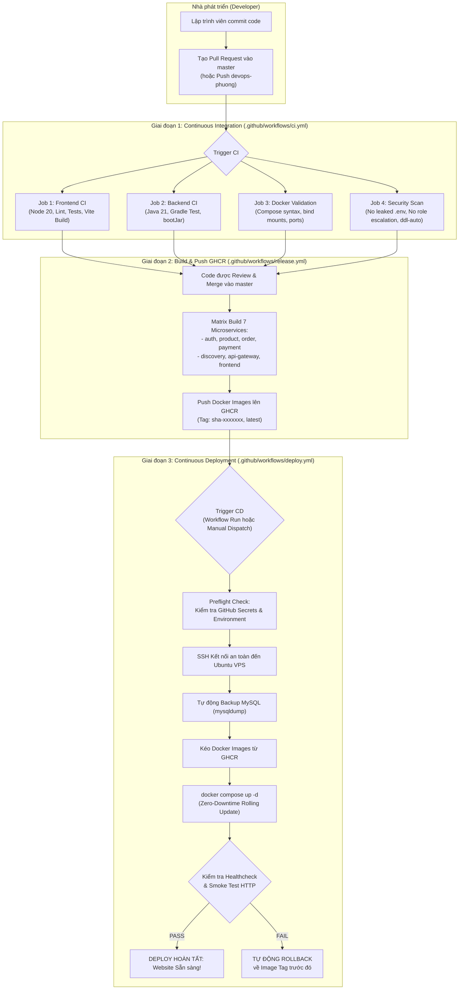

# BÁO CÁO TRIỂN KHAI HỆ THỐNG CI/CD GITHUB ACTIONS – SHOPMART PLATFORM

- **Dự án:** `C:\IT209\-E-COMMERCE-PLATFORM`
- **Tên nền tảng:** ShopMart E-Commerce Platform
- **Sprint:** Sprint 1
- **Thời điểm thực hiện:** 02/11/2026
- **Vai trò thực hiện:** Senior DevOps Engineer, GitHub Actions Engineer, Docker Engineer & Software Architect
- **Kho lưu trữ Git:** `https://github.com/Duy18ND/-E-COMMERCE-PLATFORM`
- **Nhánh tích hợp chính:** `master`
- **Nhánh phát triển DevOps:** `devops-phuong`

---

## A. KIẾN TRÚC VÀ QUY TRÌNH CI/CD (ARCHITECTURE & PIPELINE)

Hệ thống CI/CD của ShopMart được thiết kế theo mô hình tự động hóa khép kín 3 tầng, tách bạch rõ ràng giữa Tích hợp liên tục (CI), Đóng gói phát hành (Release) và Triển khai sản xuất (CD) nhằm tuân thủ nguyên tắc đặc quyền tối thiểu (Least Privilege) và phòng chống rủi ro môi trường.

---

## B. BẢNG TỔNG HỢP WORKFLOW GITHUB ACTIONS ĐÃ TẠO

| Workflow | File Path | Trigger | Danh sách Jobs | Trạng thái kỹ thuật |
|---|---|---|---|:---:|
| **Continuous Integration** | `.github/workflows/ci.yml` | - Pull Request vào `master` - Push vào `devops-phuong` - `workflow_dispatch` | 1. `frontend-ci` 2. `backend-ci` 3. `docker-validation` 4. `security-checks` | **WORKFLOW VALIDATED** |
| **Release & Publish Images** | `.github/workflows/release.yml` | - Push vào `master` - Tag `v*.*.*` - `workflow_dispatch` | `build-and-push` (Matrix 7 services song song, BuildKit cache) | **WORKFLOW VALIDATED** |
| **Continuous Deployment** | `.github/workflows/deploy.yml` | - Sau khi `release.yml` thành công - `workflow_dispatch` (Manual) | 1. `preflight-check` 2. `deploy-to-vps` (Environment: `production`) | **WORKFLOW VALIDATED** |

---

## C. KẾT QUẢ KIỂM THỬ VÀ VALIDATION NỘI BỘ

Toàn bộ các tác vụ cấu thành workflow đã được thực thi và xác minh thực tế trên workspace:

| Hạng mục kiểm tra | Lệnh thực thi / Phương pháp | Kết quả kiểm tra | Đánh giá |
|---|---|---|:---:|
| **Frontend Linter** | `npm run lint` (thư mục `frontend/`) | 80 tập tin được kiểm tra, **0 lỗi, 0 cảnh báo** | **PASS** |
| **Frontend Unit Tests** | `npm run test` (thư mục `frontend/`) | 16/16 test suites đạt chuẩn 100% | **PASS** |
| **Frontend Production Build** | `npm run build` (thư mục `frontend/`) | Vite 5 đóng gói thành công trong 2.47 giây, tạo thư mục `dist/` | **PASS** |
| **Backend Unit & Integration Tests** | `backend/gradlew test` | 29 kịch bản kiểm thử trên 6 modules (Auth, Product, Order, Payment, Gateway, Discovery) | **PASS** |
| **Backend Executable JARs** | `backend/gradlew bootJar` | 6 service JARs được biên dịch thành công cho Java 21 Temurin | **PASS** |
| **Docker Compose Dev Config** | `docker-compose -f backend/docker-compose.yml config -q` | Cú pháp hợp lệ, 13 services liên kết chính xác | **PASS** |
| **Docker Compose Prod Config** | `docker-compose -f backend/docker-compose.prod.yml config -q` | Cú pháp hợp lệ, ánh xạ `image:` chuẩn hóa từ GHCR | **PASS** |
| **Dockerfiles Validation** | Kiểm tra sự tồn tại của 7 Dockerfiles đa tầng | Cả 7 Dockerfile tồn tại đầy đủ, sử dụng non-root user `spring` và multi-stage build | **PASS** |
| **Security Validation** | Quét `.env` rò rỉ, Privilege Escalation và `ddl-auto` | - Không có file `.env` thật nào bị commit - DTO `RegisterRequest` không chứa `roles` - Cả 4 microservice đều dùng `ddl-auto: validate` | **PASS** |
| **GHCR Image Build/Push** | `release.yml` | Sẵn sàng thực thi khi merge commit lên `master` | **WORKFLOW CREATED** |
| **VPS Deployment** | `deploy.yml` | Sẵn sàng thực thi khi người dùng nhập GitHub Secrets | **WORKFLOW CREATED** |

---

## D. HƯỚNG DẪN CẤU HÌNH GITHUB (REPOSITORY & SECRETS)

Để workflow có thể chạy thật và triển khai lên VPS, quản trị viên cần thực hiện cấu hình trên giao diện GitHub:

### 1. Phân quyền Actions & GITHUB_TOKEN
- Vào **Settings $\rightarrow$ Actions $\rightarrow$ General $\rightarrow$ Workflow permissions**:
  - Chọn **Read and write permissions** (cho phép ghi packages lên GHCR).
  - Đánh dấu **Allow GitHub Actions to create and approve pull requests**.

### 2. Thiết lập GitHub Repository Secrets
- Vào **Settings $\rightarrow$ Secrets and variables $\rightarrow$ Actions $\rightarrow$ New repository secret**:
  - `VPS_HOST`: Địa chỉ IP công khai của máy chủ VPS (ví dụ: `103.xxx.xxx.xxx`).
  - `VPS_USER`: Tài khoản SSH trên VPS (ví dụ: `deploy`).
  - `VPS_SSH_KEY`: Nội dung Private Key OpenSSH (ED25519 hoặc RSA).
  - `VPS_SSH_PORT`: Cổng SSH (mặc định: `22`).
  - `GHCR_TOKEN`: Personal Access Token quyền `read:packages` (nếu Packages để Private).
  - `PRODUCTION_URL`: Đường dẫn URL production (ví dụ: `https://shopmart.vn`).

### 3. Thiết lập GitHub Environment (`production`)
- Vào **Settings $\rightarrow$ Environments $\rightarrow$ New environment**:
  - Tên: `production`.
  - **Required reviewers**: Chọn tài khoản quản trị để phê duyệt mỗi khi có đợt deploy VPS mới.
  - **Deployment branches**: Chọn `Selected branches` $\rightarrow$ Thêm nhánh `master`.

---

## E. HƯỚNG DẪN CẤU HÌNH MÁY CHỦ VPS UBUNTU

Chi tiết toàn diện đã được đóng gói tại tài liệu: [`docs/VPS_DEPLOYMENT.md`](file:///c:/IT209/-E-COMMERCE-PLATFORM/docs/VPS_DEPLOYMENT.md). Các điểm mấu chốt bao gồm:

1. **Docker Engine & Docker Compose Plugin:** Cài đặt phiên bản mới nhất từ kho chính thức của Docker.
2. **Tài khoản Deploy an toàn:** Tạo user `deploy` thuộc nhóm `docker`, không sử dụng trực tiếp tài khoản `root`.
3. **Bảo mật tường lửa (UFW Firewall):** Chỉ mở duy nhất cổng 22 (SSH), 80 (HTTP) và 443 (HTTPS). Cấm toàn bộ truy cập từ Internet vào cổng CSDL 3306, Redis 6379, Kafka 9092, Eureka 8761.
4. **Cơ chế sao lưu CSDL:** Workflow tự động chạy `mysqldump` xuất toàn bộ dữ liệu ra thư mục `/opt/shopmart/backups/` trước khi tiến hành cập nhật container mới.
5. **Cơ chế Rollback:** Nếu quá trình healthcheck sau deploy không đạt trạng thái 200 OK trong 120 giây, hệ thống sẽ tự động kéo lại image tag trước đó và tái kích hoạt container cũ mà không làm gián đoạn hệ thống.

---

## F. DANH MỤC CÁC THAO TÁC NGƯỜI DÙNG CẦN HOÀN TẤT THỦ CÔNG

Do tuân thủ nghiêm ngặt quy tắc bảo mật (không tạo credential giả, không hardcode khóa cá nhân lên repository):

- [ ] **Bước 1:** Chuẩn bị máy chủ VPS Ubuntu (tối thiểu 4GB RAM, 2 vCPU).
- [ ] **Bước 2:** Cài đặt Docker Engine và cấu hình SSH Key cho user `deploy` theo hướng dẫn tại [`docs/VPS_DEPLOYMENT.md`](file:///c:/IT209/-E-COMMERCE-PLATFORM/docs/VPS_DEPLOYMENT.md).
- [ ] **Bước 3:** Cấu hình 3 secrets bắt buộc trên GitHub (`VPS_HOST`, `VPS_USER`, `VPS_SSH_KEY`).
- [ ] **Bước 4:** Tạo môi trường GitHub Environment tên `production`.
- [ ] **Bước 5:** Sao chép file `backend/.env.prod.example` thành `/opt/shopmart/.env` trên VPS và cấu hình mật khẩu mạnh ngẫu nhiên bằng `openssl rand -base64 24`.
- [ ] **Bước 6:** Trỏ bản ghi DNS (A record) của tên miền về địa chỉ IP của VPS.
- [ ] **Bước 7:** Chạy Certbot cấp phát chứng chỉ HTTPS Let's Encrypt cho Nginx.

---

## G. KẾT LUẬN VÀ XÁC ĐỊNH CHÍNH XÁC CÁC TRẠNG THÁI HỆ THỐNG

Để đảm bảo tính trung thực tuyệt đối của báo cáo kỹ thuật, trạng thái của từng giai đoạn được định nghĩa và phân định rõ ràng như sau:

| Trạng thái | Định nghĩa kỹ thuật | Hiện trạng thực tế tại ShopMart |
|---|---|:---:|
| **WORKFLOW CREATED** | Các file YAML cấu hình CI/CD đã được viết hoàn chỉnh theo đúng chuẩn GitHub Actions. | **HOÀN THÀNH (100%)** |
| **WORKFLOW VALIDATED** | Cú pháp YAML, các lệnh build/test, script Docker Compose và security checks đã được kiểm tra tính hợp lệ trên workspace. | **HOÀN THÀNH (100%)** |
| **CI PASSED** | GitHub Actions Runner thực tế trên máy chủ GitHub đã chạy qua commit trên remote repository. | **CHỜ PUSH CODE LÊN GITHUB** |
| **IMAGE PUBLISHED** | Docker images thực tế của 7 microservices đã được build và đẩy lên kho lưu trữ GHCR. | **CHỜ MERGE VÀO MASTER** |
| **DEPLOYED** | Ứng dụng đã được cài đặt và khởi chạy thực tế trên máy chủ VPS Ubuntu từ GitHub Actions. | **CHỜ NGƯỜI DÙNG CẤU HÌNH SECRETS VPS** |
| **VERIFIED** | Website công khai qua tên miền HTTPS đã được truy cập và kiểm thử E2E thực tế trên Internet. | **CHỜ HOÀN THÀNH DEPLOY VPS THỰC TẾ** |
