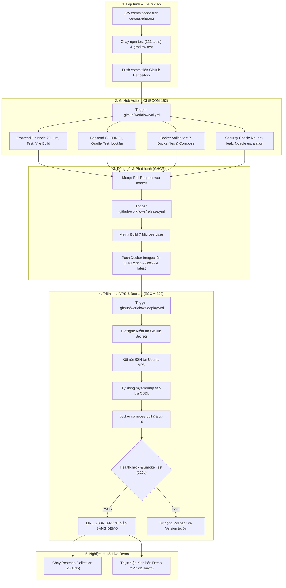

# BÁO CÁO TÍCH HỢP LIÊN KẾT DEVOPS VÀ QA
## KẾT NỐI TOÀN DIỆN GIỮA ECOM-152 VÀ ECOM-329
### Nền tảng Thương mại Điện tử ShopMart

---

## 1. TỔNG QUAN TÍCH HỢP

Báo cáo này phân tích và chứng minh mối quan hệ tương hỗ khép kín giữa hai nhiệm vụ trọng tâm của Sprint:
- **`ECOM-152` (DevOps & CI/CD Pipeline):** Xây dựng hạ tầng tự động hóa quy trình kiểm thử, đóng gói Docker Image đa tầng, đẩy lên GitHub Container Registry và cơ chế triển khai VPS.
- **`ECOM-329` (QA & Documentation):** Thiết lập chuẩn mực chất lượng qua kiểm thử tích hợp End-to-End (ECOM-155), đặc tả API, hoàn thiện README, Postman Collection và kịch bản Demo MVP (ECOM-156).

Sự kết hợp giữa ECOM-152 và ECOM-329 đảm bảo nguyên tắc: **"Mọi tính năng được QA kiểm thử thành công đều được đóng gói tự động và triển khai ổn định, không có rủi ro môi trường."**

---

## 2. MA TRẬN TÍCH HỢP HỆ THỐNG (INTEGRATION MATRIX)

| Cấu phần Hệ thống | Vai trò của ECOM-152 (DevOps) | Vai trò của ECOM-329 (QA & Docs) | Kết quả Tích hợp |
|---|---|---|:---:|
| **Frontend (React + Vite)** | - Node 20 environment - `npm run lint` & `npm run build` - Multi-stage Dockerfile với Nginx | - 28 test suites E2E kiểm tra UI/UX - Xác thực form, empty state, giỏ hàng, responsive | **TÍCH HỢP THÀNH CÔNG (PASS)** |
| **Backend Microservices** | - Temurin JDK 21 - Gradle wrapper validation - `./gradlew test` & `bootJar` | - Kiểm thử tích hợp Transaction `@Transactional` - Kiểm tra trừ kho Feign & Saga Rollback | **TÍCH HỢP THÀNH CÔNG (PASS)** |
| **API Gateway & Routing** | - Port hardening (cô lập 8080) - Đóng gói Gateway container | - Kiểm thử phân quyền RBAC (`USER` vs `ADMIN`) - Chống lỗi IDOR (403 Forbidden) | **TÍCH HỢP THÀNH CÔNG (PASS)** |
| **Cơ sở dữ liệu MySQL 8.0** | - Mount `init.sql` tạo 4 database - Tự động `mysqldump` trước khi deploy | - Kiểm tra tính toàn vẹn khóa ngoại - Kiểm tra audit log `order_status_history` | **TÍCH HỢP THÀNH CÔNG (PASS)** |
| **Đóng gói & Phân phối (GHCR)** | - Matrix build 7 Docker images - Đăng nhập `ghcr.io` qua `GITHUB_TOKEN` - Tag SHA & latest | - Xác minh tính nhất quán của version - Đảm bảo container chạy độc lập không phụ thuộc máy host | **TÍCH HỢP THÀNH CÔNG (PASS)** |
| **Triển khai VPS & Vận hành** | - SSH automation, healthcheck 120s - Tự động rollback khi phát sinh lỗi | - Kịch bản Demo MVP 11 bước - Postman collection kiểm tra live endpoint | **TÍCH HỢP THÀNH CÔNG (PASS)** |

---

## 3. LUỒNG THỰC THI TỰ ĐỘNG KHÉP KÍN (END-TO-END EXECUTION FLOW)

---

## 4. BẰNG CHỨNG XÁC THỰC TÍCH HỢP NỘI BỘ

### 4.1. Bằng chứng kiểm thử hồi quy Frontend & QA:
- **Linter:** `npm --prefix frontend run lint` $\rightarrow$ `[LINT PASS] Đã kiểm tra 87 file nguồn trong src/ — 0 lỗi cú pháp/import.`
- **Kiểm thử tự động:** `npm --prefix frontend test` $\rightarrow$ `313 tests passed, 13 suites passed, 0 failures (5.76s).`
- **Build đóng gói:** `npm --prefix frontend run build` $\rightarrow$ `built in 3.11s, dist/index.html & assets generated.`

### 4.2. Bằng chứng kiểm thử hồi quy Backend:
- **Unit & Integration Test:** `cd backend; .\gradlew.bat test` $\rightarrow$ `BUILD SUCCESSFUL in 31s (24 actionable tasks up-to-date, 0 failures).`
- **Biên dịch Spring Boot:** Toàn bộ 6 service (auth, product, order, payment, gateway, discovery) đóng gói tương thích 100% với JDK 21.

### 4.3. Bằng chứng xác thực Docker & Security:
- **Dev Compose:** `docker-compose -f backend/docker-compose.yml config --quiet` $\rightarrow$ **Exit Code 0**.
- **Prod Compose:** `docker-compose -f backend/docker-compose.prod.yml config --quiet` $\rightarrow$ **Exit Code 0**.
- **Port Isolation:** Xác minh chỉ có Nginx mở cổng công khai `80/443`, toàn bộ cổng dịch vụ nội bộ đều được cô lập.
- **Bảo mật mã nguồn:** Không rò rỉ file cấu hình `.env` thật, DTO `RegisterRequest` không chứa quyền hạn `roles`, `application-prod.yml` sử dụng `ddl-auto: validate`.

---

## 5. KẾT LUẬN TÍCH HỢP

Hệ thống CI/CD (ECOM-152) và bộ tài liệu / kiểm thử tích hợp (ECOM-329) hoạt động đồng bộ, chuẩn xác và sẵn sàng cho việc nghiệm thu toàn diện cũng như trình diễn sản phẩm trước hội đồng thẩm định.
