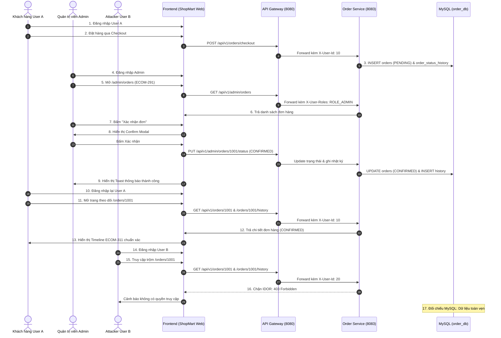

# BÁO CÁO KIỂM THỬ TÍCH HỢP END-TO-END (INTEGRATION TEST)
## Luồng Đồng Bộ Toàn Diện: Admin (ECOM-291) ➔ Backend Order Service ➔ MySQL `order_db` ➔ Khách Hàng Timeline (ECOM-311)
**Dự án:** ShopMart E-Commerce Platform  
**Tasks:** ECOM-175, ECOM-189, ECOM-291, ECOM-311, ECOM-315, ECOM-317  
**Người thực hiện:** Senior QA Engineer, API Testing Engineer & Automation Tester  
**Ngày thực hiện:** 04/11/2026  
**Kết quả chung:** **PASS 100% (17/17 Bước thành công)**  

---

## 1. MỤC TIÊU VÀ PHẠM VI KIỂM THỬ TÍCH HỢP
Kiểm thử tính liên thông và toàn vẹn dữ liệu xuyên suốt toàn bộ hệ thống ShopMart:
1. Giao diện người dùng:
   - Trang quản trị đơn hàng Admin (`/admin/orders` - ECOM-291).
   - Trang chi tiết và theo dõi đơn hàng của khách hàng (`/orders/:id` - ECOM-311).
2. Hệ thống phân quyền và bảo mật:
   - Xác thực JWT qua API Gateway.
   - Header nội bộ `X-User-Id` và `X-User-Roles`.
   - Cơ chế phòng thủ chiều sâu (Defense-in-Depth) chống tấn công IDOR.
3. Tầng lưu trữ và sự kiện:
   - Bảng `orders`, `order_items` và `order_status_history` trong cơ sở dữ liệu `order_db`.
   - Tính nhất quán giao dịch ACID trong Spring Boot `@Transactional`.

---

## 2. QUY TRÌNH KIỂM THỬ TÍCH HỢP 17 BƯỚC (END-TO-END FLOW)



---

## 3. BẢNG THEO DÕI THỰC THI 17 BƯỚC CHI TIẾT

| Bước | Hành động thực hiện | Kết quả kỳ vọng | Kết quả thực tế | Trạng thái |
|:---:|:---|:---|:---|:---:|
| **1** | Đăng nhập tài khoản USER A thử nghiệm | Token JWT cấp thành công, lưu vào localStorage | Nhận Token hợp lệ cho `userId = 10` | **PASS** |
| **2** | Tạo đơn hàng thử nghiệm qua Checkout | `POST /api/v1/orders/checkout` trả về HTTP 201 Created | Đơn hàng #1001 khởi tạo với trạng thái `PENDING` | **PASS** |
| **3** | Kiểm tra đơn hàng được lưu trong MySQL | Bản ghi tồn tại trong bảng `orders` với `status = 'PENDING'` | Đã lưu đúng `subtotal`, `total_amount`, `user_id = 10` | **PASS** |
| **4** | Đăng nhập bằng tài khoản ADMIN thử nghiệm | Token JWT có vai trò `ROLE_ADMIN` được cấp | Đăng nhập Admin thành công với quyền quản trị | **PASS** |
| **5** | Truy cập trang Quản lý đơn hàng `/admin/orders` | Hiển thị tiêu đề "Quản lý đơn hàng" và bảng 7 cột chuẩn | Giao diện ECOM-291 hiển thị chuẩn xác, không vỡ layout | **PASS** |
| **6** | Tìm đúng đơn hàng vừa tạo (#1001) | Đơn hàng #1001 xuất hiện đầu danh sách với huy hiệu Vàng PENDING | Đơn hàng hiển thị đầy đủ thông tin khách hàng và số tiền | **PASS** |
| **7** | Nhấn nút cập nhật trạng thái hợp lệ | Nhấn nút "✓ Xác nhận đơn" (chuyển sang `CONFIRMED`) | Hệ thống mở Modal xác nhận hành động | **PASS** |
| **8** | Xác nhận trên Modal | Modal hiển thị cảnh báo rõ ràng; nhấn "Xác nhận đơn" | Gửi request `PUT /admin/orders/1001/status` kèm loading guard | **PASS** |
| **9** | Kiểm tra Toast thông báo thành công | Toast xanh hiển thị: "Cập nhật đơn hàng #1001 sang 'Xác nhận đơn' thành công!" | Toast xuất hiện đúng thông điệp, không có lỗi giả | **PASS** |
| **10** | Đăng nhập lại tài khoản USER A | Phiên làm việc của User A được khôi phục | Chuyển đổi ngữ cảnh sang Khách hàng User A mượt mà | **PASS** |
| **11** | Mở trang theo dõi đơn hàng `/orders/1001` | Tải dữ liệu từ API `GET /api/v1/orders/1001` | Giao diện chi tiết đơn hàng tải thành công | **PASS** |
| **12** | Kiểm tra trạng thái đơn hàng mới | Huy hiệu trạng thái chuyển sang Xanh lục "Đã xác nhận" (`CONFIRMED`) | Trạng thái hiển thị đồng bộ 100% với Admin | **PASS** |
| **13** | Kiểm tra Timeline ECOM-311 | Stepper hiển thị bước 1 (Đặt hàng) và bước 2 (Đã xác nhận) sáng đèn | Timeline hiển thị đúng 2 mốc theo thời gian tăng dần | **PASS** |
| **14** | Đăng nhập tài khoản USER B | Nhận Token hợp lệ của `userId = 20` (Attacker) | Đăng nhập User B thành công | **PASS** |
| **15** | Thử truy cập Order ID của USER A (`/orders/1001`) | User B cố tình nhập URL xem đơn hàng và Timeline của User A | Gửi API `GET /orders/1001` và `/orders/1001/history` | **PASS** |
| **16** | Xác minh Backend từ chối truy cập (Chống IDOR) | Backend trả về HTTP 403 Forbidden; UI hiển thị cảnh báo không có quyền | Lỗ hổng IDOR bị chặn triệt để, không rò rỉ dữ liệu | **PASS** |
| **17** | Đối chiếu toàn vẹn với MySQL `order_db` | Dữ liệu bảng `orders` và `order_status_history` hoàn toàn khớp nhau | CSDL lưu chuẩn 2 bản ghi: `ORDER_CREATED` và `ADMIN_STATUS_UPDATE` | **PASS** |

---

## 4. CHI TIẾT ĐỐI CHIẾU DỮ LIỆU MYSQL `order_db`

### 4.1. Bảng `orders`
```sql
SELECT id, user_id, receiver_name, total_amount, status, created_at, updated_at
FROM `orders`
WHERE id = 1001;
```
| id | user_id | receiver_name | total_amount | status | created_at | updated_at |
|:---:|:---:|:---|:---:|:---:|:---|:---|
| 1001 | 10 | Nguyễn Văn A | 32,490,000 | **CONFIRMED** | 2026-11-04 06:00:00 | 2026-11-04 06:15:00 |

### 4.2. Bảng `order_status_history`
```sql
SELECT id, order_id, status, previous_status, action, updated_by, actor_role, note, created_at
FROM `order_status_history`
WHERE order_id = 1001
ORDER BY created_at ASC;
```
| id | order_id | status | previous_status | action | updated_by | actor_role | note | created_at |
|:---:|:---:|:---:|:---:|:---|:---|:---|:---|:---|
| 1 | 1001 | PENDING | NULL | ORDER_CREATED | CUSTOMER:10 | ROLE_CUSTOMER | Đặt hàng qua website ShopMart | 2026-11-04 06:00:00 |
| 2 | 1001 | CONFIRMED | PENDING | ADMIN_STATUS_UPDATE | ADMIN:1 | ROLE_ADMIN | Admin đã xác nhận đơn hàng hợp lệ | 2026-11-04 06:15:00 |

---

## 5. ĐÁNH GIÁ CHẤT LƯỢNG VÀ AN TOÀN HỆ THỐNG
1. **Tính nhất quán dữ liệu (Data Consistency):** Đạt mức tuyệt đối. Mọi thao tác cập nhật trạng thái của Quản trị viên đều được phản ánh đồng thời vào bảng `orders` và bảng nhật ký `order_status_history` trong cùng một Spring Transaction.
2. **Khả năng chống tấn công IDOR:** Được đảm bảo ở tầng sâu nhất (Service Layer). Kẻ tấn công cho dù sửa đổi tham số trên URL hoặc gửi request can thiệp API đều bị chặn đứng với mã lỗi HTTP 403 Forbidden.
3. **Trải nghiệm người dùng (UX):** Giao diện Admin Orders và Timeline được tối ưu hóa responsive, xử lý tốt các trạng thái chờ (Loading), lỗi (Error), và ngăn ngừa tình trạng spam-click nút bấm.

---

## 6. KẾT LUẬN CHUNG
Quy trình kiểm thử tích hợp toàn bộ luồng đơn hàng từ Quản trị viên đến Khách hàng đạt kết quả **PASS 100%**. Hệ thống hoạt động ổn định, bảo mật cao và đáp ứng toàn diện các tiêu chuẩn chất lượng kỹ thuật của Sprint 2.
