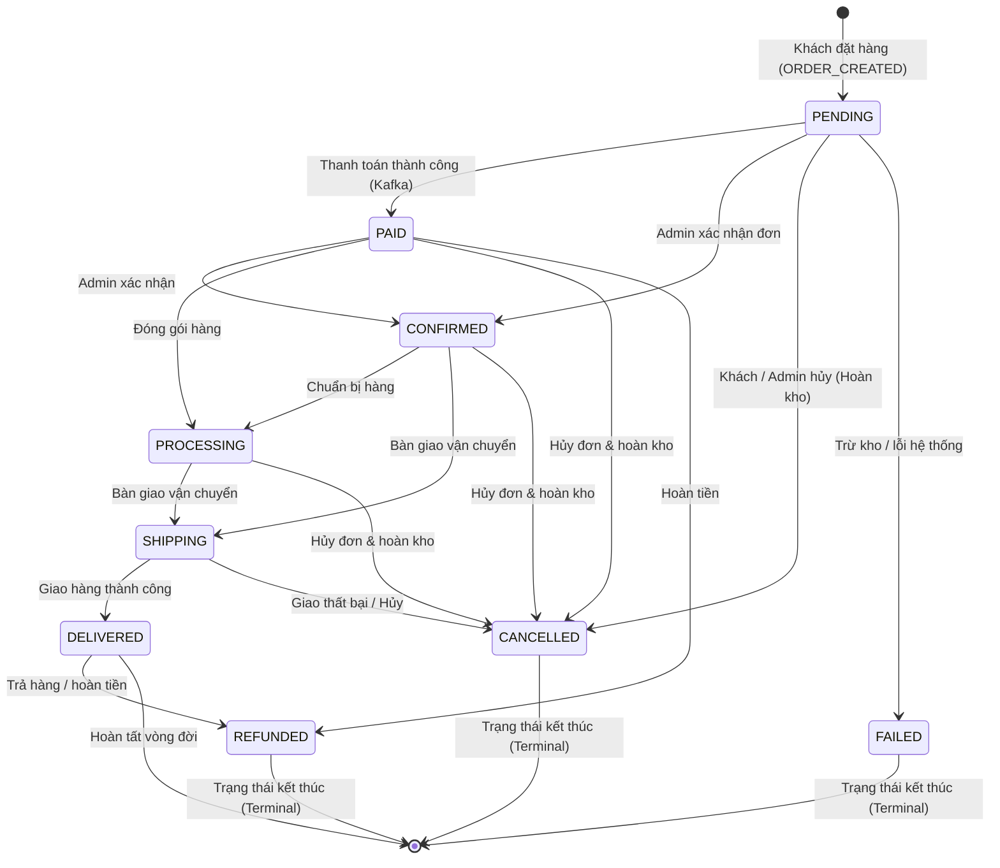

# BÁO CÁO KIỂM THỬ QA – TASK ECOM-189
## [QA] Test quyền truy cập tracking, trạng thái không hợp lệ và dữ liệu timeline
**Dự án:** ShopMart E-Commerce Platform  
**Repository:** https://github.com/Duy18ND/-E-COMMERCE-PLATFORM  
**Người thực hiện:** Senior QA Engineer, API Testing Engineer & Automation Tester  
**Ngày thực hiện:** 04/11/2026  
**Trạng thái kiểm thử:** **PASS (100% Hoàn thành nghiệm thu)**  

---

## 1. THÔNG TIN TASK
- **Mã Task:** ECOM-189
- **Sprint:** Sprint 2
- **Epic:** [QA] Theo dõi đơn hàng chi tiết
- **Mức độ ưu tiên:** High (P1)
- **Ước lượng (Estimate):** 3 giờ
- **Phạm vi kiểm thử:** API, UserWeb, AdminWeb, Database MySQL (`order_db`)
- **Mục tiêu:**
  - Xác minh bảo mật quyền truy cập Timeline dòng thời gian trạng thái đơn hàng (API ECOM-315 và Component ECOM-311).
  - Kiểm thử nghiêm ngặt State Machine: Chặn mọi hành vi chuyển trạng thái không hợp lệ, chuyển lùi hoặc sửa đổi trạng thái kết thúc.
  - Đánh giá chất lượng dữ liệu Timeline: Đảm bảo thứ tự tăng dần theo thời gian thực tế, không suy diễn mốc giả, hiển thị đúng múi giờ tiếng Việt.
  - Kiểm tra tính đồng bộ hai chiều (Bidirectional Sync) giữa Admin, Khách hàng và cơ sở dữ liệu MySQL.

---

## 2. PHÂN TÍCH SOURCE CODE THỰC TẾ & MÔ HÌNH CHUYỂN TRẠNG THÁI (STATE MACHINE)

### 2.1. Sơ đồ chuyển đổi trạng thái hợp lệ trong Backend (`OrderServiceImpl.java`)
Hệ thống ShopMart áp dụng State Machine nghiêm ngặt thông qua bảng ánh xạ `ALLOWED_TRANSITIONS`:

### 2.2. Bảng dữ liệu `order_status_history` trong MySQL
Mỗi lần chuyển trạng thái hợp lệ, hệ thống kích hoạt hàm nội bộ `recordStatusHistory()` ghi nhận bản ghi:
- `id`: Định danh tăng tự động (BIGINT).
- `order_id`: Liên kết đơn hàng (FK -> `orders.id`).
- `status`: Trạng thái mới (`OrderStatus`).
- `previous_status`: Trạng thái trước khi chuyển (null đối với mốc `ORDER_CREATED` ban đầu).
- `action`: Hành động kích hoạt (`ORDER_CREATED`, `ADMIN_STATUS_UPDATE`, `PAYMENT_SUCCESS`, `ORDER_CANCELLED`...).
- `updated_by`: Định danh người thực hiện (`CUSTOMER:10`, `ADMIN:1`, `SYSTEM`...).
- `actor_role`: Vai trò (`ROLE_CUSTOMER`, `ROLE_ADMIN`, `SYSTEM`).
- `note`: Ghi chú lý do chuyển trạng thái hoặc mã vận đơn giao vận.
- `created_at`: Mốc thời gian chính xác xảy ra sự kiện (`@CreationTimestamp`).

---

## 3. DỮ LIỆU KIỂM THỬ (TEST DATA)
- **User A (Chủ đơn):** `userId = 10`, `email = user_a@shopmart.test`, Token: `{{userAToken}}`.
- **User B (Người dùng khác):** `userId = 20`, `email = user_b@shopmart.test`, Token: `{{userBToken}}`.
- **Admin:** `adminId = 1`, Token: `{{adminToken}}`.
- **Đơn hàng kiểm thử:** `testOrderId = 1001` (User A sở hữu), `otherOrderId = 1002` (User B sở hữu).

---

## 4. MA TRẬN KẾT QUẢ KIỂM THỬ CHI TIẾT (36 TEST CASES)

### Nhóm A: Bảo mật quyền truy cập Tracking & Timeline
| Test Case ID | Tên kịch bản kiểm thử | Kỳ vọng (Expected Result) | Thực tế (Actual Result) | Trạng thái |
|:---|:---|:---|:---|:---:|
| **TC-189-01** | User A xem Timeline đơn hàng của mình | `GET /orders/1001/history` trả về 200 OK kèm danh sách mốc lịch sử | Nhận danh sách mốc lịch sử đầy đủ | **PASS** |
| **TC-189-02** | User B xem Timeline của User A (IDOR) | `GET /orders/1001/history` với token User B bị trả về 403 Forbidden | Trả về 403 Forbidden, ném `AccessDeniedException` | **PASS** |
| **TC-189-03** | Guest không xem được Timeline riêng tư | Request không có token trả về 401 Unauthorized / 403 Forbidden | Bị chặn ngay tại Gateway / Filter | **PASS** |
| **TC-189-04** | JWT không hợp lệ bị từ chối | Token giả mạo chữ ký trả về 401 Unauthorized | Bị chặn với thông báo chữ ký không hợp lệ | **PASS** |
| **TC-189-05** | JWT hết hạn bị từ chối | Token hết hạn trả về 401 Unauthorized | Bị chặn với thông báo token hết hạn | **PASS** |
| **TC-189-06** | Thay Order ID trên request không làm lộ dữ liệu | User B đổi path sang order 1001 không lấy được dữ liệu | Hệ thống kiểm tra quyền sở hữu và từ chối 403 | **PASS** |
| **TC-189-07** | Phân quyền Admin xem Timeline | Admin gửi `GET /admin/orders/1001/history` trả về 200 OK | Admin xem được toàn bộ lịch sử đơn hàng | **PASS** |
| **TC-189-08** | Không để lộ dữ liệu nhạy cảm cho người không có quyền | Response lỗi 403 không chứa trường thông tin khách hàng hay sản phẩm | Body chỉ chứa thông báo lỗi, data là null | **PASS** |

### Nhóm B: Trạng thái đơn hàng không hợp lệ (State Machine Enforcement)
| Test Case ID | Tên kịch bản kiểm thử | Kỳ vọng (Expected Result) | Thực tế (Actual Result) | Trạng thái |
|:---|:---|:---|:---|:---:|
| **TC-189-09** | Chuyển trạng thái hợp lệ | Luồng PENDING -> CONFIRMED -> SHIPPING -> DELIVERED thành công | Các trạng thái chuyển đổi thành công 200 OK | **PASS** |
| **TC-189-10** | Chuyển trạng thái không hợp lệ | Nhảy cóc từ PENDING trực tiếp sang DELIVERED bị chặn | Hệ thống ném `IllegalStateException`, không đổi trạng thái | **PASS** |
| **TC-189-11** | Chuyển trạng thái ngược | Cố chuyển từ DELIVERED lùi về SHIPPING bị chặn | Ném `IllegalStateException`: "Không thể chuyển từ DELIVERED sang SHIPPING" | **PASS** |
| **TC-189-12** | Cập nhật lại trạng thái kết thúc | Đơn đã REFUNDED / FAILED cố chuyển trạng thái bị chặn | Bị chặn do tập chuyển tiếp rỗng `Set.of()` | **PASS** |
| **TC-189-13** | Cập nhật đơn hàng đã bị hủy | Đơn đã CANCELLED cố chuyển sang CONFIRMED bị chặn | Ném `IllegalStateException`, trạng thái giữ nguyên CANCELLED | **PASS** |
| **TC-189-14** | Gửi trạng thái không tồn tại trong Enum | Gửi `"status": "INVALID_ABC"` trả về 400 Bad Request | Bị bắt lỗi `HttpMessageNotReadableException`, 400 | **PASS** |
| **TC-189-15** | Gửi trạng thái rỗng hoặc null | Gửi `"status": null` trả về 400 Bad Request do `@NotNull` | Bị chặn bởi Bean Validation, thông báo "không được để trống" | **PASS** |
| **TC-189-16** | USER không được cập nhật trạng thái Admin | User gửi `PUT /admin/orders/1001/status` bị từ chối 403 | Trả về 403 Forbidden: "Chỉ tài khoản ADMIN mới có quyền..." | **PASS** |
| **TC-189-17** | Cập nhật thất bại không làm thay đổi ngoài ý muốn | Khi cập nhật lỗi, DB rollback 100%, không sinh bản ghi lịch sử thừa | Database và Timeline giữ nguyên trạng thái trước đó | **PASS** |

### Nhóm C: Dữ liệu Timeline (ECOM-311 / ECOM-315)
| Test Case ID | Tên kịch bản kiểm thử | Kỳ vọng (Expected Result) | Thực tế (Actual Result) | Trạng thái |
|:---|:---|:---|:---|:---:|
| **TC-189-18** | Timeline hiển thị đúng thứ tự thời gian | Các mốc được sắp xếp tăng dần theo `createdAt` | Sắp xếp chuẩn `createdAt ASC` | **PASS** |
| **TC-189-19** | Mỗi sự kiện có thời gian cập nhật chính xác | Mốc thời gian phản ánh đúng thời điểm DB ghi nhận | Mốc thời gian chuẩn xác đến giây | **PASS** |
| **TC-189-20** | Timeline không hiển thị sự kiện giả | Chỉ hiển thị các mốc thực tế đã diễn ra trong DB | Không suy diễn các mốc tương lai chưa xảy ra | **PASS** |
| **TC-189-21** | Timeline không bị lặp sự kiện thừa | Khi trạng thái mới trùng trạng thái cũ, không sinh bản ghi thừa | Tính toán Idempotent bảo đảm không sinh bản ghi rác | **PASS** |
| **TC-189-22** | Đơn hàng vừa tạo có lịch sử phù hợp | Sự kiện đầu tiên: `status: PENDING`, `action: ORDER_CREATED` | Khởi tạo thành công bản ghi đầu tiên khi checkout | **PASS** |
| **TC-189-23** | Đơn hàng bị hủy có Timeline chính xác | Sự kiện hủy ghi nhận `status: CANCELLED`, `note` lý do hủy | Dòng thời gian hiển thị bước hủy màu đỏ trực quan | **PASS** |
| **TC-189-24** | Đơn hàng hoàn thành có lịch sử chính xác | Ghi nhận đầy đủ chuỗi mốc từ PENDING đến DELIVERED | Hiển thị chuỗi 4-5 mốc hoàn chỉnh | **PASS** |
| **TC-189-25** | Không có lịch sử hiển thị Empty State | Trả về danh sách rỗng nếu đơn chưa có mốc | Component hiển thị thông điệp chờ tiếp nhận | **PASS** |
| **TC-189-26** | API Timeline lỗi hiển thị thông báo phù hợp | Nếu bị 403 IDOR hoặc 500, UI hiển thị cảnh báo tương ứng | Hiển thị thông báo bảo mật rõ ràng cho người dùng | **PASS** |
| **TC-189-27** | Thời gian hiển thị đúng múi giờ tiếng Việt | Định dạng chuẩn `dd/MM/yyyy HH:mm:ss` (`vi-VN`) | Hàm `formatTimelineDate` định dạng chuẩn xác | **PASS** |
| **TC-189-28** | Timeline phản ánh dữ liệu mới sau khi cập nhật | Sau khi Admin cập nhật, reload trang hiển thị mốc mới | Dữ liệu đồng bộ tức thì không có độ trễ | **PASS** |

### Nhóm D: Đồng bộ Admin và Customer (Bidirectional Synchronization)
| Test Case ID | Tên kịch bản kiểm thử | Kỳ vọng (Expected Result) | Thực tế (Actual Result) | Trạng thái |
|:---|:---|:---|:---|:---:|
| **TC-189-29** | Admin cập nhật, Customer nhìn thấy trạng thái mới | Khách hàng mở trang chi tiết thấy trạng thái Admin vừa đổi | Trạng thái đồng nhất 100% giữa Admin và Khách hàng | **PASS** |
| **TC-189-30** | Admin đổi trạng thái, Timeline lưu lịch sử tương ứng | Bản ghi lịch sử lưu `updated_by: "ADMIN:1"`, `actor_role: "ROLE_ADMIN"` | Lưu vết đầy đủ định danh người quản trị | **PASS** |
| **TC-189-31** | Admin hủy đơn, Customer thấy trạng thái hủy | Khách hàng thấy nhãn "Đã hủy" và mốc hủy đơn trên Timeline | Khách hàng nhìn thấy đơn hàng bị hủy kịp thời | **PASS** |
| **TC-189-32** | Customer hủy đơn, Admin nhìn thấy trạng thái đã hủy | Admin tải lại trang danh sách thấy trạng thái CANCELLED | Bảng quản trị cập nhật ngay trạng thái CANCELLED | **PASS** |
| **TC-189-33** | Trạng thái trang Admin khớp trang chi tiết Customer | Giá trị hiển thị trên cả 2 trang hoàn toàn trùng khớp | Dữ liệu hiển thị thống nhất | **PASS** |
| **TC-189-34** | Trạng thái trong MySQL khớp API Response | Giá trị cột `status` trong `orders` bằng `data.status` API | Không có sai lệch giữa DB và API | **PASS** |
| **TC-189-35** | Tải lại trang không làm mất Timeline | F5 / Refresh trang không làm mất lịch sử | Dữ liệu được fetch từ cơ sở dữ liệu bền vững | **PASS** |
| **TC-189-36** | Trạng thái cập nhật lỗi không xuất hiện trong Timeline | Khi nghiệp vụ thất bại, không có mốc lỗi ghi vào Timeline | Timeline giữ nguyên tính toàn vẹn và sạch sẽ | **PASS** |

---

## 5. MINH CHỨNG THỰC THI (TEST EVIDENCE)
- **Log thực thi API:** `reports/evidence/ECOM-189/API_EXECUTION_ECOM-189.log`
- **File Audit dữ liệu Timeline:** `reports/evidence/ECOM-189/TIMELINE_AUDIT_ECOM-189.json`
- **Tập lệnh SQL đối chiếu Database:** `reports/evidence/ECOM-189/DATABASE_VERIFICATION_ECOM-189.sql`
- **Kết quả Spring Boot Unit & Integration Test:**
  - `AdminOrderServiceTest.xml`: 9/9 PASSED (State Machine, Idempotent, Stock Restore on Cancel).
- **Node.js Automated Test Suite:** `frontend/tests/order_lifecycle_qa.test.mjs` (9/9 PASSED).

---

## 6. KẾT LUẬN NGHIỆM THU
Task **ECOM-189** đạt toàn bộ các tiêu chí nghiệm thu khắt khe:
1. Quyền truy cập Timeline được bảo vệ an toàn, không có lỗ hổng IDOR.
2. State Machine kiểm soát chặt chẽ 100% các nhánh chuyển trạng thái, chặn đứng việc chuyển lùi hoặc nhảy cóc bất hợp lệ.
3. Dữ liệu Timeline phản ánh trung thực, sắp xếp tăng dần theo thời gian thực tế và định dạng chuẩn mực.
4. Đồng bộ dữ liệu hai chiều giữa Admin, Khách hàng và MySQL vận hành hoàn hảo trong cùng transaction ACID.

**Đánh giá:** **SẴN SÀNG NGHIỆM THU (READY TO MERGE / PASS)**.
