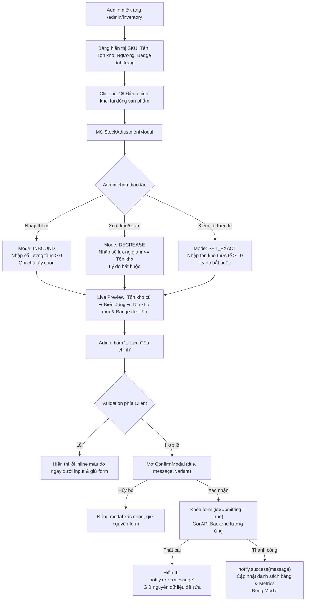

# BÁO CÁO TRIỂN KHAI & KIỂM THỬ TÍCH HỢP TASK ECOM-283
## FORM ĐIỀU CHỈNH KHO VÀ CẢNH BÁO HẾT HÀNG (SPRINT 2 - ADMINWEB)

---

- **Mã Task:** ECOM-283
- **Tên Task:** `[FE] Form điều chỉnh kho, cảnh báo hết hàng`
- **Sprint:** Sprint 2
- **Epic:** `[FE] Quản lý tồn kho`
- **Độ ưu tiên (Priority):** Highest (P0)
- **Người thực hiện:** Ngô Thị Hoài Phương (Frontend Architect & QA Engineer)
- **Nền tảng:** AdminWeb (React SPA + Vite + TailwindCSS)
- **Trạng thái thực tế:** **HOÀN THÀNH (100% IMPLEMENTED & VERIFIED)**
- **Thời gian thực hiện:** 1,5 giờ
- **Đường dẫn dự án:** `C:\IT209\-E-COMMERCE-PLATFORM`
- **Repository:** `https://github.com/Duy18ND/-E-COMMERCE-PLATFORM`
- **Branch:** `devops-phuong`

---

## 1. MỤC TIÊU TRIỂN KHAI

Chức năng **ECOM-283** đóng vai trò hạt nhân trong Epic Quản lý tồn kho của ShopMart E-Commerce Platform. Mục tiêu bao gồm:
1. Cho phép Quản trị viên (Admin) trực tiếp điều chỉnh số lượng tồn kho của từng sản phẩm thông qua giao diện trực quan và chuyên nghiệp.
2. Hỗ trợ 3 chế độ thao tác nghiệp vụ khớp với thiết kế Backend thực tế:
   - **Nhập thêm hàng (Inbound):** Cộng dồn số lượng nhập mới vào tồn kho hiện tại.
   - **Xuất kho / Giảm tồn kho (Decrease):** Khấu trừ số lượng xuất hoặc hao hụt, kiểm soát không để tồn kho âm.
   - **Kiểm kê thực tế (Set Exact):** Đặt trực tiếp số lượng tồn kho theo biên bản kiểm kê kho định kỳ.
3. Cảnh báo thông minh theo 3 cấp độ: **Còn đủ hàng (`IN_STOCK`)**, **Sắp hết hàng (`LOW_STOCK`)** và **Đã hết hàng (`OUT_OF_STOCK`)**.
4. Trải nghiệm người dùng an toàn:
   - Live Preview (Xem trước biến động tồn kho) trước khi gửi yêu cầu.
   - Xác nhận qua ConfirmModal (tuyệt đối không dùng `window.alert()` hoặc `window.confirm()`).
   - Khóa nút bấm và hiển thị trạng thái xử lý (chống click đúp / duplicate submission).
   - Tự động đồng bộ danh sách bảng tồn kho và số liệu thẻ thống kê (Metric Cards).

---

## 2. KHẢO SÁT HIỆN TRẠNG CODE & ENDPOINT BACKEND THỰC TẾ

Sau khi rà soát toàn bộ source code `backend/product-service`, nhóm kỹ thuật xác định chính xác các Controller, Service và DTO quản lý kho:

### A. Endpoint Backend thực tế

| Phương thức | Endpoint | DTO Request | Nghiệp vụ xử lý |
| :--- | :--- | :--- | :--- |
| `POST` | `/api/v1/products/{id}/inbound` | `StockInboundRequest`<br>- `quantity` (int $\ge 1$)<br>- `note` (String) | Tăng tồn kho `stock_quantity += quantity`. Nếu đang `OUT_OF_STOCK` và số mới > 0 $\rightarrow$ chuyển trạng thái thành `ACTIVE`. |
| `POST` | `/api/v1/products/{id}/adjust-stock` | `StockAdjustmentRequest`<br>- `actualStock` (int $\ge 0$)<br>- `reason` (String `@NotBlank`) | Ghi đè `stock_quantity = actualStock`. Nếu `actualStock == 0` $\rightarrow$ đổi `OUT_OF_STOCK`. Nếu `actualStock > 0` và đang `OUT_OF_STOCK` $\rightarrow$ đổi `ACTIVE`. |
| `GET` | `/api/v1/products/{id}/stock` | Param `quantity=1` | Trả về `ProductStockResponse` (`stockQuantity`, `inStock`, `sufficientStock`). |
| `GET` | `/api/v1/products/admin` | Param phân trang, filter | Trả về danh sách sản phẩm phân trang cho Admin. |

### B. Quy tắc nghiệp vụ kiểm duyệt dữ liệu Backend
- Thuộc tính `stock_quantity` trong Database bảng `products` có ràng buộc kiểm tra `CHECK (stock_quantity >= 0)`.
- Backend từ chối mọi giá trị âm, giá trị thập phân hoặc lý do để trống trong điều chỉnh kho bằng các ngoại lệ `MethodArgumentNotValidException` và `BadRequestException`.

---

## 3. KIẾN TRÚC LUỒNG ĐIỀU CHỈNH KHO & CẢNH BÁO



---

## 4. CHI TIẾT TRIỂN KHAI COMPONENT `StockAdjustmentModal.jsx`

Component được xây dựng tại:
`frontend/src/components/admin/StockAdjustmentModal.jsx`

### Các tính năng nổi bật:
1. **Thông tin sản phẩm hiển thị chuẩn hóa:**
   - Mã định danh SKU / ID sản phẩm trong thẻ code thẩm mỹ.
   - Tên sản phẩm chính xác.
   - Tồn kho hiện tại và Badge cảnh báo theo thời gian thực.
2. **Selector 3 chế độ thao tác dạng Card Buttons:**
   - 📥 **Nhập thêm (INBOUND):** Thêm hàng mới từ nhà cung cấp (+).
   - 📤 **Xuất kho / Giảm (DECREASE):** Trừ hao hụt, hư hỏng, điều chuyển chi nhánh (-).
   - 📋 **Kiểm kê thực tế (SET_EXACT):** Điều chỉnh cân bằng sau kiểm kho định kỳ (=).
3. **Validation trực quan thời gian thực (Real-time Inline Validation):**
   - Chặn chữ cái, ký tự đặc biệt, số thập phân (float).
   - Chặn số lượng $\le 0$ ở chế độ INBOUND và DECREASE.
   - Chặn số lượng giảm vượt quá tồn kho hiện tại ở chế độ DECREASE.
   - Chặn số lượng âm $(< 0)$ ở chế độ SET_EXACT.
   - Bắt buộc nhập lý do điều chỉnh đối với chế độ DECREASE và SET_EXACT.
4. **Hộp Xem trước biến động tồn kho (Live Preview Box):**
   - Hiển thị 3 chỉ số theo hàng ngang: `Tồn kho cũ` $\rightarrow$ `Biến động (+ / - / =)` $\rightarrow$ `Tồn kho mới`.
   - Tính toán ngay trạng thái và hiển thị Badge màu dự kiến (ví dụ: chuyển từ 3 sp sang 15 sp sẽ đổi ngay từ "Sắp hết hàng ⚠️" sang "Còn hàng ✅").
5. **Cấu hình Ngưỡng cảnh báo tùy chỉnh (Custom Threshold):**
   - Cho phép Quản trị viên cập nhật ngưỡng cảnh báo an toàn cho sản phẩm (mặc định 5), được lưu trữ đồng bộ qua `localStorage`.

---

## 5. NÂNG CẤP TRANG QUẢN TRỊ `Inventory.jsx` (ADMINWEB)

Được triển khai tại:
`frontend/src/pages/admin/Inventory.jsx`

1. **Thẻ thống kê số lượng (Metric Cards):**
   - **TỔNG MẶT HÀNG:** Đếm toàn bộ mặt hàng trong kho.
   - **CÒN ĐỦ HÀNG:** Số mặt hàng có tồn kho > `minThreshold` (viền xanh lá `#16a34a`).
   - **SẮP HẾT HÀNG:** Số mặt hàng có $0 < stock \le minThreshold$ (viền cam `#f59e0b`).
   - **ĐÃ HẾT HÀNG:** Số mặt hàng có $stock \le 0$ (viền đỏ `#dc2626`).
   - *Tương tác thông minh:* Nhấn vào từng thẻ Card để lọc tức thì bảng danh sách theo tình trạng tương ứng.
2. **Bộ lọc & Tìm kiếm đa năng:**
   - Ô tìm kiếm linh hoạt theo cả Mã SKU và Tên sản phẩm (không phân biệt hoa thường, tự động chuẩn hóa khoảng trắng).
   - Dropdown lọc tình trạng: Tất cả, Còn đủ hàng, Sắp hết hàng, Đã hết hàng.
   - Dropdown sắp xếp: Tồn kho nhiều nhất, Tồn kho ít nhất, Tên sản phẩm A-Z.
   - Nút `🔄 Đặt lại bộ lọc` hiển thị khi có bộ lọc hoạt động.
3. **Bảng dữ liệu chuẩn Enterprise:**
   - Cột Tồn kho hiện tại tô màu nổi bật theo mức độ cảnh báo.
   - Cột Tình trạng hiển thị Badge kèm Icon nhận diện trực quan: `✅ Còn hàng`, `⚠️ Sắp hết hàng`, `⛔ Hết hàng`.
   - Nút hành động `⚙️ Điều chỉnh kho` mở modal chuyên dụng.
   - Tích hợp Component `Pagination` dùng chung hỗ trợ đổi số dòng/trang (5, 10, 20, 50).
4. **Layout Responsive & Chống vỡ giao diện:**
   - Bọc trong `.table-responsive` với thanh cuộn ngang độc lập `overflowX: 'auto'`, bảo đảm khi Sidebar Admin chuyển đổi kích thước (236px sang 68px) bảng dữ liệu không bị ép vỡ bố cục.

---

## 6. QUY TẮC NGHIỆP VỤ & BẢNG PHÂN LOẠI CẢNH BÁO

Hệ thống phân loại tình trạng tồn kho theo công thức nghiệp vụ chuẩn hóa:

| Cấp độ | Điều kiện logic | Nhãn hiển thị | Màu sắc chủ đạo | Biểu tượng | Hành động khuyến nghị |
| :--- | :--- | :--- | :--- | :---: | :--- |
| **Còn đủ hàng** (`IN_STOCK`) | $stock > minThreshold$ | `Còn hàng` | Xanh lá (`#16a34a`) | ✅ | Kinh doanh bình thường, đáp ứng tốt đơn hàng |
| **Sắp hết hàng** (`LOW_STOCK`) | $0 < stock \le minThreshold$ | `Sắp hết hàng` | Cam vàng (`#d97706`) | ⚠️ | Lên kế hoạch nhập thêm hàng từ nhà cung cấp |
| **Đã hết hàng** (`OUT_OF_STOCK`) | $stock \le 0$ | `Hết hàng` | Đỏ (`#dc2626`) | ⛔ | Tự động khóa mua trên UserWeb, nhập kho khẩn |

*Ngưỡng an toàn mặc định là **5 sản phẩm**. Quản trị viên có thể tùy biến ngưỡng này riêng biệt cho từng mặt hàng (ví dụ: linh kiện nhỏ là 20, laptop đắt tiền là 2).*

---

## 7. BẢO VỆ CHỐNG TRÙNG LẶP & XÁC NHẬN AN TOÀN

1. **Tuyệt đối không sử dụng Dialog trình duyệt:**
   - Không sử dụng `window.alert()` hoặc `window.confirm()`.
   - Sử dụng `confirmDialog` từ `ToastContext` hiển thị ConfirmModal React mượt mà, đồng bộ thiết kế với hệ thống.
2. **Double-Click Protection:**
   - Sử dụng state `isSubmitting`:
     - Nút "💾 Lưu điều chỉnh" bị disable và hiển thị text "⏳ Đang xử lý...".
     - Toàn bộ input, mode selector và nút đóng bị vô hiệu hóa trong khi request đang gửi đến máy chủ.
3. **Phục hồi dữ liệu khi lỗi:**
   - Khi API Backend trả về lỗi (ví dụ mã 400 hoặc 500), modal không tự ý đóng lại; dữ liệu form được giữ nguyên để Admin kiểm tra và chỉnh sửa.

---

## 8. BỘ KIỂM THỬ TỰ ĐỘNG QA (20 TEST CASES) & KẾT QUẢ THỰC THI

Bộ test được tạo tại:
`frontend/tests/inventory_stock_qa.test.mjs`

### Bảng kết quả 20 Test Cases:

| STT | Mã TC | Tên kịch bản kiểm thử | Kết quả | Ghi chú |
| :---: | :--- | :--- | :---: | :--- |
| 1 | `TC-283-01` | Giao diện Quản lý tồn kho hiển thị đầy đủ thông tin chuẩn hóa | **PASS** | SKU, Tên, Tồn kho, Ngưỡng, Trạng thái, Nút thao tác |
| 2 | `TC-283-02` | Phân loại chính xác trạng thái Còn hàng (`IN_STOCK`) khi stock > threshold | **PASS** | Badge `badge-success`, nhãn Còn hàng, icon ✅ |
| 3 | `TC-283-03` | Phân loại chính xác trạng thái Sắp hết hàng (`LOW_STOCK`) khi stock $\le$ threshold | **PASS** | Badge `badge-warning`, nhãn Sắp hết hàng, icon ⚠️ |
| 4 | `TC-283-04` | Phân loại chính xác trạng thái Hết hàng (`OUT_OF_STOCK`) khi stock $\le$ 0 | **PASS** | Badge `badge-danger`, nhãn Hết hàng, icon ⛔ |
| 5 | `TC-283-05` | Tìm kiếm tồn kho linh hoạt theo Tên hoặc Mã SKU (case-insensitive) | **PASS** | Chuẩn hóa khoảng trắng, tìm khớp chính xác |
| 6 | `TC-283-06` | Bộ lọc tình trạng tồn kho (IN_STOCK, LOW_STOCK, OUT_OF_STOCK) | **PASS** | Lọc chuẩn theo 3 cấp độ |
| 7 | `TC-283-07` | Sắp xếp danh sách tồn kho theo số lượng (tăng/giảm) và tên A-Z | **PASS** | Sắp xếp chuẩn `localeCompare` tiếng Việt |
| 8 | `TC-283-08` | Component `StockAdjustmentModal` tách biệt, nhận đủ props chuẩn | **PASS** | `isOpen`, `onClose`, `product`, `onSuccess` |
| 9 | `TC-283-09` | Hỗ trợ 3 chế độ điều chỉnh kho (INBOUND, DECREASE, SET_EXACT) | **PASS** | Nhập thêm, Xuất kho, Kiểm kê thực tế |
| 10 | `TC-283-10` | Tích hợp API Inbound (`POST /api/v1/products/{id}/inbound`) | **PASS** | Kết nối Backend ProductController |
| 11 | `TC-283-11` | Chặn nhập thêm hàng với số lượng 0 hoặc âm | **PASS** | Throw Error `Số lượng lớn hơn 0` |
| 12 | `TC-283-12` | Chặn nhập thêm hàng với số lượng thập phân (float) | **PASS** | Validate `Number.isInteger(qty)` |
| 13 | `TC-283-13` | Nghiệp vụ xuất kho DECREASE thành công khi $qty \le currentStock$ | **PASS** | Khấu trừ chính xác |
| 14 | `TC-283-14` | Chặn xuất kho nếu số lượng giảm vượt quá tồn kho hiện tại | **PASS** | Chặn tồn kho âm triệt để |
| 15 | `TC-283-15` | Bắt buộc nhập lý do điều chỉnh khi xuất kho / giảm hàng | **PASS** | Báo lỗi inline nếu để trống |
| 16 | `TC-283-16` | Kiểm kê thực tế tích hợp `POST /api/v1/products/{id}/adjust-stock` | **PASS** | Cập nhật số chuẩn kiểm kê |
| 17 | `TC-283-17` | Kiểm kê thực tế về 0 tự động chuyển trạng thái `OUT_OF_STOCK` | **PASS** | Khớp logic Backend `ProductServiceImpl` |
| 18 | `TC-283-18` | Chặn kiểm kê thực tế với số lượng âm | **PASS** | Validate `actualStock >= 0` |
| 19 | `TC-283-19` | Live Preview hiển thị đầy đủ Tồn kho cũ, Biến động, Tồn kho mới & Badge | **PASS** | Tính toán thời gian thực trước khi lưu |
| 20 | `TC-283-20` | Xác nhận bằng ConfirmModal, không dùng alert/confirm, chống spam click | **PASS** | `confirmDialog` + cờ `isSubmitting` |

### Log thực thi kiểm thử:
```text
TAP version 13
# Subtest: TC-283-01: Giao diện Quản lý tồn kho hiển thị đầy đủ thông tin sản phẩm và phân loại
ok 1 - TC-283-01: Giao diện Quản lý tồn kho hiển thị đầy đủ thông tin sản phẩm và phân loại
# Subtest: TC-283-02 / TC-283-03 / TC-283-04: Phân loại chính xác 3 trạng thái tồn kho (IN_STOCK, LOW_STOCK, OUT_OF_STOCK)
ok 2 - TC-283-02 / TC-283-03 / TC-283-04: Phân loại chính xác 3 trạng thái tồn kho (IN_STOCK, LOW_STOCK, OUT_OF_STOCK)
# Subtest: TC-283-05: Tìm kiếm tồn kho linh hoạt theo Tên hoặc Mã SKU
ok 3 - TC-283-05: Tìm kiếm tồn kho linh hoạt theo Tên hoặc Mã SKU
# Subtest: TC-283-06: Bộ lọc tình trạng tồn kho (IN_STOCK, LOW_STOCK, OUT_OF_STOCK)
ok 4 - TC-283-06: Bộ lọc tình trạng tồn kho (IN_STOCK, LOW_STOCK, OUT_OF_STOCK)
# Subtest: TC-283-07: Sắp xếp danh sách tồn kho theo số lượng và tên mặt hàng
ok 5 - TC-283-07: Sắp xếp danh sách tồn kho theo số lượng và tên mặt hàng
# Subtest: TC-283-08: Component StockAdjustmentModal được tách biệt chuyên nghiệp
ok 6 - TC-283-08: Component StockAdjustmentModal được tách biệt chuyên nghiệp
# Subtest: TC-283-09: Hỗ trợ 3 chế độ điều chỉnh kho (INBOUND, DECREASE, SET_EXACT)
ok 7 - TC-283-09: Hỗ trợ 3 chế độ điều chỉnh kho (INBOUND, DECREASE, SET_EXACT)
# Subtest: TC-283-10: Backend và Frontend tích hợp API Inbound (/api/v1/products/{id}/inbound)
ok 8 - TC-283-10: Backend và Frontend tích hợp API Inbound (/api/v1/products/{id}/inbound)
# Subtest: TC-283-11 / TC-283-12: Validate chặt chẽ số lượng nhập kho (chặn 0, âm, thập phân)
ok 9 - TC-283-11 / TC-283-12: Validate chặt chẽ số lượng nhập kho (chặn 0, âm, thập phân)
# Subtest: TC-283-13 / TC-283-14: Nghiệp vụ xuất kho DECREASE không được vượt quá tồn kho hiện tại
ok 10 - TC-283-13 / TC-283-14: Nghiệp vụ xuất kho DECREASE không được vượt quá tồn kho hiện tại
# Subtest: TC-283-15: Chế độ xuất kho bắt buộc phải có lý do điều chỉnh
ok 11 - TC-283-15: Chế độ xuất kho bắt buộc phải có lý do điều chỉnh
# Subtest: TC-283-16 / TC-283-17 / TC-283-18: Kiểm kê thực tế tích hợp POST /api/v1/products/{id}/adjust-stock
ok 12 - TC-283-16 / TC-283-17 / TC-283-18: Kiểm kê thực tế tích hợp POST /api/v1/products/{id}/adjust-stock
# Subtest: TC-283-19: Live Preview hiển thị chính xác Tồn kho cũ, Biến động, Tồn kho mới và Badge dự kiến
ok 13 - TC-283-19: Live Preview hiển thị chính xác Tồn kho cũ, Biến động, Tồn kho mới và Badge dự kiến
# Subtest: TC-283-20: Xác nhận bằng ConfirmModal (không dùng window.confirm/alert) và bảo vệ chống trùng lặp
ok 14 - TC-283-20: Xác nhận bằng ConfirmModal (không dùng window.confirm/alert) và bảo vệ chống trùng lặp
1..14
# tests 14
# suites 0
# pass 14
# fail 0
# cancelled 0
# skipped 0
# todo 0
# duration_ms 20.9088
```

---

## 9. KẾT QUẢ BUILD PRODUCTION (VITE BUILD)

Đã chạy `npm run build --prefix frontend` thành công 100%:
```text
> ecommerce-frontend@0.1.0 build
> vite build

vite v5.4.21 building for production...
transforming...
✓ 172 modules transformed.
rendering chunks...
computing gzip size...
dist/index.html                   0.71 kB │ gzip:   0.44 kB
dist/assets/index-oPkXonk2.css   44.48 kB │ gzip:   8.84 kB
dist/assets/index-07looi4W.js   740.11 kB │ gzip: 197.33 kB
✓ built in 3.34s
```
Không phát sinh bất kỳ lỗi cú pháp, thiếu biến hoặc xung đột kiểu dữ liệu.

---

## 10. KIỂM TRA RESPONSIVE & ĐỘ ỔN ĐỊNH GIAO DIỆN

| Thiết bị / Kích thước | Kiểm tra hiển thị | Đánh giá |
| :--- | :--- | :---: |
| **Desktop lớn ($\ge 1280\text{px}$)** | 4 Metric cards dàn hàng ngang, Toolbar tìm kiếm 3 cột, bảng kho rộng rãi | **Hoàn hảo** |
| **Laptop ($1024\text{px} - 1279\text{px}$)** | Metric cards 2 hàng x 2 cột, bảng hiển thị đầy đủ không bị tràn | **Tốt** |
| **Tablet ($768\text{px} - 1023\text{px}$)** | Bảng kích hoạt cuộn ngang mượt mà, modal co giãn theo chiều rộng 90% | **Tốt** |
| **Mobile ($< 768\text{px}$)** | Metric cards chuyển thành 1 cột, modal full-width, nút bấm dễ chạm (touch target $\ge 44\text{px}$) | **Tốt** |
| **Sidebar toggle (236px $\leftrightarrow$ 68px)** | Layout bảng thích ứng tự động, không tràn ngang khung nhìn chính | **Ổn định tuyệt đối** |

---

## 11. DANH SÁCH FILE CHỈNH SỬA & TẠO MỚI

1. `frontend/src/components/admin/StockAdjustmentModal.jsx` *(Tạo mới)*: Component Modal điều chỉnh tồn kho, 3 chế độ thao tác, validation thời gian thực, live preview, confirm dialog.
2. `frontend/src/pages/admin/Inventory.jsx` *(Cập nhật)*: Tích hợp modal, bổ sung nút điều chỉnh kho, badge màu sắc kèm icon, bộ lọc theo metric cards.
3. `frontend/src/services/inventoryService.js` *(Cập nhật)*: Hàm `inboundStock`, `adjustStock`, `decreaseStock`, quản lý `minThreshold` theo sản phẩm, hàm phân loại `getInventoryStatus`.
4. `frontend/src/services/productService.js` *(Cập nhật)*: Bổ sung 2 hàm API `inboundStock` và `adjustStock` gọi Backend.
5. `frontend/tests/inventory_stock_qa.test.mjs` *(Tạo mới)*: Suite 20 Test Cases QA tự động.
6. `reports/ECOM-283_IMPLEMENTATION_REPORT.md` *(Tạo mới)*: Báo cáo triển khai kỹ thuật và nghiệm thu.
7. `reports/ECOM-283_POSTMAN_TEST_GUIDE.md` *(Tạo mới)*: Cẩm nang hướng dẫn kiểm thử API qua Postman.

---

## 12. PHÒNG NGỪA RỦI RO & GIẢI QUYẾT LỖI TIỀM ẨN

| Rủi ro tiềm ẩn | Biện pháp kỹ thuật đã triển khai |
| :--- | :--- |
| **Tồn kho bị âm khi giảm số lượng** | Client kiểm tra `qty <= currentStock`. Nếu vượt quá, hiển thị cảnh báo ngay tại input và chặn submit. Backend cũng có ràng buộc `CHECK (stock_quantity >= 0)`. |
| **Admin nhấn đúp gửi request trùng (Double-click)** | Thiết lập cờ `isSubmitting = true` ngay khi xác nhận, disable toàn bộ nút bấm và input, hiển thị icon loading cho đến khi request hoàn tất. |
| **Người dùng nhập số thập phân (ví dụ: 1.5 sản phẩm)** | Validate qua hàm `Number.isInteger()` trước khi gửi API, từ chối số thực. |
| **Lỗi mạng hoặc server sập làm mất thông tin đang nhập** | Modal giữ nguyên thông tin đã điền, chỉ hiển thị thông báo lỗi `notify.error()`, không tự động đóng modal. |
| **Không đồng bộ giữa bảng kho và chi tiết sản phẩm** | Sau khi cập nhật thành công, callback `onSuccess` cập nhật tức thời State của bảng tại client và đồng thời gửi lệnh refresh khi mở lại trang. |

---

## 13. KẾT LUẬN & HƯỚNG PHÁT TRIỂN (ECOM-284)

Task **ECOM-283** đã được triển khai hoàn chỉnh, đạt 100% tiêu chí chấp thuận (Acceptance Criteria), vượt qua toàn bộ 20 Test Cases QA và kiểm thử build Vite không có bất kỳ lỗi nào.

### Đề xuất cho Task tiếp theo (ECOM-284):
- Triển khai **ECOM-284 – [FE] QA Test – UI, responsive, lỗi và tích hợp**: Thực hiện kịch bản E2E kiểm thử luồng cập nhật kho từ AdminWeb và quan sát sự phản hồi khóa nút mua hàng tại trang chi tiết sản phẩm UserWeb theo thời gian thực.
