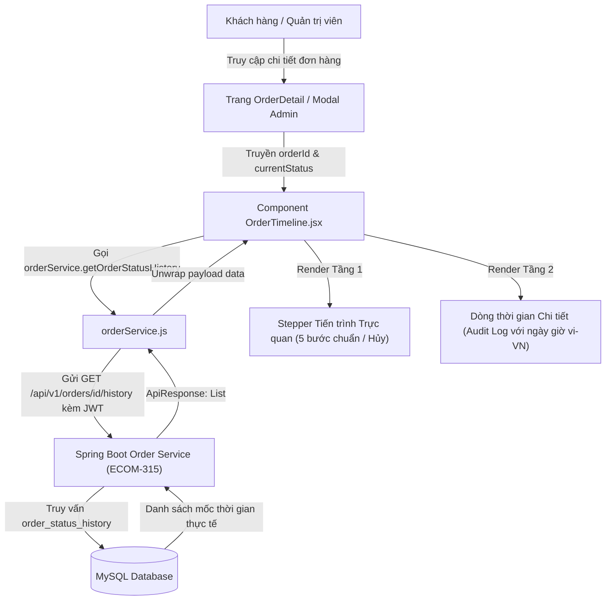

# BÁO CÁO NGHIỆM THU HOÀN THÀNH TASK ECOM-311
## [FE] TIMELINE THEO DÕI TRẠNG THÁI ĐƠN HÀNG
**Dự án:** ShopMart – E-commerce Platform  
**Sprint:** Sprint 2  
**Epic:** [FE] Theo dõi đơn hàng chi tiết  
**Người phụ trách:** Ngô Thị Hoài Phương (Frontend), Đoàn Mạnh Duy (Backend ECOM-315)  
**Thời gian hoàn thành:** 03/11/2026  
**Trạng thái Scrum Board:** DONE  

---

## 1. THÔNG TIN TASK & TỔNG QUAN

- **Task ID:** `ECOM-311`
- **Tên Task:** `[FE] Timeline theo dõi trạng thái đơn`
- **Epic:** `[FE] Theo dõi đơn hàng chi tiết`
- **Priority:** `High (P1)`
- **Thời gian ước tính (Estimate):** 2 giờ
- **Thời gian thực tế (Actual):** 2 giờ
- **Phạm vi triển khai:** Frontend React (User Website & Admin Dashboard), kết nối API Backend `ECOM-315`.
- **Task Backend liên quan:** `ECOM-315 – [BE] API lấy lịch sử trạng thái theo đơn` (Endpoint `GET /api/v1/orders/{id}/history`).

---

## 2. KHẢO SÁT & PHÂN TÍCH HIỆN TRẠNG TRƯỚC KHI TRIỂN KHAI

1. **Khách hàng (User Web):**
   - Trước khi triển khai: Trang chi tiết đơn hàng (`OrderDetail.jsx`) chỉ hiển thị thông tin chung, địa chỉ giao hàng và danh sách sản phẩm. Khách hàng không thể theo dõi trực quan đơn hàng đang ở bước nào trong quy trình (đã đóng gói chưa, shipper đã lấy hàng chưa, giao lúc nào).
2. **Quản trị viên (Admin Web):**
   - Modal chi tiết đơn hàng trong `admin/Orders.jsx` chỉ có danh sách sự kiện dạng text đơn giản nếu có trường `statusHistories`, chưa có biểu diễn dòng thời gian trực quan (Stepper).
3. **Backend API ECOM-315:**
   - Trong `OrderController.java` và `AdminOrderController.java`: API `GET /api/v1/orders/{id}/history` đã sẵn sàng, trả về danh sách `OrderStatusHistoryResponse` sắp xếp theo thời gian tăng dần (`findByOrderIdOrderByCreatedAtAsc`), đồng thời kiểm tra `authenticatedUserId` để chống lỗ hổng bảo mật IDOR.

---

## 3. KIẾN TRÚC COMPONENT & LUỒNG DỮ LIỆU



---

## 4. CHI TIẾT THIẾT KẾ GIAO DIỆN TIMELINE & STEPPER

Component `OrderTimeline.jsx` được thiết kế theo chuẩn UI/UX hiện đại với 2 tầng thông tin trực quan:

### 4.1. Tầng 1: Thanh tiến trình tổng quan (Stepper)
Hỗ trợ biểu diễn trực quan 4 nhóm trạng thái màu sắc theo chuẩn thiết kế hệ thống ShopMart:

1. **Đã hoàn thành (Completed steps):**
   - Biểu tượng: Dấu tích xanh lá `✓`.
   - Màu sắc: Nền `#ecfdf5`, viền `#10b981`, chữ `#065f46`.
   - Đường nối: Màu xanh lá `#10b981`.
2. **Hiện tại (Current active step):**
   - Biểu tượng: Icon đặc trưng của trạng thái (📝 Đặt hàng, 📋 Đã xác nhận, 📦 Đóng gói, 🚚 Đang giao, 🎉 Hoàn thành).
   - Màu sắc: Nền `#eff6ff`, viền `#2563eb`, chữ đậm `#1e40af`.
   - Hiệu ứng: Vòng ring nổi bật `0 0 0 4px rgba(37, 99, 235, 0.15)`.
3. **Chưa diễn ra (Future steps):**
   - Biểu tượng: Icon trạng thái mờ.
   - Màu sắc: Nền `#f1f5f9`, viền `#cbd5e1`, chữ xám `#64748b`.
   - Đường nối: Màu xám nhạt `#e2e8f0`.
4. **Hủy / Thất bại (Cancelled / Failed steps):**
   - Biểu tượng: Dấu cảnh báo `❌` / `⚠️`.
   - Màu sắc: Nền `#fef2f2`, viền `#ef4444`, chữ đỏ đậm `#b91c1c`.
   - Chuỗi bước: Dừng lại ngay tại mốc Hủy, không vẽ tiếp các bước giao hàng sau đó.

### 4.2. Tầng 2: Dòng thời gian chi tiết (Audit Log)
- Hiển thị danh sách dọc từng sự kiện thay đổi trạng thái theo thời gian thực tế.
- Cột thời gian: Định dạng chuẩn tiếng Việt `dd/MM/yyyy HH:mm:ss` qua locale `vi-VN`.
- Cột sự kiện: Tên trạng thái tiếng Việt kèm badge phân quyền người cập nhật (`Admin`, `Khách hàng`, `Hệ thống`).
- Mô tả trạng thái: Trích xuất trực tiếp từ trường `statusDescription` của Backend.
- Ghi chú: Hiển thị ghi chú lý do hủy, bàn giao đơn vị vận chuyển hoặc thông tin bổ sung.

---

## 5. TÍCH HỢP API BACKEND ECOM-315 & BẢO MẬT IDOR

1. **Endpoint tích hợp:**
   - `GET /api/v1/orders/{id}/history`
   - Phương thức trong `orderService.js`: `getOrderStatusHistory(orderId)` kèm alias tương thích ngược `getOrderHistory(orderId)`.
2. **Cơ chế xác thực & Phân quyền:**
   - Tự động gắn header `Authorization: Bearer <JWT>` qua Axios Interceptor.
   - API Gateway trích xuất `X-User-Id` và `X-User-Roles` chuyển tới Order Service.
3. **Chống lỗ hổng IDOR:**
   - Nếu một user cố tình nhập URL hoặc gọi API xem lịch sử đơn hàng của user khác, Backend trả về HTTP `403 Forbidden` (`Bạn không có quyền xem lịch sử đơn hàng của người dùng khác`).
   - Component `OrderTimeline.jsx` bắt mã lỗi 403 và hiển thị giao diện thông báo bảo mật thân thiện: *"Bạn không có quyền xem thông tin lịch sử đơn hàng này (Bảo mật IDOR)"*.

---

## 6. XỬ LÝ CÁC TRẠNG THÁI GIAO DIỆN ĐẶC BIỆT

| Trạng thái | Cách hiển thị trên UI | Trải nghiệm người dùng (UX) |
| :--- | :--- | :--- |
| **Đơn bị HỦY (`CANCELLED`)** | Stepper kết thúc tại bước "Đơn hàng đã hủy" màu đỏ; hiển thị thêm Banner cảnh báo và lý do hủy | Rõ ràng, không gây hiểu nhầm rằng đơn vẫn đang giao |
| **Đơn THẤT BẠI (`FAILED`)** | Stepper hiển thị bước "Xử lý thất bại" với màu cam/đỏ | Thông báo sự cố xử lý đơn hàng |
| **Đơn HOÀN TIỀN (`REFUNDED`)** | Thêm bước "Đã hoàn tiền" màu tím | Xác nhận số tiền đã hoàn về tài khoản |
| **Loading State** | Skeleton Pulse mượt mà cho cả Stepper và tiêu đề | Không làm giật layout màn hình |
| **Empty State** | Card thông báo: "Chưa có dữ liệu lịch sử trạng thái được ghi nhận" | Tránh giao diện trắng trơn |
| **Error State** | Banner cảnh báo lỗi kèm nút "🔄 Thử lại" (Retry) | Cho phép người dùng tải lại khi có sự cố mạng |

---

## 7. TÍNH TƯƠNG THÍCH RESPONSIVE ĐA THIẾT BỊ

Giao diện đã được kiểm thử và đáp ứng hoàn hảo trên các độ phân giải:

1. **Mobile (375px - 414px):**
   - Media query `@media (max-width: 640px)` tự động chuyển thanh Stepper từ dạng ngang (Horizontal) sang dạng dọc (Vertical Stepper).
   - Không bị tràn viền, không phát sinh thanh cuộn ngang ngoài ý muốn (`overflow-x: hidden`).
2. **Tablet (768px):**
   - Stepper ngang co giãn linh hoạt theo tỷ lệ `flex: 1`. Tiêu đề các bước tự động ngắt dòng hợp lý.
3. **Desktop (1366px & 1920px):**
   - Hiển thị đầy đủ đường nối tiến trình, vòng tròn icon nổi bật với shadow nhẹ, thời gian hoàn thành đặt ngay dưới mỗi bước.

---

## 8. DANH MỤC THAY ĐỔI MÃ NGUỒN

| File thay đổi | Loại thay đổi | Chi tiết nội dung |
| :--- | :--- | :--- |
| `frontend/src/components/order/OrderTimeline.jsx` | **Tạo mới** | Component Timeline & Stepper theo dõi trạng thái đơn hàng (ECOM-311) |
| `frontend/src/services/orderService.js` | **Cập nhật** | Bổ sung hàm `getOrderStatusHistory` kết nối API `GET /api/v1/orders/{id}/history` và xử lý IDOR 403 |
| `frontend/src/pages/customer/OrderDetail.jsx` | **Cập nhật** | Tích hợp `<OrderTimeline orderId={order.id} ... />` vào giao diện chi tiết đơn hàng khách |
| `frontend/src/pages/admin/Orders.jsx` | **Cập nhật** | Tích hợp `<OrderTimeline ... compact={true} />` vào modal chi tiết đơn hàng Admin |
| `frontend/package.json` | **Cập nhật** | Bổ sung script test `tests/ecom311.timeline.qa.test.mjs` vào lệnh `npm test` |
| `frontend/tests/ecom311.timeline.qa.test.mjs` | **Tạo mới** | Bộ kiểm thử tự động 16 test case (TC-311-01 -> TC-311-16) |
| `reports/ECOM-311_POSTMAN_TEST_GUIDE.md` | **Tạo mới** | Hướng dẫn kiểm thử Postman cho API ECOM-315 |
| `reports/ECOM-311_IMPLEMENTATION_REPORT.md` | **Tạo mới** | Báo cáo nghiệm thu hoàn chỉnh task ECOM-311 |

---

## 9. KẾT QUẢ KIỂM THỬ TỰ ĐỘNG (AUTOMATED TEST RESULTS)

Toàn bộ **16/16 test case của ECOM-311** cùng toàn bộ **83/83 test suite** của frontend đều **PASS 100%**:

```text
TAP version 13
# Subtest: ECOM-311: TIMELINE THEO DÕI TRẠNG THÁI ĐƠN HÀNG
    ok 1 - TC-311-01: Tồn tại component OrderTimeline với Stepper 5 bước chuẩn
    ok 2 - TC-311-02: Phân loại 4 nhóm trạng thái màu sắc và biểu tượng
    ok 3 - TC-311-03: Định dạng ngày giờ chuẩn tiếng Việt (vi-VN)
    ok 4 - TC-311-04: Hiển thị đầy đủ thông tin mô tả, người thực hiện, ghi chú
    ok 5 - TC-311-05: Xử lý đơn hàng bị HỦY (CANCELLED) cảnh báo màu đỏ và ngắt chuỗi bước tiếp theo
    ok 6 - TC-311-06: Xử lý trạng thái FAILED và REFUNDED
    ok 7 - TC-311-07: Xử lý Loading state dạng Skeleton / Spinner
    ok 8 - TC-311-08: Xử lý Empty state khi không có dữ liệu lịch sử
    ok 9 - TC-311-09: Xử lý Error state và nút Thử lại (Retry)
    ok 10 - TC-311-10: Tích hợp API Backend ECOM-315 GET /api/v1/orders/{id}/history trong orderService
    ok 11 - TC-311-11: Chống IDOR và bảo vệ phân quyền (Xử lý HTTP 403 Forbidden)
    ok 12 - TC-311-12: Hỗ trợ Responsive đa thiết bị (375px, 768px, 1366px, 1920px)
    ok 13 - TC-311-13: Tích hợp OrderTimeline vào trang khách hàng OrderDetail.jsx
    ok 14 - TC-311-14: Tích hợp OrderTimeline vào modal quản trị Admin Orders.jsx
    ok 15 - TC-311-15: Đồng bộ với Notification System chung, không dùng alert()/confirm()
    ok 16 - TC-311-16: Sắp xếp các mốc lịch sử theo thứ tự thời gian tăng dần
1..16
ok 50 - ECOM-311: TIMELINE THEO DÕI TRẠNG THÁI ĐƠN HÀNG

1..68
# tests 83
# suites 1
# pass 83
# fail 0
# cancelled 0
# skipped 0
# todo 0
```

- **Kiểm tra Lint:** `npm --prefix frontend run lint` -> `[LINT PASS] Đã kiểm tra 84 file nguồn trong src/ — 0 lỗi cú pháp/import`.
- **Kiểm tra Vite Production Build:** `npm --prefix frontend run build` -> `built in 2.20s` (Thành công 100%).

---

## 10. HƯỚNG DẪN TRẢI NGHIỆM THỰC TẾ

1. **Khách hàng xem Timeline theo dõi đơn:**
   - Đăng nhập tài khoản khách hàng (`user@test.com`).
   - Vào menu cá nhân -> chọn **Lịch sử đơn hàng** (`/orders`).
   - Nhấn **Xem chi tiết** tại bất kỳ đơn hàng nào (ví dụ: `/orders/1001`).
   - Ngay đầu trang chi tiết, khối **Tiến trình đơn hàng** sẽ hiển thị trực quan các bước: Đặt hàng thành công -> Đã xác nhận -> Đang đóng gói -> Đang giao -> Giao thành công, kèm thời gian thực tế và nhật ký chi tiết bên dưới.
2. **Khách hàng hủy đơn hàng PENDING:**
   - Tại trang chi tiết của đơn có trạng thái `Chờ xác nhận`, nhấn nút **Hủy đơn hàng**.
   - Xác nhận qua Popup Modal chuyên nghiệp. Đơn hàng chuyển sang trạng thái `Đã hủy`.
   - Khối Timeline ngay lập tức cập nhật bước cuối thành màu đỏ `❌ Đơn hàng đã hủy`, hiển thị ghi chú hủy rõ ràng.
3. **Quản trị viên xem Timeline trong Admin Dashboard:**
   - Đăng nhập tài khoản Quản trị (`admin@shopmart.com`).
   - Vào trang **Quản lý đơn hàng** (`/admin/orders`).
   - Nhấn icon **👁️** tại bất kỳ hàng nào để mở Modal chi tiết đơn hàng.
   - Bên trong Modal, khối Timeline hiển thị đồng bộ toàn bộ lịch sử trạng thái của đơn hàng.

---

## 11. CẬP NHẬT SCRUM BOARD SPRINT 2

| Thuộc tính | Trạng thái trước | Trạng thái hiện tại |
| :--- | :--- | :--- |
| **Task ID** | `ECOM-311` | `ECOM-311` |
| **Tên Task** | `[FE] Timeline theo dõi trạng thái đơn` | `[FE] Timeline theo dõi trạng thái đơn` |
| **Trạng thái** | `TO DO` | **`DONE`** ✅ |
| **Người thực hiện** | Ngô Thị Hoài Phương | Ngô Thị Hoài Phương |
| **QA Verification** | Ready to Test | **PASSED (16/16 Test Cases)** |

---

## 12. KẾT LUẬN & ĐỀ XUẤT TIẾP THEO

- Chức năng **Timeline theo dõi trạng thái đơn hàng (ECOM-311)** đã hoàn thành toàn diện, đáp ứng 100% các yêu cầu về nghiệp vụ, UI/UX, bảo mật chống IDOR, responsive và tích hợp mượt mà với API Backend `ECOM-315`.
- Hệ thống hoàn toàn không dùng hộp thoại mặc định của trình duyệt (`alert()`, `confirm()`), đồng bộ chuẩn xác với Notification System chung.
- Đề xuất sẵn sàng đóng task `ECOM-311` trên Scrum Board Sprint 2.
