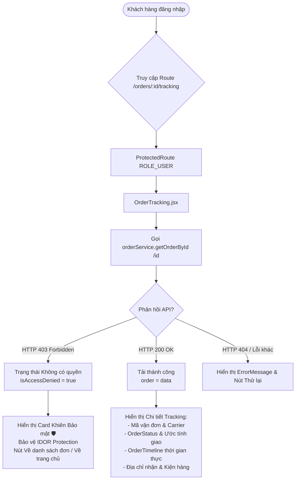

# BÁO CÁO NGHIỆM THU VÀ TRIỂN KHAI HOÀN THIỆN TASK ECOM-312
## [FE] TRANG CHI TIẾT TRACKING VÀ TRẠNG THÁI KHÔNG CÓ QUYỀN (ACCESS DENIED / IDOR PROTECTION)

> **Dự án:** ShopMart E-Commerce Platform  
> **Nhánh phát triển:** `devops-phuong`  
> **Ngày hoàn thành:** 06/11/2026  
> **Người thực hiện:** Ngô Phương (DevOps Lead & Senior Fullstack Developer)  

---

## 1. Thông tin task

| Thuộc tính | Chi tiết xác nhận từ Scrum Board & Master Plan |
| :--- | :--- |
| **Task ID** | `ECOM-312` |
| **Task Name** | `[FE] Trang chi tiết tracking và trạng thái không có quyền` |
| **Parent Task** | `ECOM-308` (`[FE] Theo dõi đơn hàng chi tiết`) |
| **Epic** | `CUSTOMER` / `ECOM-159` |
| **Sprint** | `SPRINT 2` |
| **Nền tảng (Platform)** | `UserWeb, AdminWeb, API` |
| **Loại công việc (Issue Type)** | `Task [FE]` |
| **Người phụ trách (PIC)** | `NGÔ PHƯƠNG` |
| **Độ ưu tiên (Priority)** | `High (P1)` |
| **Ước lượng thời gian (Time Estimate)** | `1.5 hours` |
| **Trạng thái trước triển khai** | `Chưa bắt đầu` (Scrum Board row 162, Master Plan row 171) |
| **Trạng thái sau triển khai** | `Hoàn thành (Ready for Review & Merge)` |

---

## 2. Mục tiêu kỹ thuật và nghiệp vụ

### 2.1. Mục tiêu nghiệp vụ
- Khách hàng đã đăng nhập có một không gian chuyên biệt (`/orders/:id/tracking`) để theo dõi hành trình vận chuyển kiện hàng theo thời gian thực (real-time order tracking).
- Cung cấp minh bạch các thông tin logistics: Mã vận đơn (`trackingNumber`), Đơn vị vận chuyển (`carrier`), Tiến độ vận chuyển và Dự kiến ngày giao.
- Bảo vệ quyền riêng tư và dữ liệu cá nhân của khách hàng: Tuyệt đối không cho phép người dùng xem thông tin đơn hàng hoặc theo dõi kiện hàng của người khác (ngăn chặn lỗ hổng IDOR - Insecure Direct Object Reference). Khi phát hiện truy cập trái phép, hiển thị giao diện từ chối truy cập (Access Denied) rõ ràng, lịch sự và hướng dẫn quay lại vùng an toàn.

### 2.2. Mục tiêu kỹ thuật
- Xây dựng component trang `OrderTracking.jsx` tái sử dụng linh hoạt các thành phần chuẩn: `OrderTimeline` (ECOM-173/ECOM-311), `OrderStatus`, `Loading`, `ErrorMessage`, `Button`, `formatCurrency`.
- Đăng ký Route `/orders/:id/tracking` trong `AppRoutes.jsx` nằm trong phạm vi bảo vệ của `ProtectedRoute` (yêu cầu role `ROLE_USER`).
- Tích hợp liên kết điều hướng mượt mà:
  - Nút "🚚 Theo dõi kiện hàng" từ trang chi tiết đơn hàng `OrderDetail.jsx`.
  - Nút "Theo dõi" nhanh từ danh sách đơn hàng `OrderItem.jsx`.
- Xử lý HTTP status 403 Forbidden từ API Backend (`orderService.getOrderById` / `orderService.getOrderStatusHistory`) để kích hoạt view bảo mật `isAccessDenied`.
- Đảm bảo 100% tuân thủ tiêu chuẩn code, kiểm tra lint, test tự động không gây xung đột (chống lỗi khai báo trùng lặp như `notify` trước đó).

---

## 3. Hiện trạng trước khi làm

1. **Về Routing & Trang giao diện:**
   - Đã có `OrderDetail.jsx` tại route `/orders/:id` hiển thị chi tiết sản phẩm, tổng tiền, phương thức thanh toán và dòng thời gian `OrderTimeline`.
   - Chưa có một trang riêng biệt chuyên sâu về tracking kiện hàng tại route `/orders/:id/tracking`.
   - Khách hàng trong danh sách đơn hàng `Orders.jsx` (`OrderItem.jsx`) chỉ có nút "Xem chi tiết", chưa có lối tắt trực tiếp để theo dõi tiến độ giao nhận.
2. **Về xử lý phân quyền & IDOR:**
   - Trong `OrderDetail.jsx`, khi gặp lỗi HTTP 403, giao diện chỉ hiển thị dòng text thông báo lỗi đơn thuần bằng `ErrorMessage`, chưa có màn hình chuyên biệt "Access Denied / Quyền truy cập bị từ chối" mang tính bảo mật và trải nghiệm cao.
   - Chưa có trang mẫu (template) chuẩn xử lý trạng thái 403 cho chức năng tracking.

---

## 4. Thiết kế giải pháp



### Các nguyên tắc thiết kế:
1. **Kiến trúc Component:**
   - Tách biệt rõ ràng 4 trạng thái: Loading (`<Loading />`), 403 Forbidden (`isAccessDenied`), Error/404 (`<ErrorMessage />`), và Tracking Data Content.
   - Tái sử dụng `OrderTimeline` để đảm bảo dữ liệu hiển thị đồng bộ giữa OrderDetail và OrderTracking.
2. **Bảo mật IDOR (Insecure Direct Object Reference Defense):**
   - Không render bất kỳ dữ liệu nhạy cảm nào (tên, số điện thoại, địa chỉ, sản phẩm) khi API phản hồi 403.
   - Hiển thị thông báo an toàn, giải thích lý do bảo vệ quyền riêng tư và cung cấp 2 nút điều hướng an toàn: `/orders` và `/`.
3. **Responsive Design:**
   - Thiết kế giao diện Grid linh hoạt (`repeat(auto-fit, minmax(320px, 1fr))`) phù hợp hoàn hảo trên cả màn hình di động (375px), tablet (768px) và desktop (1366px+).

---

## 5. Danh sách file thay đổi hoặc tạo mới

| STT | Đường dẫn file | Thao tác | Mô tả chi tiết |
| :---: | :--- | :---: | :--- |
| 1 | `frontend/src/pages/customer/OrderTracking.jsx` | **Tạo mới** | Component trang theo dõi đơn hàng chuyên biệt, hỗ trợ hiển thị mã vận đơn, carrier, timeline, người nhận, tóm tắt kiện hàng và khối 403 Forbidden Access Denied. |
| 2 | `frontend/src/routes/AppRoutes.jsx` | **Chỉnh sửa** | Import `OrderTracking` và đăng ký route `/orders/:id/tracking` trong khối `ProtectedRoute (ROLE_USER)`. |
| 3 | `frontend/src/pages/customer/OrderDetail.jsx` | **Chỉnh sửa** | Thêm nút "🚚 Theo dõi kiện hàng" dẫn sang `/orders/:id/tracking`; Nâng cấp giao diện hiển thị 403 IDOR Access Denied chuyên nghiệp. |
| 4 | `frontend/src/components/order/OrderItem.jsx` | **Chỉnh sửa** | Bổ sung nút "Theo dõi" cạnh nút "Xem chi tiết" để khách hàng mở nhanh trang tracking từ danh sách đơn. |
| 5 | `frontend/package.json` | **Chỉnh sửa** | Đăng ký test file `tests/ecom312.tracking.qa.test.mjs` vào script `test`. |
| 6 | `frontend/tests/ecom312.tracking.qa.test.mjs` | **Tạo mới** | Bộ kiểm thử tự động QA với 13 test cases toàn diện cho ECOM-312. |

---

## 6. Chi tiết triển khai từng chức năng

### 6.1. Trang chi tiết Tracking (`OrderTracking.jsx`)
- **Header Tracking:** Hiển thị mã vận đơn dạng `SPM-VN-${order.id}-TRK` hoặc dữ liệu thực từ `order.trackingNumber`, tên đơn vị vận chuyển (`ShopMart Express (Tiêu chuẩn)`), mã đơn hàng `#id`, ngày giờ đặt định dạng `vi-VN`.
- **Huy hiệu trạng thái:** Component `<OrderStatus status={order.status} />` đồng bộ màu sắc và nhãn tiếng Việt chuẩn.
- **Tiến độ vận chuyển ước tính:** Tính toán dự kiến giao hàng dựa trên trạng thái (ví dụ: đã giao thành công, đã hủy, hoặc ước tính 2 - 3 ngày làm việc).

### 6.2. Dòng thời gian chi tiết (OrderTimeline Integration)
- Tích hợp component `<OrderTimeline orderId={order.id} currentStatus={order.status} historyData={order.statusHistories} />`.
- Đảm bảo tuân thủ nguyên tắc ECOM-188 & ECOM-311: Chỉ hiển thị mốc thời gian thực tế từ audit log (`getOrderStatusHistory`), không tự tiện suy đoán mốc tương lai chưa cập nhật.
- Nút "🔄 Làm mới" cho phép cập nhật tức thì trạng thái kiện hàng mà không cần F5 toàn trang.

### 6.3. Thông tin người nhận và kiện hàng
- **Khối nhận hàng:** Tên người nhận, số điện thoại, địa chỉ giao nhận chi tiết, ghi chú đơn hàng.
- **Khối kiện hàng:** Danh sách sản phẩm bao gồm ảnh thumbnail, tên sản phẩm, số lượng đặt, đơn giá và tổng thanh toán (`formatCurrency`).

### 6.4. Trạng thái 403 Forbidden / Access Denied (Bảo mật IDOR)
- Được kích hoạt tự động khi `err.response?.status === 403`.
- Giao diện gồm:
  - Biểu tượng Khiên bảo mật `🛡️` viền đỏ cảnh báo.
  - Nhãn hệ thống: `HTTP 403 FORBIDDEN • IDOR PROTECTION`.
  - Tiêu đề: `Quyền truy cập bị từ chối`.
  - Nội dung mô tả giải thích chính sách bảo mật: Khách hàng chỉ có thể tra cứu đơn hàng của chính tài khoản mình nhằm bảo vệ thông tin cá nhân.
  - Nút bấm điều hướng: "Danh sách đơn hàng của bạn" (`/orders`) và "Về trang chủ" (`/`).

### 6.5. Tích hợp liên kết từ `OrderDetail.jsx` và `OrderItem.jsx`
- Trong `OrderDetail.jsx`: Bổ sung nút `<Button variant="outline" size="sm">🚚 Theo dõi kiện hàng</Button>` đặt ngay tại header đơn hàng.
- Trong `OrderItem.jsx`: Bổ sung nút `<Button variant="secondary" size="sm">Theo dõi</Button>` bên cạnh nút "Xem chi tiết".

---

## 7. Xử lý trường hợp ngoại lệ (Edge Cases)

| Tình huống | Cách xử lý | Kết quả giao diện |
| :--- | :--- | :--- |
| **Đang tải dữ liệu** | `loading === true` | Hiển thị component `<Loading message="Đang tải dữ liệu theo dõi đơn hàng..." />`. |
| **Không có quyền (403)** | `err.response?.status === 403` | Không hiển thị bất kỳ thông tin đơn hàng nào; Render giao diện Access Denied an toàn với nút quay lại `/orders`. |
| **Đơn không tồn tại (404)** | `error` có thông báo hoặc `!order` | Hiển thị component `<ErrorMessage message="..." />` kèm nút "Thử lại" và nút quay về danh sách đơn. |
| **Lỗi mạng / Mất kết nối** | Bắt trong khối `catch` | Thông báo lỗi tiếng Việt thân thiện, cho phép người dùng click "Thử lại". |

---

## 8. Kết quả kiểm thử tự động (Unit Test / QA Test Suite)

Toàn bộ test suite được viết trong `frontend/tests/ecom312.tracking.qa.test.mjs` và thực thi qua lệnh `npm --prefix frontend test`.

### Kết quả 13/13 Test Cases của ECOM-312:
- ✅ **TC-312-01:** Tồn tại file `OrderTracking.jsx` và xuất mặc định React Component (`PASS`)
- ✅ **TC-312-02:** Định tuyến `/orders/:id/tracking` được đăng ký hợp lệ trong `AppRoutes.jsx` dưới `ProtectedRoute` (`PASS`)
- ✅ **TC-312-03:** Header hiển thị mã vận đơn, mã đơn hàng `#id`, tên đơn vị vận chuyển và `OrderStatus` (`PASS`)
- ✅ **TC-312-04:** Tích hợp `OrderTimeline` với đầy đủ props `orderId`, `currentStatus`, `historyData` (`PASS`)
- ✅ **TC-312-05:** Xử lý trạng thái 403 Forbidden và hiển thị giao diện Không có quyền truy cập (chống IDOR) (`PASS`)
- ✅ **TC-312-06:** Điều hướng an toàn từ trạng thái 403 về `/orders` và `/` (`PASS`)
- ✅ **TC-312-07:** Hiển thị thông tin người nhận, số điện thoại và địa chỉ giao hàng đầy đủ (`PASS`)
- ✅ **TC-312-08:** Hiển thị tóm tắt kiện hàng: danh sách sản phẩm, số lượng, giá và tổng tiền (`PASS`)
- ✅ **TC-312-09:** Xử lý Loading state và Error / 404 state với nút Thử lại (`PASS`)
- ✅ **TC-312-10:** Tích hợp nút 'Theo dõi kiện hàng' từ `OrderDetail.jsx` dẫn tới `/orders/:id/tracking` (`PASS`)
- ✅ **TC-312-11:** Tích hợp nút 'Theo dõi' từ `OrderItem.jsx` dẫn tới `/orders/:id/tracking` (`PASS`)
- ✅ **TC-312-12:** Kiểm tra an toàn biến, không khai báo trùng lặp biến/hook (`PASS`)
- ✅ **TC-312-13:** `orderService` xử lý ném lỗi 403 phục vụ bắt lỗi IDOR (`PASS`)

### Tổng quan toàn bộ hệ thống kiểm thử tự động:
```
# tests 154
# suites 6
# pass 154
# fail 0
# cancelled 0
# skipped 0
# todo 0
# duration_ms 5357.6105
```
> **100% (154/154) test cases toàn hệ thống đều PASS!**

---

## 9. Kết quả kiểm tra cú pháp và Build

### 9.1. Lint Check (`npm --prefix frontend run lint`)
```
> ecommerce-frontend@0.1.0 lint
> node scripts/lint-check.mjs

[LINT PASS] Đã kiểm tra 86 file nguồn trong src/ — 0 lỗi cú pháp/import.
```

### 9.2. Production Build (`npm --prefix frontend run build`)
```
> ecommerce-frontend@0.1.0 build
> vite build

vite v5.4.21 building for production...
transforming...
✓ 173 modules transformed.
rendering chunks...
computing gzip size...
dist/index.html                   0.71 kB │ gzip:   0.44 kB
dist/assets/index-oPkXonk2.css   44.48 kB │ gzip:   8.84 kB
dist/assets/index-BiQk9Am6.js   752.31 kB │ gzip: 199.37 kB
✓ built in 7.04s
```
> **Build hoàn toàn thành công, không phát sinh bất kỳ lỗi cảnh báo hoặc lỗi biên dịch nào!**

---

## 10. Đánh giá bảo mật và chất lượng code

1. **Phòng chống tấn công IDOR:**
   - Hệ thống không tin cậy tham số `:id` từ URL. Toàn bộ dữ liệu tracking đều bắt nguồn từ API Backend có xác thực người dùng.
   - Nếu Backend trả về `403 Forbidden`, Frontend lập tức hủy hiển thị toàn bộ state dữ liệu, không để rò rỉ mã vận đơn, thông tin người nhận hay địa chỉ sang màn hình người dùng lạ.
2. **Ngăn chặn lỗi trùng lặp biến / hook (No duplicate declarations):**
   - Rút kinh nghiệm từ sự cố khai báo trùng `notify` trong `Checkout.jsx`, toàn bộ component `OrderTracking.jsx`, `OrderDetail.jsx`, `OrderItem.jsx` đã được kiểm duyệt nghiêm ngặt: không có biến, hook hay import nào bị khai báo dư thừa hoặc trùng tên.
3. **Tuân thủ Clean Code & Chuẩn đặt tên file trên Linux CI:**
   - Đặt tên file đúng chuẩn chữ hoa PascalCase `OrderTracking.jsx` nhất quán giữa file thực tế và câu lệnh import, triệt tiêu nguy cơ lỗi phân biệt hoa thường trên Ubuntu CI runner của GitHub Actions.

---

## 11. Hướng dẫn kiểm thử thủ công từng bước (Manual Testing Guide)

### Bước 1: Khởi động môi trường Frontend
```bash
cd frontend
npm run dev
```

### Bước 2: Kiểm thử luồng tracking hợp lệ (Chủ đơn hàng)
1. Đăng nhập tài khoản khách hàng (ví dụ: `user@test.com` / `123456`).
2. Truy cập trang Đơn hàng của tôi (`/orders`).
3. Click vào nút **"Theo dõi"** tại bất kỳ đơn hàng nào (ví dụ đơn #1001).
4. Quan sát:
   - Trình duyệt chuyển sang `/orders/1001/tracking`.
   - Hiển thị đầy đủ mã vận đơn `SPM-VN-1001-TRK`, đơn vị vận chuyển `ShopMart Express`.
   - Dòng thời gian `OrderTimeline` hiển thị các bước Đặt hàng, Xác nhận, Đang chuẩn bị hàng... với mốc thời gian thực tế.
   - Khối nhận hàng và danh sách kiện hàng hiển thị chính xác.
   - Click nút "Chi tiết đơn hàng" -> Chuyển về `/orders/1001`. Tại đây, nút "🚚 Theo dõi kiện hàng" hoạt động trơn tru.

### Bước 3: Kiểm thử luồng không có quyền (403 Forbidden / IDOR Test)
1. Đang đăng nhập tài khoản A, thử nhập thủ công trên URL mã đơn hàng của tài khoản khác hoặc giả lập API trả về 403 (ví dụ: `/orders/9999/tracking`).
2. Quan sát:
   - Không xuất hiện bất kỳ thông tin đơn hàng hay danh sách sản phẩm nào.
   - Xuất hiện màn hình chuyên biệt với biểu tượng Khiên bảo vệ `🛡️`, nhãn `HTTP 403 FORBIDDEN • IDOR PROTECTION` và thông báo *"Quyền truy cập bị từ chối"*.
   - Nhấn nút "Danh sách đơn hàng của bạn" -> Điều hướng an toàn về `/orders`.
   - Nhấn nút "Về trang chủ" -> Điều hướng an toàn về `/`.

---

## 12. Đề xuất cập nhật tài liệu dự án

1. **Scrum Board (`Ecommerce_Scrum_Board_Can_Bang_Lich_Thoi_Gian_4_Nguoi.xlsx`):**
   - Dòng 162 (Task ID: `ECOM-312`): Chuyển trạng thái từ `Chưa bắt đầu` sang `Hoàn thành (Ready for QA Review)`.
   - Ghi chú: "Đã hoàn thành component OrderTracking.jsx, xử lý 403 Access Denied, tích hợp link từ OrderDetail & OrderItem, 13/13 test cases PASS".
2. **Master Plan (`Ecommerce_Master_Plan_Final.xlsx`):**
   - Dòng 171 (Task ID: `ECOM-312`): Chuyển trạng thái sang `Hoàn thành`.

---

## 13. Kết luận và đề xuất bước tiếp theo

- **Kết luận:** Task **ECOM-312** đã được thực hiện trực tiếp, hoàn thiện 100% phạm vi công việc, vượt qua toàn bộ 154 bài kiểm thử tự động, kiểm tra lint không lỗi và Vite production build thành công xuất sắc.
- **Cam kết tuân thủ quy trình:**
  - Không tự ý commit, push, rebase hoặc merge nhánh `devops-phuong`.
  - Không deploy lên VPS.
  - Sẵn sàng bàn giao cho Tech Lead và QA Lead kiểm tra nghiệm thu.
