# KỊCH BẢN TRÌNH DIỄN SẢN PHẨM LIVE DEMO MVP (11 BƯỚC)
## SHOPMART E-COMMERCE PLATFORM — MICROSERVICES SYSTEM
### Tài liệu Hướng dẫn Demo Nghiệm thu & Bảo vệ Đồ án — Sub-task ECOM-156 (thuộc ECOM-329)

---

## 1. THÔNG TIN CHUẨN BỊ TRƯỚC KHI DEMO

- **Địa chỉ truy cập giao diện (Frontend UI):** `http://localhost:5173` (hoặc `http://localhost` qua Nginx)
- **Cổng API Gateway:** `http://localhost:8080`
- **Eureka Service Registry:** `http://localhost:8761` (Tài khoản: `eureka` / `eurekapassword`)
- **Kafka UI:** `http://localhost:8090`
- **Tài khoản Khách hàng dùng thử:**
  - Email: `customer@shopmart.com`
  - Mật khẩu: `Customer@123`
- **Tài khoản Quản trị viên (Admin):**
  - Email: `admin@shopmart.com`
  - Mật khẩu: `Admin@123`

---

## 2. KỊCH BẢN 11 BƯỚC TRÌNH DIỄN CHI TIẾT

```mermaid
flowchart LR
    B1["Bước 1: Khởi động"] --> B2["Bước 2: Storefront"]
    B2 --> B3["Bước 3: Tìm kiếm"]
    B3 --> B4["Bước 4: Đăng nhập"]
    B4 --> B5["Bước 5: Giỏ hàng"]
    B5 --> B6["Bước 6: Checkout"]
    B6 --> B7["Bước 7: Tạo đơn"]
    B7 --> B8["Bước 8: Tracking"]
    B8 --> B9["Bước 9: Admin Login"]
    B9 --> B10["Bước 10: Duyệt đơn"]
    B10 --> B11["Bước 11: Kiểm tra DB"]
```



---

### BƯỚC 1: KHỞI ĐỘNG HỆ THỐNG VÀ KIỂM TRA SỨC KHỎE
- **Thao tác:**
  1. Mở terminal tại thư mục `backend/` và kiểm tra toàn bộ 12 containers đã sẵn sàng:
     ```bash
     docker compose ps
     ```
  2. Mở trình duyệt truy cập `http://localhost:8761` (Eureka Dashboard):
     - Xác nhận 5 microservices đã đăng ký thành công: `AUTH-SERVICE`, `PRODUCT-SERVICE`, `ORDER-SERVICE`, `PAYMENT-SERVICE`, `API-GATEWAY`.
- **Lời thuyết trình:**
  > *"Hệ thống ShopMart được triển khai theo kiến trúc Microservices phân tán. Tại Eureka Registry, chúng ta thấy toàn bộ 5 dịch vụ lõi đều đã đăng ký và gửi nhịp tim định kỳ. Toàn bộ request từ bên ngoài đều đi qua cổng tập trung API Gateway."*

---

### BƯỚC 2: GUEST TRUY CẬP STOREFRONT
- **Thao tác:**
  1. Mở trình duyệt ở chế độ ẩn danh (Incognito) truy cập `http://localhost:5173`.
  2. Quan sát trang chủ hiển thị:
     - Header chứa Logo ShopMart, thanh tìm kiếm, biểu tượng Giỏ hàng, nút Đăng nhập / Đăng ký.
     - Banner khuyến mãi và Lưới danh sách sản phẩm (Product Grid).
     - Mỗi thẻ sản phẩm hiển thị: Ảnh sắc nét, tên, giá bán định dạng VND (`xx.xxx.xxx đ`), số lượng tồn kho và nhãn trạng thái.
- **Lời thuyết trình:**
  > *"Đây là giao diện phía người dùng khách (Guest). Khách hàng có thể thoải mái xem danh mục, duyệt các sản phẩm mới nhất và phân trang mượt mà mà không bắt buộc phải đăng nhập."*

---

### BƯỚC 3: XEM VÀ TÌM KIẾM SẢN PHẨM
- **Thao tác:**
  1. Gõ từ khóa `"iPhone"` vào thanh tìm kiếm trên Header $\rightarrow$ Nhấn Enter.
  2. Danh sách sản phẩm lập tức lọc ra các sản phẩm iPhone tương ứng.
  3. Chọn bộ lọc danh mục `"Điện thoại"` $\rightarrow$ Danh sách cập nhật tự động và reset về trang 1.
  4. Nhấp vào sản phẩm `"iPhone 15 Pro Max 256GB"`:
     - Mở trang chi tiết sản phẩm `/products/1`.
     - Hiển thị mô tả sản phẩm, thông số kỹ thuật và số lượng tồn kho tức thời (gọi API `/api/v1/products/1/stock`).
- **Lời thuyết trình:**
  > *"Hệ thống hỗ trợ tìm kiếm full-text kết hợp bộ lọc danh mục và khoảng giá. Khi xem chi tiết sản phẩm, số lượng tồn kho được xác thực thời gian thực từ cơ sở dữ liệu để chống tình trạng đặt ảo."*

---

### BƯỚC 4: ĐĂNG KÝ VÀ ĐĂNG NHẬP
- **Thao tác:**
  1. Nhấn nút "Đăng nhập" trên Header $\rightarrow$ Chuyển đến `/login`.
  2. Nhập thông tin khách hàng:
     - Email: `customer@shopmart.com`
     - Mật khẩu: `Customer@123`
  3. Nhấn "Đăng nhập":
     - Hệ thống gọi API `POST /api/v1/auth/login`.
     - API Gateway cấp mã JWT Token lưu an toàn tại localStorage.
     - Header lập tức đổi trạng thái: Hiển thị tên người dùng `"Nguyen Van A"`, menu tài khoản và badge số lượng giỏ hàng.
- **Lời thuyết trình:**
  > *"Quá trình xác thực sử dụng chuẩn JSON Web Token mã hóa an toàn. Khi người dùng đăng nhập thành công, các request tiếp theo tự động đính kèm Bearer Token qua Axios interceptor."*

---

### BƯỚC 5: THÊM SẢN PHẨM VÀO GIỎ HÀNG
- **Thao tác:**
  1. Tại trang chi tiết sản phẩm, chọn số lượng = `1` $\rightarrow$ Nhấn "Thêm vào giỏ".
  2. Màn hình xuất hiện Toast Notification màu xanh: *"Đã thêm sản phẩm vào giỏ hàng thành công!"*.
  3. Nhấp vào biểu tượng Giỏ hàng trên Header $\rightarrow$ Chuyển đến `/cart`.
  4. Thao tác trên giỏ hàng:
     - Nhấn nút `+` để tăng số lượng lên `2` $\rightarrow$ Tổng tiền tạm tính tự động cập nhật theo VND.
     - Thử tăng vượt tồn kho $\rightarrow$ Nút tự động bị khóa để bảo vệ dữ liệu.
- **Lời thuyết trình:**
  > *"Giỏ hàng được quản lý tập trung tại `order-service`. Mọi thao tác tăng giảm số lượng đều được kiểm tra đối chiếu trực tiếp với tồn kho thực tế, bảo đảm khách hàng không thể đặt vượt quá số lượng hàng có trong kho."*

---

### BƯỚC 6: TIẾN HÀNH CHECKOUT (ĐẶT HÀNG)
- **Thao tác:**
  1. Tại trang Giỏ hàng, nhấn nút "Tiến hành thanh toán" $\rightarrow$ Điều hướng tới `/checkout`.
  2. Quan sát thông tin người nhận:
     - Hệ thống tự động điền: Họ tên, Số điện thoại và Địa chỉ nhận hàng từ sổ địa chỉ của tài khoản.
  3. Chọn phương thức thanh toán: `"Thanh toán khi nhận hàng (COD)"` hoặc `"Thanh toán trực tuyến mô phỏng (Online Mock)"`.
  4. Nhập ghi chú giao hàng: `"Giao hàng giờ hành chính"`.
- **Lời thuyết trình:**
  > *"Màn hình Checkout tối ưu trải nghiệm người dùng bằng cách tự động nạp thông tin giao hàng đã lưu, giảm thiểu thời gian thao tác cho khách hàng."*

---

### BƯỚC 7: TẠO ĐƠN HÀNG VÀ TRỪ TỒN KHO TỰ ĐỘNG
- **Thao tác:**
  1. Nhấn nút "Xác nhận đặt hàng":
     - Hệ thống gửi `POST /api/v1/orders/checkout`.
     - Transaction `@Transactional` trong `order-service` gọi OpenFeign sang `product-service` để trừ tồn kho.
     - Tạo bản ghi đơn hàng ở trạng thái `PENDING`.
  2. Giao diện chuyển hướng đến trang `/order-success` hiển thị Mã đơn hàng (`ORD-...`) và tóm tắt kiện hàng.
  3. Mở tab mới xem lại sản phẩm vừa mua $\rightarrow$ Tồn kho sản phẩm đã giảm đi đúng số lượng đã đặt.
- **Lời thuyết trình:**
  > *"Tại bước này, hệ thống áp dụng cơ chế giao dịch phân tán. Số lượng tồn kho tại Product Service được giữ và trừ ngay lập tức. Nếu có bất kỳ sự cố kết nối nào, toàn bộ giao dịch sẽ tự động Rollback nguyên vẹn."*

---

### BƯỚC 8: THEO DÕI ĐƠN HÀNG VÀ TIMELINE
- **Thao tác:**
  1. Từ menu tài khoản, chọn "Đơn hàng của tôi" $\rightarrow$ `/orders`.
  2. Nhấp vào đơn hàng vừa tạo để xem chi tiết `/orders/{id}`:
     - Thành phần `OrderTimeline` trực quan hiển thị 5 mốc: *Đã đặt hàng $\rightarrow$ Đã xác nhận $\rightarrow$ Đang chuẩn bị $\rightarrow$ Đang giao $\rightarrow$ Đã giao hàng*.
     - Mốc hiện tại *"Đã đặt hàng"* đang sáng đèn kèm hiệu ứng pulse và mốc thời gian chi tiết.
- **Lời thuyết trình:**
  > *"Khách hàng có thể theo dõi tiến độ xử lý đơn hàng theo thời gian thực. Mỗi khi đơn hàng chuyển giai đoạn, timeline sẽ cập nhật ngay lập tức."*

---

### BƯỚC 9: ADMIN ĐĂNG NHẬP HỆ THỐNG
- **Thao tác:**
  1. Mở cửa sổ trình duyệt khác (hoặc Đăng xuất tài khoản khách hàng).
  2. Đăng nhập tài khoản Quản trị viên:
     - Email: `admin@shopmart.com`
     - Mật khẩu: `Admin@123`
  3. Nhấn vào menu "Quản trị" trên Header $\rightarrow$ Chuyển đến `/admin/orders`.
- **Lời thuyết trình:**
  > *"Tài khoản Admin sở hữu quyền `ROLE_ADMIN`. API Gateway sẽ xác thực quyền hạn trước khi cho phép truy cập vào các tài nguyên quản trị đơn hàng và tồn kho."*

---

### BƯỚC 10: ADMIN QUẢN LÝ VÀ DUYỆT ĐƠN HÀNG
- **Thao tác:**
  1. Tại bảng danh sách đơn hàng Admin `/admin/orders`:
     - Nhìn thấy đơn hàng mới vừa được khách tạo ở trạng thái `PENDING`.
  2. Nhấn nút "Duyệt đơn" (hoặc chọn trạng thái `CONFIRMED`):
     - Hiển thị Modal xác nhận: *"Bạn có chắc chắn muốn duyệt đơn hàng ORD-...?"*.
     - Nhấn "Xác nhận".
  3. Hệ thống gửi `PUT /api/v1/admin/orders/{id}/status`:
     - Trạng thái đơn hàng chuyển sang `CONFIRMED`.
     - Tự động ghi nhận một dòng nhật ký audit log vào bảng `order_status_history`.
  4. Quay lại tab của Khách hàng $\rightarrow$ Trạng thái đơn hàng trên Timeline đã đồng bộ tức thì sang *"Đã xác nhận"*.
- **Lời thuyết trình:**
  > *"Quy trình duyệt đơn của Admin diễn ra chặt chẽ với modal xác nhận và cơ chế Audit Log minh bạch, lưu lại chính xác ai là người duyệt và vào thời điểm nào."*

---

### BƯỚC 11: KIỂM TRA DỮ LIỆU ĐƯỢC LƯU TRONG CƠ SỞ DỮ LIỆU
- **Thao tác:**
  1. Mở terminal kết nối vào MySQL container:
     ```bash
     docker exec -it ecommerce-mysql mysql -u root -prootpassword
     ```
  2. Truy vấn dữ liệu đơn hàng và audit log:
     ```sql
     USE order_db;
     SELECT id, order_code, user_id, status, total_amount, payment_method FROM orders ORDER BY id DESC LIMIT 1;
     SELECT order_id, status, previous_status, action, updated_by, actor_role, created_at FROM order_status_history ORDER BY id DESC LIMIT 2;
     ```
  3. Truy vấn dữ liệu tồn kho sản phẩm:
     ```sql
     USE product_db;
     SELECT id, name, stock FROM products WHERE id = 1;
     ```
  4. Hiển thị kết quả: Dữ liệu khớp 100% với các thao tác vừa thực hiện trên giao diện.
- **Lời thuyết trình:**
  > *"Như Hội đồng có thể quan sát trực tiếp trong cơ sở dữ liệu MySQL 8.0, đơn hàng đã được lưu trữ bền vững với mã định danh duy nhất, lịch sử trạng thái được kiểm toán đầy đủ, và tồn kho sản phẩm được đồng bộ chính xác. Buổi demo luồng nghiệp vụ MVP hoàn tất thành công 100%."*

---

## 3. KẾT LUẬN DEMO

Kịch bản 11 bước trên phản ánh 100% chức năng thực tế của hệ thống ShopMart. Toàn bộ các thao tác đều diễn ra trơn tru, không có lỗi phát sinh và dữ liệu nhất quán xuyên suốt từ Frontend, qua API Gateway, đến các Microservices và Cơ sở dữ liệu.
