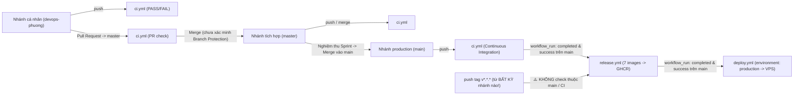
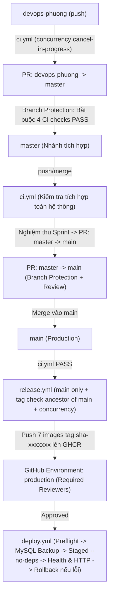

# SHOPMART – AUDIT CI/CD BRANCH STRATEGY

- **Ngày audit**: 2026-11-18
- **Repository**: `C:\IT209\-E-COMMERCE-PLATFORM`
- **Nhánh đang kiểm tra**: `devops-phuong` (`786a1a8`, có các thay đổi chưa commit trong working tree)
- **Trạng thái nhánh remote quan sát được**:
  - `origin/devops-phuong`: `786a1a8`
  - `origin/master`: `81fd223` (`Merge pull request #68 from Duy18ND/devops-phuong`)
  - `origin/main`: `e478368` (`Merge pull request #69 from Duy18ND/master`)
- **Phạm vi**: Chỉ audit (không sửa workflow/Compose, không commit/push/merge/deploy VPS).

---

## 1. Tổng quan quy trình CI/CD hiện tại

Hệ thống gồm 3 GitHub Actions workflow chính:
1. **[`.github/workflows/ci.yml`](../.github/workflows/ci.yml)** (`Continuous Integration (CI)`):
   - Chạy 4 job: `frontend-ci` (Node 20: `npm ci`, `lint`, `test`, `build`), `backend-ci` (Java 21: `./gradlew test`, `./gradlew bootJar`), `docker-validation` (kiểm tra 7 Dockerfiles, bind mounts `init.sql`/`nginx.prod.conf`, `docker compose config --quiet` cho dev & prod, kiểm tra port hardening `127.0.0.1` / `80,443`), `security-checks` (kiểm tra không track `.env` nhạy cảm, `RegisterRequest` không expose `roles`, `application-prod.yml` dùng `ddl-auto: validate`).
   - Trigger: `pull_request` (`master`, `main`), `push` (`devops-phuong`, `master`, `main`), `workflow_dispatch`.
2. **[`.github/workflows/release.yml`](../.github/workflows/release.yml)** (`Release and Publish Docker Images`):
   - Build và push 7 Docker image (`auth-service`, `product-service`, `order-service`, `payment-service`, `discovery-server`, `api-gateway`, `frontend`) lên GHCR (`ghcr.io/<owner>/<service>`).
   - Trigger: `workflow_run` khi `Continuous Integration (CI)` hoàn thành trên `main`, `push` tag `v*.*.*`, và `workflow_dispatch` (có input `image_tag`, khóa ở `refs/heads/main`).
   - Gắn tag bất biến `sha-xxxxxxx` (đã xác minh tính duy nhất của prefix 7 ký tự), tag `latest` (khi `workflow_run` trên `main`), và tag ref/custom nếu có.
3. **[`.github/workflows/deploy.yml`](../.github/workflows/deploy.yml)** (`Continuous Deployment (CD) to Production VPS`):
   - Job `preflight-check`: xác thực `sha-xxxxxxx`, nhánh `main`, kiểm tra 4 secret SSH (`VPS_HOST`, `VPS_USER`, `VPS_SSH_KEY`, `VPS_SSH_FINGERPRINT`).
   - Job `deploy-to-vps` (gắn `environment: production`, `concurrency: production-deploy`, `cancel-in-progress: false`): SCP các file cấu hình chuẩn hóa sang `/tmp/shopmart-deploy`, chạy 8 phase qua SSH trên `/opt/shopmart` (validate staged compose với `.env` & `docker-compose.vps.yml` của VPS -> kiểm tra infra `zookeeper/kafka/mysql/redis/nginx` -> verify 7 package trên GHCR -> backup MySQL bắt buộc -> đọc & đối chiếu `IMAGE_TAG` trong `.env` với cả 7 container và pin `shopmart-rollback/*:pre-deploy` -> pull & diff digest -> backup manifest & áp dụng config -> recreate có chọn lọc theo stage `--no-deps --no-build` + xử lý `nginx` -> verify health & HTTP -> cập nhật `IMAGE_TAG` trong `.env`, hoặc rollback toàn diện nếu lỗi).

---

## 2. Sơ đồ luồng branch thực tế



---

## 3. Bảng so sánh quy trình hiện tại và quy trình mong muốn

| Giai đoạn / Yêu cầu | Quy trình mong muốn | Thực tế trong repo hiện tại | Trạng thái |
| --- | --- | --- | --- |
| **GĐ 1: `devops-phuong`** | Push chạy CI; PR vào `master` chạy CI; chỉ merge khi CI PASS; không release/deploy | `ci.yml` chạy khi push `devops-phuong` và PR vào `master`; `release.yml`/`deploy.yml` không trigger; **Branch Protection chưa xác minh** | **WARNING** |
| **GĐ 2: `master`** | Merge vào `master` chạy CI toàn hệ thống; không release prod; không deploy VPS prod | `ci.yml` chạy trên `master`; `release.yml`/`deploy.yml` không trigger từ `master`; chưa có cấu hình staging (chấp nhận theo yêu cầu) | **PASS** |
| **GĐ 3: `main` & Release** | Merge `master` -> `main` chạy CI -> Release GHCR với tag bất biến SHA; không dùng `latest` cho prod; chỉ release từ `main` | `ci.yml` -> `release.yml` chạy đúng trên `main` với `sha-xxxxxxx`; **NHƯNG** `push: tags: ['v*.*.*']` không kiểm tra commit có thuộc `main`/đã qua CI; `release.yml` vẫn push thêm tag `latest` và thiếu `concurrency` | **FAIL** |
| **GĐ 4: Deploy VPS** | Chỉ deploy khi Release trên `main` thành công; đúng `sha-xxxxxxx`; backup DB, healthcheck, rollback; bảo vệ file VPS & infra | `deploy.yml` khóa chặt `main` & `sha-xxxxxxx`, kiểm tra GHCR, backup MySQL, đọc `.env` `IMAGE_TAG` nhất quán, recreate `--no-deps`, healthcheck & rollback đầy đủ; **chưa xác minh** Environment approval trên GitHub UI | **WARNING** |

---

## 4. Kết quả audit riêng cho CI, Release và Deploy

### A. Audit CI (`ci.yml`)
1. **Branch chạy CI**: `pull_request` (`master`, `main`), `push` (`devops-phuong`, `master`, `main`), `workflow_dispatch`. -> **PASS**
2. **Push vào `devops-phuong`**: Có (`push.branches` dòng 7). -> **PASS**
3. **Push hoặc PR vào `master`**: Có (`pull_request.branches` dòng 5, `push.branches` dòng 7). -> **PASS**
4. **Cập nhật `main`**: Có (`pull_request.branches` dòng 5, `push.branches` dòng 7). -> **PASS**
5. **Kiểm tra build & test đầy đủ**: Có `frontend-ci` (lint, test, vite build), `backend-ci` (`gradlew test`, `bootJar`), `docker-validation` (7 Dockerfiles, bind mounts, compose syntax, port hardening), `security-checks` (`.env`, `RegisterRequest`, `ddl-auto: validate`). -> **PASS**
6. **Khả năng CI bị bỏ qua ngoài ý muốn**: Không có `paths-ignore`; tuy nhiên nhánh cá nhân khác (`BE-Duy`, `BE-Linh`, `FE-Chien`) chỉ chạy CI khi mở PR vào `master`. -> **WARNING**
7. **Cơ chế ngăn merge khi CI thất bại**: Không thể cấu hình trong YAML; phụ thuộc **GitHub Branch Protection / Rulesets** trên GitHub UI. -> **NOT VERIFIED**

### B. Audit Release (`release.yml`)
1. **Chỉ cho phép từ `main`**: `workflow_run` và `workflow_dispatch` khóa chặt `main`, **NHƯNG** `push: tags: ['v*.*.*']` (dòng 8-9, 109-116) không kiểm tra commit thuộc `main`. -> **FAIL**
2. **Trigger nhầm khi push `master`/`devops-phuong`**: Không trigger theo branch push, nhưng có thể trigger nhầm nếu ai đó push tag `v*.*.*` trỏ tới commit trên `master`/`devops-phuong`. -> **WARNING**
3. **Phụ thuộc CI thành công**: Có ở `workflow_run` (`conclusion == 'success'`), không kiểm tra CI ở `workflow_dispatch` và `push: tags`. -> **WARNING**
4. **Build đủ 7 Docker images**: Đủ 7 service trong matrix (dòng 32-56). -> **PASS**
5. **Push đúng GHCR package**: `ghcr.io/<owner_lc>/<service.name>` (dòng 162). -> **PASS**
6. **Tag bất biến theo commit SHA**: Có, xác minh 40-char SHA và 7-char prefix duy nhất -> `sha-xxxxxxx` (dòng 129-146, 164). -> **PASS**
7. **Nguy cơ release nhầm commit chưa merge vào `main`**: Có thể xảy ra qua `push: tags: ['v*.*.*']`. -> **FAIL**
8. **Sử dụng `latest` trong production**: `deploy.yml` từ chối `latest`, nhưng `release.yml` dòng 165 vẫn push tag `latest` lên GHCR (và `.env.prod.example` dòng 36 vẫn để `IMAGE_TAG=latest`). -> **WARNING**
9. **Quyền GitHub Actions tối thiểu**: `contents: read`, `packages: write` (dòng 17-19). -> **PASS**

### C. Audit Deploy (`deploy.yml`)
1. **Chỉ chạy sau Release thành công trên `main`**: Có (`workflow_run` + `conclusion == 'success' && head_branch == 'main'`, `workflow_dispatch` khóa `refs/heads/main`). -> **PASS**
2. **Deploy nhầm khi push `master`**: Không thể xảy ra. -> **PASS**
3. **Xác minh SHA Release với commit `main`**: Có (`workflow_run.head_sha` trên `main`; `workflow_dispatch` kiểm tra `^sha-[0-9a-fA-F]{7}$` + `git merge-base --is-ancestor`). -> **PASS**
4. **Deploy đúng 7 images theo cùng `IMAGE_TAG`**: Có (`APP_SERVICES` gồm đủ 7 service, Phase 5 kiểm tra 7 container khớp `PREV_ENV_IMAGE_TAG`, Phase 6 pull theo `IMAGE_TAG`). -> **PASS**
5. **Kiểm tra image tồn tại trên GHCR trước deploy**: Có (`verify_ghcr_packages` dùng `docker manifest inspect` cho cả 7 package ở Phase 3). -> **PASS**
6. **Kiểm tra cấu hình VPS trước khi thay đổi**: Có (Phase 1 kiểm tra `.env` và `docker-compose.vps.yml`, validate `dc config --quiet` với file staged trước khi ghi bất kỳ file prod nào). -> **PASS**
7. **Bảo vệ MySQL, Redis, Kafka, Zookeeper & dữ liệu persistent**: Có (Phase 2 assert healthy; mọi `dc up` dùng `--no-deps --no-build` chỉ trên `SERVICES_TO_RECREATE` hoặc `nginx`; không có `down`, `down -v`, `prune`). -> **PASS**
8. **Backup database trước deploy**: Có (Phase 4 chạy `mysqldump --all-databases`, kiểm tra 4 DB `auth_db`, `product_db`, `order_db`, `payment_db`, `gzip -t`, `chmod 600`). -> **PASS**
9. **Kiểm tra healthcheck sau deploy**: Có (`wait_service_healthy` từng stage + `nginx` + `verify_all_health_and_http` kiểm tra 5 HTTP endpoints qua Nginx). -> **PASS**
10. **Rollback khi deploy thất bại**: Có (restore `.env`, `export IMAGE_TAG="${PREV_ENV_IMAGE_TAG}"`, restore manifest config/migrations/scripts, recreate app services & `nginx` về đúng `prev_id` đã pin, verify health). Lưu ý: không tự restore SQL dump để tránh mất dữ liệu giao dịch mới. -> **PASS**
11. **Nguy cơ restart/recreate service không cần thiết**: Đã loại bỏ nhờ `extract_service_block_hash` + `SERVICES_TO_RECREATE` (chỉ recreate service đổi image digest hoặc đổi block Compose). -> **PASS**
12. **Bảo vệ file cấu hình riêng của VPS**: Có (không ghi đè `.env`, `docker-compose.vps.yml`, `nginx.vps-http.conf`, `auth_schema.sql`; chỉ cập nhật dòng `IMAGE_TAG=` trong `.env` sau khi verify thành công). -> **PASS**

### D. Audit luồng Git & vận hành đồng thời
- **Merge `master` -> `main`**: Kích hoạt `ci.yml` -> `release.yml` -> `deploy.yml` theo đúng chuỗi `workflow_run` trên `main` -> **PASS** (nếu không có thay đổi ở local chưa push!).
- **Release chạy 2 lần cho cùng commit**: **WARNING** — `release.yml` chưa có `concurrency` group nên `workflow_run` và `workflow_dispatch`/tag có thể chạy song song trên cùng commit.
- **Deploy chạy 2 lần đồng thời**: **PASS** — `deploy.yml` có `concurrency: group: production-deploy, cancel-in-progress: false` (dòng 19-21).
- **Nguy cơ deploy nhầm phiên bản cũ**: Thấp ở `workflow_run`; ở `workflow_dispatch` vẫn có thể nhập một `sha-xxxxxxx` cũ hơn bản hiện tại vì `git merge-base --is-ancestor` cho phép mọi tổ tiên của `main` (hữu ích cho rollback thủ công, nhưng cần cân nhắc bật phê duyệt thủ công). -> **WARNING**
- **GitHub Environment `production` manual approval**: Đã khai báo `environment: production` trong `deploy.yml`, nhưng bật *Required reviewers* hay chưa thì **NOT VERIFIED**.

---

## 5. Các lỗi hoặc rủi ro được phát hiện

### Lỗi / Rủi ro 1 (HIGH): `release.yml` cho phép build & push GHCR từ tag `v*.*.*` trên nhánh ngoài `main`
- **File**: `.github/workflows/release.yml` (dòng 8-9, 109-116)
- **Nguyên nhân**: Block `else` xử lý `push: tags: ['v*.*.*']` chỉ kiểm tra `GITHUB_SHA_VAL` là 40 hex chars, không fetch/kiểm tra commit đó có nằm trong `origin/main` hay đã pass CI chưa.
- **Hậu quả**: Push một tag `v*.*.*` từ `devops-phuong` hoặc `master` sẽ phát hành image từ code chưa nghiệm thu Sprint lên GHCR.
- **Cách sửa đề xuất**: Trong `release.yml`, ở nhánh `push` tag `v*.*.*`, bắt buộc fetch `origin/main` và kiểm tra `git merge-base --is-ancestor "$FULL_SHA" origin/main`, nếu không phải tổ tiên của `origin/main` thì `exit 1`.
- **Mức độ ưu tiên**: **Cao (P1)**

### Lỗi / Rủi ro 2 (MEDIUM): `release.yml` thiếu `concurrency` control
- **File**: `.github/workflows/release.yml` (top-level, sau dòng 19)
- **Nguyên nhân**: Chưa khai báo `concurrency` như `deploy.yml`.
- **Hậu quả**: Hai lần release cùng commit (ví dụ `workflow_run` + `workflow_dispatch` hoặc tag) có thể chạy song song, tranh chấp push cùng tag `sha-xxxxxxx` / `latest` lên GHCR.
- **Cách sửa đề xuất**: Thêm:
  ```yaml
  concurrency:
    group: release-${{ github.event.workflow_run.head_sha || github.sha }}
    cancel-in-progress: false
  ```
- **Mức độ ưu tiên**: **Trung bình (P2)**

### Lỗi / Rủi ro 3 (MEDIUM): `release.yml` vẫn gắn tag `latest` và `.env.prod.example` mặc định `IMAGE_TAG=latest`
- **File**: `.github/workflows/release.yml` (dòng 165), `backend/.env.prod.example` (dòng 36)
- **Nguyên nhân**: `metadata-action` vẫn bật `type=raw,value=latest` khi `workflow_run` trên `main`.
- **Hậu quả**: Dù `deploy.yml` từ chối `latest`, tag `latest` vẫn tồn tại trên GHCR và có thể bị dùng nhầm nếu thao tác thủ công trên VPS.
- **Cách sửa đề xuất**: Gỡ dòng `type=raw,value=latest` trong `release.yml` (chỉ giữ `sha-xxxxxxx`, `v*.*.*`, `custom_tag` != `latest`), và đổi `IMAGE_TAG=sha-CHANGE_ME` trong `.env.prod.example`.
- **Mức độ ưu tiên**: **Trung bình (P2)**

### Lỗi / Rủi ro 4 (MEDIUM): Các bản vá bảo mật & deploy an toàn hiện chỉ nằm ở working tree local trên `devops-phuong`
- **File**: Working tree của `devops-phuong` (`ci.yml`, `release.yml`, `deploy.yml`, `docker-compose.prod.yml`, `DataInitializer.java`, `application-prod.yml`)
- **Nguyên nhân**: Chưa được commit/push lên `origin/devops-phuong` và chưa merge qua `master` -> `main`.
- **Hậu quả**: Nếu merge `master` vào `main` ngay lúc này, GitHub Actions sẽ chạy phiên bản workflow cũ trên `origin/main` (`e478368`), chưa có các lớp bảo vệ mới vừa audit.
- **Mức độ ưu tiên**: **Cao (P1 - quy trình)**

### Lỗi / Rủi ro 5 (LOW): `ci.yml` thiếu `concurrency` cho nhánh phát triển & PR
- **File**: `.github/workflows/ci.yml`
- **Nguyên nhân**: Chưa cấu hình `concurrency`.
- **Hậu quả**: Push liên tiếp lên `devops-phuong` hoặc PR làm chạy thừa nhiều CI run song song.
- **Cách sửa đề xuất**: Thêm `concurrency: { group: ci-${{ github.workflow }}-${{ github.ref }}, cancel-in-progress: ${{ github.ref != 'refs/heads/main' && github.ref != 'refs/heads/master' }} }`.
- **Mức độ ưu tiên**: **Thấp (P3)**

---

## 6. Những phần đang hoạt động đúng

- Phân tách vai trò trigger giữa 3 workflow (`ci.yml` cho dev/PR/tích hợp/prod; `release.yml` cho đóng gói GHCR; `deploy.yml` cho CD VPS) rõ ràng, không deploy khi push `devops-phuong` hoặc `master`.
- Chuỗi `sha-xxxxxxx` + kiểm tra tính duy nhất của prefix 7 ký tự + checkout exact 40-char SHA giữa `release.yml` và `deploy.yml`.
- Toàn bộ GitHub Actions trong 3 workflow đều đã pin theo commit SHA đầy đủ (40 hex).
- Cơ chế bảo vệ VPS trong `deploy.yml`: đọc `IMAGE_TAG` từ `.env` không lộ secret, kiểm tra đồng bộ 7 container, backup MySQL bắt buộc + `gzip -t`, staged `dc config --quiet`, recreate có chọn lọc `--no-deps --no-build` không đụng infra (`mysql`, `redis`, `kafka`, `zookeeper`), xử lý riêng `nginx`, healthcheck + HTTP smoke test, và rollback đầy đủ.

---

## 7. Những phần chưa thể xác minh (`NOT VERIFIED`)

1. **GitHub Branch Protection Rules / Rulesets** cho `master` và `main` (có bắt buộc PR, bắt buộc 4 status checks của `ci.yml` pass trước khi merge, khóa force-push hay không) — không truy cập được GitHub Settings từ repo cục bộ.
2. **GitHub Environment `production` protection rules** (có bật *Required reviewers* phê duyệt thủ công trước khi chạy job `deploy-to-vps` hay không) — cần kiểm tra trên GitHub UI.
3. **GitHub Repository Secrets & GHCR package permissions** (`VPS_HOST`, `VPS_USER`, `VPS_SSH_KEY`, `VPS_SSH_FINGERPRINT`, `GHCR_TOKEN`).
4. **Trạng thái thực tế trên VPS `/opt/shopmart`** (`.env`, `docker-compose.vps.yml`, `nginx.vps-http.conf`, `auth_schema.sql`, Docker volumes đang chạy) — không SSH/đụng tới VPS theo đúng ràng buộc.

---

## 8. Các thay đổi cần thiết, xếp theo mức độ ưu tiên

1. **[P1] Sửa `release.yml` cho `push: tags: ['v*.*.*']`**: Xác minh commit của tag bắt buộc là tổ tiên của `origin/main` (`git merge-base --is-ancestor`), từ chối nếu tag trỏ tới nhánh ngoài `main`.
2. **[P1] Thiết lập GitHub Branch Protection / Rulesets trên GitHub UI**:
   - Nhánh `master`: bắt buộc PR, bắt buộc pass 4 CI checks (`Frontend CI`, `Backend CI`, `Docker & Compose Validation`, `Security & Secret Scan`).
   - Nhánh `main`: bắt buộc PR từ `master` (hoặc reviewer duyệt), bắt buộc pass 4 CI checks, cấm push trực tiếp và force-push.
3. **[P1] Bật Required Reviewers cho GitHub Environment `production`**: Đảm bảo trước khi job `deploy-to-vps` chạy lên VPS thật phải có người duyệt thủ công.
4. **[P2] Thêm `concurrency` cho `release.yml`** để tránh 2 lần release chạy song song cho cùng commit.
5. **[P2] Cân nhắc gỡ tag `latest` khỏi `release.yml`** (và sửa `IMAGE_TAG` mẫu trong `backend/.env.prod.example`) để đồng bộ tuyệt đối chính sách bất biến.
6. **[P3] Thêm `concurrency` cho `ci.yml`** để tối ưu runner khi push liên tiếp trên nhánh cá nhân.

---

## 9. Sơ đồ CI/CD đề xuất cuối cùng



---

## 10. Checklist kiểm thử sau khi sửa

- [ ] Kiểm tra YAML syntax (`yamllint` / `actionlint`) cho cả 3 file `ci.yml`, `release.yml`, `deploy.yml`.
- [ ] Push thử commit lên `devops-phuong`: xác nhận chỉ `ci.yml` chạy, `release.yml` và `deploy.yml` **không** chạy.
- [ ] Tạo PR `devops-phuong` -> `master`: xác nhận không thể merge khi CI fail; merge được khi CI pass.
- [ ] Sau khi merge vào `master`: xác nhận `ci.yml` chạy trên `master`; `release.yml` và `deploy.yml` **không** chạy.
- [ ] Tạo tag test (hoặc kiểm tra logic): xác nhận tag không thuộc `main` bị `release.yml` từ chối.
- [ ] Merge `master` -> `main` sau nghiệm thu Sprint: xác nhận thứ tự `ci.yml` (PASS) -> `release.yml` (7 image `sha-xxxxxxx` trên GHCR) -> chờ duyệt `Environment: production` -> `deploy.yml` (healthcheck PASS, `.env` cập nhật `IMAGE_TAG=sha-xxxxxxx`, không recreate MySQL/Redis/Kafka/Zookeeper).
